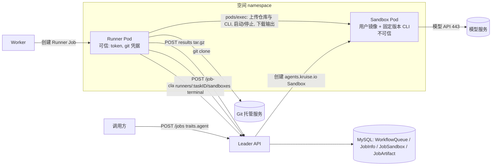
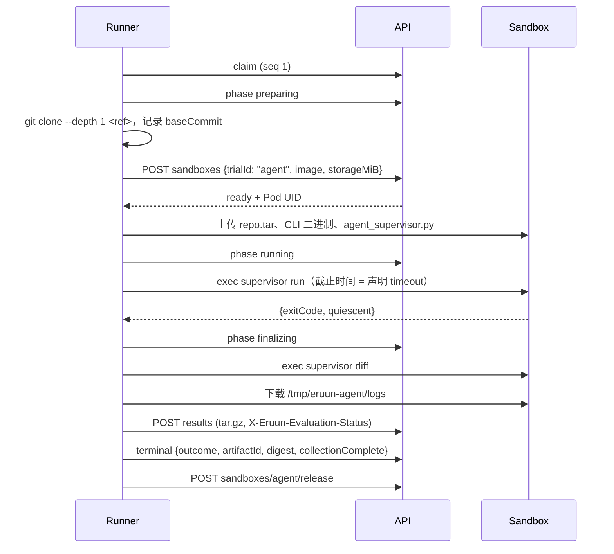

# 一次性 Agent 任务设计

> 状态：Draft / Proposal。本文是 [AI Runtime 愿景](ai-runtime-vision.md) Phase 1 的第一个场景设计：给定仓库和指令，在隔离环境里运行 Codex 或 Claude Code，产出 diff 和轨迹。第 1 节的决策已于 2026-10-27 按推荐全部确认；下一步是 §9.1 的 S0 实验。在实现合入前，文中的字段、路由、内部类型和默认值都不构成 API、数据库或部署承诺。

> 基线：`origin/main` `fff5258`（2026-10-26）。Eruun 尚未发布，本方案直接修改内部字段名，不保留兼容层或迁移窗口。

## 1. 决策记录

D1–D8 均按“推荐”一列确认（2026-10-27）。

| 编号 | 决策 | 确认的方案 | 备选与放弃理由 |
| --- | --- | --- | --- |
| D1 | 公共形状 | 独立 Job 的 `type: job` + `traits.agent`，与 `traits.eval` 并列 | 新增 `type: agent` step：评测已经确立 `type: job` + Trait 的形状，再开一种 step 类型会让两类 Runner 任务形状不一致。复用 `traits.eval` 并合成 Harbor 任务包：语义是评测（reward），而且会把 Agent 任务绑定到某个评测框架的版本和目录约定上 |
| D2 | 执行拓扑 | 可信 Runner Pod 加一个 Sandbox；Agent 只在 Sandbox 内运行 | 单 Pod（Agent 与 Runner 同容器）：Agent 以绕过审批的模式运行，能读取同一容器内的 Runner 能力 token 和 git 凭据，从而伪造事件和结果 |
| D3 | Agent CLI 来源 | 平台固定版本，二进制随 Runner 镜像发布，由 Runner 上传到 Sandbox | 要求用户镜像预装：版本不受平台控制，无法复用已验证的命令行参数。运行时在线安装：依赖 npm/网络，失败面大，安装耗时计入任务 |
| D4 | 仓库获取 | Runner 用 git 凭据克隆，深度 1，再以 tar 上传到 Sandbox | 在 Sandbox 内克隆：git 凭据会进入 Agent 可见的环境 |
| D5 | 第一版范围 | 只支持独立 Job；不支持 Application 组件、恢复、push 或创建 PR | 见 §3.3 |
| D6 | 内部字段 | 先用一个无行为变化的重构 PR 把 `EvaluationInfo` 改为 `RunnerInfo`，并引入 `config.IsRunnerJob` | 继续沿用 `EvaluationInfo` 保存 Agent 声明：两类 Runner 共用一个名为“evaluation”的列和结构，会误导后续维护 |
| D7 | 模型凭据 | 第一版把模型 key 通过 exec 环境变量注入 Sandbox；Agent 能读到自己的 key。[出站网关](egress-gateway-design.md)落地后改为注入 attempt 级出站 token，真实 key 只在网关侧使用（E3、E9） | 平台模型代理：可避免 key 暴露，由出站网关 Proposal 承接，不在本文范围 |
| D8 | harness 字段名 | `traits.agent.harness` | `traits.agent.agent` 读起来重复。`traits.eval.agent` 表示同一概念，是否统一改名另行决定，不在本文范围 |

## 2. 背景

### 2.1 现有可复用能力

Harbor 评测已经实现了一个 Agent Runtime 需要的大部分机制，但它们只对 `config.JobEval` 开放：

| 能力 | 当前实现 | 代码依据 |
| --- | --- | --- |
| 提交、空间授权、TaskID、调度准入 | 独立 Job 统一路径，评测额外校验 Secret 引用 | `jobs/service.go` `Submit`、`prepareTask`、`enqueue` |
| Runner Pod 渲染 | 固定镜像与命令、非 root、只读根文件系统、受限 SA、有上限的 `/work` emptyDir、`ActiveDeadlineSeconds` | `jobs/builder.go` `BuildEvaluationTask`、`infrastructure/workspace/evaluation.go` `PrepareEvaluationJob` |
| Runner 身份与单 owner | 能力 token + Pod 名称/UID + live Job UID + ExecutionKey/RunGeneration/Attempt；先 claim 后操作 | `jobs/service.go` `authorizeRunner`、`jobs/runner_events.go` |
| 阶段、心跳、终态证据 | `claim/phase/heartbeat/progress/terminal` v1 协议，ACK 下发 `stop` | `jobs/runner_events.go` |
| 按需 Sandbox | API 侧创建 `agents.kruise.io` Sandbox，带租约、UID 条件删除、未采集完整时保留 24 小时 | `jobs/sandbox.go`、`jobs/sandbox_runtime.go` |
| 结果归档与保存 | tar.gz 安全解包、根 `result.json` 摘要、数据库/MinIO 目标、保留期 | `jobs/artifacts` |
| 资源准入 | Runner 资源加 trial 资源乘以并发数计入空间与全局准入 | `domain/repository/job_scheduler_resources.go` |
| 原生 CLI 调用 | Codex `exec --json`、Claude Code `--print --output-format stream-json`，进程组终止与静止检查 | `jobs/runners/harbor/native_checkpoint.py` |
| 网络 | 空间基线允许本 namespace、DNS 和公网 80/443（排除私网与集群 CIDR）；Runner 另加 API 与 Kubernetes API 的 /32 规则 | `infrastructure/workspace/namespace.go` `networkPolicy`、`evaluation.go` |

### 2.2 缺口

- `command` Job 只有容器退出码。没有阶段与心跳，没有结果归档，也没有把不可信进程与平台凭据分开的机制。
- 评测路径要求先上传 Harbor 任务包。仓库、指令与 diff 不是它的输入输出模型。
- `JobEval` 在 23 个非测试文件中被直接判断。要接入第二类 Runner，必须先把“Runner 类 Job”抽成一个判断，否则每个分支都要重复修改。

## 3. 概念、目标与非目标

### 3.1 概念

- **Agent 任务**：一次 Job 执行内，一个 harness（Codex 或 Claude Code）在一个 Sandbox 中，针对一个仓库的一个提交执行一条指令。
- **Runner**：平台可信进程，持有能力 token 和 git 凭据，负责 claim、准备 Sandbox、启动和停止 Agent、采集和上传结果。
- **Sandbox**：运行用户声明镜像的不可信环境。Agent 拥有其中的完整 shell，但没有 Kubernetes token，也拿不到平台凭据。
- **diff**：任务结束时工作区相对基线提交的全部变更，包括 Agent 自己的提交和未提交的改动，按 `.gitignore` 排除。

### 3.2 目标

1. 用一次 `POST /api/v1/jobs` 提交 Agent 任务，复用 TaskID、空间授权、调度准入、取消、超时与结果保存。
2. Runner 协议从“评测专用”变成“Runner 类 Job 通用”，评测与 Agent 共用同一套 claim/阶段/终态/结果门禁。
3. 成功的含义可判定：harness 正常退出、diff 和轨迹采集完整、结果已持久化确认。

### 3.3 非目标

- Application 组件内的 Agent 任务。提交时明确拒绝 `traits.agent`；需要时再扩展，形状已经和 `traits.eval` 对齐。
- 故障恢复。Runner 或 Sandbox 丢失时任务失败，Sandbox 按现有规则保留 24 小时供排查。恢复可以复用 `traits.eval.recovery` 的原生会话机制，留到后续。
- 把结果推送回仓库或创建 PR。这是一个外部副作用，需要写权限凭据和审计，属于 R5。
- 判断改动是否正确。Agent 任务成功不代表改动正确，正如评测 reward 为 0 也不代表运行失败。
- 自定义模型端点（`baseURL`）与平台模型代理。空间网络策略本来就拒绝私网地址；私网与集群内上游改由[出站网关](egress-gateway-design.md)经平台注册后访问。
- 多轮交互、人工审批工具调用、MCP。

## 4. 架构



### 4.1 主流程



阶段沿用 v1 协议的 `preparing/running/finalizing`。Agent 任务不发送 `progress` 事件，API 对 `JobAgent` 的 progress 返回 400。

### 4.2 停止

ACK 返回 `action=stop`（取消或超过绝对截止时间）时，Runner 执行 `supervisor stop` 终止 CLI 进程组，然后照常进入 finalizing，采集到当时为止的 diff 和轨迹。terminal 的 outcome 使用 ACK 下发的 `stopOutcome`，`result.json` 记录 `interrupted: true`。部分结果不会被报告为成功。

## 5. 公共契约

### 5.1 类型

```go
// domain/spec/traits.go：Traits 与 JobTraits 各新增一个字段
Agent *AgentTraitSpec `json:"agent,omitempty"`

// domain/spec/agent.go
type AgentTraitSpec struct {
	Harness           string              `json:"harness"`
	Model             string              `json:"model"`
	Instruction       string              `json:"instruction"`
	Repo              AgentRepo           `json:"repo"`
	Image             string              `json:"image"`
	TimeoutSeconds    int64               `json:"timeoutSeconds,omitempty"`
	SandboxResources  *ResourceTraitsSpec `json:"sandboxResources,omitempty"`
	SandboxStorageMiB int64               `json:"sandboxStorageMiB,omitempty"`
	ResultPolicy      *JobResultPolicy    `json:"resultPolicy,omitempty"`
}

type AgentRepo struct {
	URL        string           `json:"url"`
	Ref        string           `json:"ref,omitempty"`
	Credential *SecretSelectorSpec `json:"credential,omitempty"`
}

func (a *AgentTraitSpec) Normalize() error
```

`SecretSelectorSpec` 是 env Trait 中 `valueFrom.secret` 已经使用的类型（`{"name", "key"}`），不新增第二种 Secret 引用写法。

### 5.2 字段规则与默认值

| 字段 | 规则 | 默认 |
| --- | --- | --- |
| `harness` | `codex` 或 `claude-code` | 必填 |
| `model` | harness 原生模型名，1–256 字节，不含换行；不加 provider 前缀 | 必填 |
| `instruction` | UTF-8，1–32768 字节 | 必填 |
| `repo.url` | `https`，主机名不是 IP 字面量，不含 userinfo、query、fragment。实际可达范围由 Runner 所在的空间 NetworkPolicy 决定（只允许公网 443/80），所以私网和集群内 git 服务第一版不可用。`urlSecurityPolicy` 约束的是 Eruun 服务端自己的出站请求，不用于这里 | 必填 |
| `repo.ref` | 分支、标签或 40 位提交 SHA；不以 `-` 开头，符合 `git check-ref-format` | 远端 HEAD |
| `repo.credential` | 本空间内存在的 Secret 与 key；提交时校验存在 | 无（公开仓库） |
| `image` | 显式 tag 或 digest（`ExplicitJobImage`）；镜像必须提供 `/bin/sh`、`git`、`tar`、`python3` 和 Linux `/proc`；以 UID 1000 运行时 `/workspace` 与 `/tmp` 可写 | 必填 |
| `timeoutSeconds` | 60–86400，只计 Agent 运行段；准备与收尾另有固定预算 | 3600 |
| `sandboxResources` | 同 `traits.eval.sandboxResources`；不支持 GPU | 请求 1 CPU / 2Gi，限制 2 CPU / 4Gi |
| `sandboxStorageMiB` | 1024–1048576 | 10240 |
| `resultPolicy` | 同 `traits.eval.resultPolicy`；省略时快照空间默认策略 | 空间默认 |

step 上的其他 Trait 只接受 `resources`（控制 Runner）和 `envs`。`envs` 沿用评测的封闭集合和“只能来自一个 Secret 引用”的规则，并要求包含所选 harness 需要的 key：`codex` 需要 `OPENAI_API_KEY`，`claude-code` 需要 `ANTHROPIC_API_KEY`。

### 5.3 校验与错误

`JobSpec.Normalize` 对 `type: job` 的 step 要求 `traits.eval` 与 `traits.agent` 恰好提供一个，并拒绝 `spec` 与 `retry`。错误都通过 `bcode.ErrJobInput`（HTTP 400）返回：

| 条件 | 消息 |
| --- | --- |
| 同时或都未声明 `traits.eval` / `traits.agent` | `type job requires exactly one of traits.eval or traits.agent` |
| harness 不支持 | `unsupported agent harness` |
| 缺少 harness 对应的模型 key | `agent harness codex requires OPENAI_API_KEY from a Secret` |
| `repo.url` 非 https 或带凭据 | `repo.url must be an https URL without credentials, query or fragment` |
| Secret 或 key 不存在 | `credential Secret key is missing`（复用现有消息） |
| Application 组件声明 `traits.agent` | `traits.agent is only supported by standalone Jobs` |
| 管理员未配置 Runner | HTTP 503 `Job Runner is not configured` |

### 5.4 示例

请求：

```json
{
  "name": "fix-flaky-test",
  "stages": [{
    "name": "agent",
    "steps": [{
      "name": "fix",
      "type": "job",
      "traits": {
        "agent": {
          "harness": "codex",
          "model": "<model>",
          "instruction": "Fix the flaky TestLeaseRenewal in pkg/lease and explain the root cause in NOTES.md.",
          "repo": {
            "url": "https://github.com/<org>/<repo>.git",
            "ref": "main",
            "credential": {"name": "git-readonly", "key": "token"}
          },
          "image": "ghcr.io/<org>/go-devenv:1.27.3",
          "timeoutSeconds": 3600
        },
        "envs": [{"name": "OPENAI_API_KEY", "valueFrom": {"secret": {"name": "model-keys", "key": "openai"}}}]
      }
    }]
  }]
}
```

`POST /api/v1/jobs` 照常返回 202 和 `taskId`。`GET /api/v1/jobs/:taskID` 复用现有 `runnerStatus`、`sandboxes`、`collectionState`、`results` 字段；`results[].summary` 带有 §7.2 的 diff 统计，调用方不下载归档也能判断有没有改动。diff 本身需要下载完整归档后取 `outputs/diff.patch`，第一版不增加单文件下载接口。

## 6. 执行

### 6.1 Runner Pod

`BuildAgentTask` 与 `BuildEvaluationTask` 共用一个提取出来的 `buildRunnerJob`：镜像（同一个 `jobs.runnerImage`）、`runner` 容器名、UID 1000、只读根文件系统、`/work` emptyDir 上限、SA `eruun-evaluation-runner`、`ERUUN_JOB_CONFIG` 与 `POD_*` 下行字段、标签和截止时间都相同。差异只有：

- 命令为 `python /opt/eruun/agent_runner.py`；`PrepareEvaluationJob` 按 JobType 接受两条固定命令之一。
- git 凭据以 `secretKeyRef` 注入 Runner 环境变量 `ERUUN_GIT_TOKEN`。它不写入 `ERUUN_JOB_CONFIG`，也不传入 Sandbox。
- `job.Timeout = timeoutSeconds + EvaluationCollectionGraceSeconds + 准备预算`。准备预算固定 900 秒，覆盖克隆、Sandbox 分配、上传。收尾沿用 960 秒窗口，因此可以直接复用 Runner 的事件重试与收尾逻辑。

Runner 配置（内部协议，不是用户接口）：

```json
{
  "kind": "agent",
  "taskId": "<taskID>",
  "executionKey": "<executionKey>",
  "namespace": "<namespace>",
  "resultURL": "<apiURL>/api/v1/job-runners/<taskID>/results",
  "eventURL": "<apiURL>/api/v1/job-runners/<taskID>/events",
  "sandboxURL": "<apiURL>/api/v1/job-runners/<taskID>/sandboxes",
  "token": "<64 hex>",
  "agent": {"harness": "codex", "version": "codex-cli 0.154.0", "model": "<model>"},
  "instruction": "<instruction>",
  "repo": {"url": "https://github.com/<org>/<repo>.git", "ref": "main", "credential": true},
  "image": "<image>",
  "sandboxStorageMiB": 10240,
  "timeoutSeconds": 3600,
  "preparationTimeoutSeconds": 900,
  "finalizationTimeoutSeconds": 960
}
```

### 6.2 仓库与 Sandbox 准备

1. Runner 通过 `GIT_ASKPASS` 读取 `ERUUN_GIT_TOKEN`，执行 `git clone --depth 1 --branch <ref>`；ref 为 SHA 时用 `git init` 加 `git fetch --depth 1 origin <sha>`。凭据不出现在 URL、`.git/config` 或日志中。记录 `baseCommit = git rev-parse HEAD`。
2. 上传前检查 `.git/config` 中没有 `extraheader` 或 credential 段，然后打包为 tar。
3. `POST sandboxes {"trialId": "agent", "image": <声明镜像>, "storageMiB": <声明值>}`。API 对 `JobAgent` 额外校验：`trialId` 必须是 `agent`，`image` 与 `storageMiB` 必须等于持久化声明，同一执行最多一个槽位。Sandbox 资源来自 `RunnerInfo` 中的 `sandboxResources`。
4. 通过现有 pods/exec 通道上传：仓库到 `/workspace/repo`，固定版本 CLI 到 `/tmp/eruun-agent/bin`，supervisor 到 `/tmp/eruun-agent/supervisor.py`。平台文件都放在 `/tmp/eruun-agent` 下，不要求镜像预留其他可写目录。

`agents.kruise.io` Sandbox CRD 与评测一样是前提条件；集群中缺失时，Sandbox 分配失败，任务明确失败。

### 6.3 Sandbox 内 supervisor

`agent_supervisor.py` 是 `native_checkpoint.py` 的单次运行版本，复用它的命令构造、进程组终止、`/proc` 静止检查和凭据落盘检查。它不做分段和会话恢复。

| 子命令 | 行为 | 标准输出 |
| --- | --- | --- |
| `run` | 校验 CLI 版本；以新 session 启动 CLI，参数沿用 `native_checkpoint.py` 的 `command()`（不带 resume），工作目录 `/workspace/repo`；stdout 写入 `/tmp/eruun-agent/logs/trajectory.jsonl`，stderr 写入 `/tmp/eruun-agent/logs/stderr.log`；超时或收到 stop 时终止进程组；确认静止 | `{"exitCode": 0, "timedOut": false, "quiescent": true, "sessionId": "<uuid>"}` |
| `stop` | 按 `run` 记录的进程组发送 SIGINT，5 秒后 SIGKILL，再检查静止 | `{"stopped": true, "quiescent": true}` |
| `diff` | `git add -A`；`git diff --cached --binary <baseCommit>` 写入 `/tmp/eruun-agent/logs/diff.patch`；`git diff --cached --numstat` 统计；`git log --format=%H <baseCommit>..HEAD` 列出 Agent 的提交 | `{"files": 3, "insertions": 40, "deletions": 12, "bytes": 5120, "commits": []}` |

模型 key 以 Secret 引用注入 Runner 容器环境，Runner 只在 `run` 这次 exec 的环境变量里传给 supervisor，不写入 Sandbox 的 Pod spec 或文件（D7）。Codex 沿用 `native_checkpoint.py` 的 `env_key` 配置方式，不生成 `auth.json`。

CLI 配置目录（`CODEX_HOME`、`CLAUDE_CONFIG_DIR`）设在 `/tmp/eruun-agent/logs/native`，原生会话随结果一起采集。`HOME` 设为 `/tmp/eruun-agent/home`，不依赖镜像中 UID 1000 是否有可写的家目录。启动前沿用 `native_checkpoint.py` 的环境变量，关闭自动更新、遥测和错误上报。运行结束后如果配置目录出现 `auth.json` 或 `.credentials.json`，采集标记为不完整。

静止检查不通过时，supervisor 终止所有非基线进程并再检查一次；仍不通过就不生成 diff，`collectionComplete=false`。这保证 diff 不是在后台进程仍在写入时截取的。

## 7. 结果

### 7.1 归档布局

```text
result.json                    平台采集摘要（下表）
outputs/
  diff.patch                   相对 baseCommit 的二进制安全 diff
  trajectory.jsonl             CLI 结构化事件流
  stderr.log
  native/...                   原生会话文件
  runner.log                   Runner 自身的有界日志
```

### 7.2 `result.json`

```json
{
  "taskId": "<taskID>",
  "kind": "agent",
  "harness": {"name": "codex", "version": "codex-cli 0.154.0"},
  "model": "<model>",
  "repo": {"url": "https://github.com/<org>/<repo>.git", "ref": "main", "baseCommit": "<40 hex>"},
  "executionStatus": "succeeded",
  "agentExitCode": 0,
  "interrupted": false,
  "durationSeconds": 812,
  "diff": {"files": 3, "insertions": 40, "deletions": 12, "bytes": 5120, "commits": []},
  "redactions": 0,
  "collectionComplete": true,
  "collectionErrors": []
}
```

- `executionStatus` 与 `collectionComplete` 沿用现有摘要字段，`applyRunnerEvent` 的 terminal 校验不需要修改。
- diff 超过 64 MiB 时不截断，记 `collectionErrors: [{"path": "outputs/diff.patch", "reason": "diff_too_large"}]`，`collectionComplete=false`。
- 上传前，Runner 在所有输出文件中查找能力 token、git 凭据和模型 key 的原值，替换为 `[REDACTED]`，次数记入 `redactions`。这是对原样保留原则的唯一例外，理由是凭据不能进入结果制品。

### 7.3 成功判定

终态 `succeeded` 要求以下条件同时成立：

1. CLI 退出码为 0，且未超时、未被停止。
2. supervisor 确认静止，diff 已生成。
3. `collectionComplete=true`，结果归档已持久化，terminal ACK 成功。
4. Runner 进程退出码为 0，Kubernetes Job 成功（现有门禁）。

diff 为空也算成功，`diff.files=0`，由调用方判断。

## 8. 服务端改动

### 8.1 Runner 类 Job 通用化（D6，无行为变化）

| 改动 | 位置 |
| --- | --- |
| `model.JobInfo` / `model.JobTask` 的 `EvaluationInfo` 改名 `RunnerInfo`，列 `evaluation_info` 改为 `runner_info` | `domain/model/job.go`；`infrastructure/datastore/mysql/migrations.go` 增加一次列改名迁移（已有部署的数据要保留） |
| `evaluationInfo` 改名 `runnerInfo`；`decodeRunnerInfo` 按 `JobType` 校验对应 Trait 和 `FrameworkVersion` | `jobs/builder.go` |
| 新增 `config.IsRunnerJob(t JobType) bool`，替换 Runner 鉴权、事件、结果、Sandbox、准入、取消清理和授权中的 `== JobEval` 判断；评测专用分支（恢复、checkpoint、trial progress）保持 `JobEval` | `config/consts.go` 及 §2.2 所列文件 |
| `evaluationRunnerState` 改名 `runnerState`；`jobinfo.EvaluationRunnerCheckpoint` 改名 `RunnerCheckpoint` | `jobs/runner_events.go`、`jobinfo` |
| 从 `BuildEvaluationTask` 提取 `buildRunnerJob` | `jobs/builder.go` |

SA、标签和 NetworkPolicy 名称（`eruun-evaluation-runner`）这次不改，避免同时改动集群对象。

### 8.2 Agent 任务（新增行为）

| 改动 | 位置 |
| --- | --- |
| `AgentTraitSpec` 与校验；`type: job` 恰好一个 Runner Trait；Application 组件拒绝 `traits.agent` | `domain/spec/agent.go`、`job.go`、`evaluation_component.go` |
| `config.JobAgent JobType = "agent"`；`IsRunnerJob` 包含它 | `config/consts.go` |
| `BuildTask` 识别 `traits.agent`；`BuildAgentTask`；`prepareTask` 校验模型 key 与 git Secret | `jobs/builder.go`、`jobs/service.go` |
| `PrepareEvaluationJob` 按 JobType 接受固定命令 | `infrastructure/workspace/evaluation.go` |
| Sandbox 分配：Agent 的 trialId、镜像、存储与槽位校验；资源来自 `RunnerInfo` | `jobs/sandbox.go`、`jobs/sandbox_runtime.go` |
| 准入资源：Agent 计 Runner 加一个 Sandbox | `domain/repository/job_scheduler_resources.go` |
| 授权：`step.Type == "job"` 时 `JobEval` 或 `JobAgent` 都匹配 | `domain/service/account/access_store.go` |
| `Get` 详情：`hasEvaluation` 改为“有 Runner 类执行” | `jobs/service.go` |
| progress 事件对 `JobAgent` 返回 400 | `jobs/runner_events.go` |
| Runner：`agent_runner.py`、`agent_supervisor.py`；复用 `StatusReporter`、`upload_with_retry`、Sandbox 分配/exec/安全下载 | `jobs/runners/harbor/`（目录改名见 §9） |
| Runner 镜像：固定版本 Codex 与 Claude Code 的 Linux 二进制，校验 SHA-256 | Runner `Dockerfile` |

`StatusReporter` 与 Sandbox 客户端目前写在 `runner.py` 和 `eruun_environment.py` 中，后者继承 Harbor 的 `ACKEnvironment`。如果 Agent Runner 无法在不构造 Harbor 环境配置的情况下复用分配、exec 和下载，就把这三项提取到 `sandbox_client.py`，两个 Runner 共用；不复制第二份实现。

## 9. 交付拆分

| 步骤 | 内容 | 退出条件 |
| --- | --- | --- |
| S0 实验 | 在受限 Sandbox（非 root、无 capability、RuntimeDefault seccomp）中运行固定版本的 Codex 与 Claude Code 静态二进制；确认 glibc/musl 兼容、无需写 `/usr`、`--json` / `stream-json` 输出可解析、进程组终止后静止 | 按 §9.1 判定通过；若二进制不能用，回到 D3 选择备选方案 |
| PR 1 | §8.1 重构 | 现有测试全部通过；评测行为与 API 不变 |
| PR 2 | §8.2 全部；Runner 目录改为 `jobs/runners/python/`，包含 `harbor` 与 `agent` 两个入口 | 单元测试与 kind 冒烟（§10）通过；`workspace-jobs-api.md` 增加 Agent 任务章节，本文更新实现记录 |

### 9.1 S0 实验清单

S0 由维护者在目标集群手动执行。文件在 [`examples/agent-task-s0/`](../examples/agent-task-s0/)：

| 文件 | 用途 |
| --- | --- |
| `Dockerfile` | 最小 Sandbox 镜像：`/bin/sh`、`git`、`tar`、`python3`、GNU `sleep`、UID 1000、可写 `/workspace` |
| `pod.yaml` | 第 1 级：与 `buildSandbox` 安全设置相同的普通 Pod，可选放到 ACS 算力 |
| `sandbox.yaml` | 第 2 级：与 `buildSandbox` 同形的 `agents.kruise.io` Sandbox，放在 ACS Agent Sandbox 算力 |
| `probe.py` | 在容器内以 UID 1000 运行，按 §6.3 的参数调用 CLI，输出 JSON 报告；报告只含布尔值、计数和路径，不含凭据或模型输出 |

`probe.py` 已在本地 arm64 Docker（Debian bookworm，PID 1 为 `sleep`）中用假 CLI 验证过：正常路径通过；凭据写入文件、`setsid` 逃逸的后台进程、写到允许目录之外，这三种情况都能被检出。真实 CLI 和集群均未运行过。

**测试矩阵。** 两个 harness 各跑：第 1 级加最小镜像；第 2 级加最小镜像；第 1 级加你实际使用的开发镜像。

**0. 前提核对（只读）**

```bash
NS=<eruun-workspace-namespace>
kubectl get ns "$NS" -o jsonpath='{.metadata.labels}'   # 应含 pod-security.kubernetes.io/enforce=restricted
kubectl get crd sandboxes.agents.kruise.io
kubectl get nodes -L kubernetes.io/arch
kubectl version
```

**1. 在工作站准备二进制。** 下面的地址是按 Codex GitHub Releases 和 Claude Code 官方 `install.sh` 的发布方式写的，执行前请对照 [Codex Releases](https://github.com/openai/codex/releases) 和 `https://claude.ai/install.sh` 核对；资产名不同时以官方为准，并记录实际 URL。节点是 arm64 时，Codex 换成 `aarch64-unknown-linux-musl`，Claude Code 换成 `linux-arm64`。镜像基于 musl（Alpine）时，Claude Code 换成 `linux-x64-musl`。

```bash
mkdir -p s0-bin && cd s0-bin
curl -fL -o codex.tar.gz https://github.com/openai/codex/releases/download/rust-v0.154.0/codex-x86_64-unknown-linux-musl.tar.gz
tar -xzf codex.tar.gz && mv codex-x86_64-unknown-linux-musl codex
GCS=https://storage.googleapis.com/claude-code-dist-86c565f3-f756-42ad-8dfa-d59b1c096819/claude-code-releases
curl -fsSL -o claude-manifest.json "$GCS/2.1.281/manifest.json"
curl -fL -o claude "$GCS/2.1.281/linux-x64/claude"
python3 -c 'import json; print(json.load(open("claude-manifest.json"))["platforms"]["linux-x64"]["checksum"])'
shasum -a 256 codex.tar.gz codex claude   # claude 的值须与上一行一致
chmod 755 codex claude && cd ..
```

**2. 构建并推送最小镜像**

```bash
IMG=<registry>/eruun-s0-sandbox:1
docker build --platform linux/amd64 -t "$IMG" examples/agent-task-s0 && docker push "$IMG"
```

在 Apple Silicon 上构建时必须带 `--platform`，否则会得到 arm64 镜像；节点是 arm64 时改为 `linux/arm64`。

**3. 创建模型 key Secret。** 从文件读取，避免 key 进入 shell 历史；只测一个 harness 时只给对应的 key。

```bash
kubectl -n "$NS" create secret generic s0-model-keys --from-file=openai=./openai.key --from-file=anthropic=./anthropic.key
```

**4. 第 1 级：普通 Pod**

```bash
POD=s0-agent-probe
sed -e "s#<namespace>#$NS#" -e "s#<image>#$IMG#" examples/agent-task-s0/pod.yaml | kubectl apply -f -
kubectl -n "$NS" wait --for=condition=Ready "pod/$POD" --timeout=300s
kubectl -n "$NS" exec "$POD" -- mkdir -p /tmp/eruun-agent/bin
kubectl cp s0-bin/codex "$NS/$POD:/tmp/eruun-agent/bin/codex"
kubectl cp s0-bin/claude "$NS/$POD:/tmp/eruun-agent/bin/claude"
kubectl cp examples/agent-task-s0/probe.py "$NS/$POD:/tmp/eruun-agent/probe.py"
kubectl -n "$NS" exec "$POD" -- chmod 755 /tmp/eruun-agent/bin/codex /tmp/eruun-agent/bin/claude
kubectl -n "$NS" exec "$POD" -- python3 /tmp/eruun-agent/probe.py codex <codex-model>
kubectl -n "$NS" exec "$POD" -- python3 /tmp/eruun-agent/probe.py claude-code <claude-model>
```

每个 harness 约需 1–15 分钟。使用自定义模型端点时，Codex 在 `python3` 前加 `env S0_OPENAI_BASE_URL=<url>`，Claude Code 加 `env ANTHROPIC_BASE_URL=<url>`。空间 NetworkPolicy 只放行公网 80/443，私网端点会连不上，这本身也是一个需要记录的结果。

**5. 第 2 级：Sandbox CR**

```bash
SHUTDOWN=$(date -u -v+4H +%Y-%m-%dT%H:%M:%SZ)   # Linux 用 date -u -d '+4 hours' +%Y-%m-%dT%H:%M:%SZ
sed -e "s#<namespace>#$NS#" -e "s#<image>#$IMG#" -e "s#<shutdown-time>#$SHUTDOWN#" examples/agent-task-s0/sandbox.yaml | kubectl apply -f -
kubectl -n "$NS" get sandbox s0-agent-probe-sbx -o yaml
kubectl -n "$NS" get pods -l app.kubernetes.io/name=s0-agent-probe-sbx -o name
```

取得 Pod 名后赋给 `POD`，重复第 4 步中 `wait` 之后的命令。如果标签没有传到 Pod，从 Sandbox 的 `status` 读取 Pod 名，并记下这一点。

**6. 收集报告并清理**

```bash
kubectl cp "$NS/$POD:/tmp/eruun-agent/s0-report-codex.json" ./s0-report-codex-<level>.json
kubectl cp "$NS/$POD:/tmp/eruun-agent/s0-report-claude-code.json" ./s0-report-claude-code-<level>.json
kubectl -n "$NS" delete pod s0-agent-probe --ignore-not-found
kubectl -n "$NS" delete sandbox s0-agent-probe-sbx --ignore-not-found
kubectl -n "$NS" delete secret s0-model-keys
```

**判定**

| 检查 | 报告字段 | 通过条件 | 不通过意味着 |
| --- | --- | --- | --- |
| 镜像前提 | `environment.ok` | 工具齐全、UID 1000、`/workspace` 与 `/tmp` 可写、PID 1 是 `sleep` | 镜像不满足 §5.2。若第 2 级的 PID 1 不是 `sleep`（Sandbox 运行时注入了 init），§6.3 静止检查的前提不成立，需要改设计 |
| 二进制兼容 | `version.ok` | `--version` 输出与固定字符串完全一致 | 架构、libc 或 seccomp 不兼容；查看 `version.output`，D3 可能要换备选方案 |
| 真实任务 | `write.ok` | 退出码 0、未超时、恰好一个会话 ID 和一个会话文件、`hello.txt` 出现在 diff 中 | 模型连通（key、NetworkPolicy）、CLI 参数或输出格式与 `native_checkpoint.py` 的假设不符 |
| 写入范围 | `write.writesOutsideAllowed` | 为空 | 列出的路径就是 CLI 在 `/tmp`、`/workspace` 之外的写入位置，需要在 §6.3 用环境变量重定向，或写进镜像要求 |
| 停止与静止 | `stop.ok` | 观察到工具子进程；终止进程组后没有残留 | CLI 把工具命令放进了独立 session。supervisor 必须改为终止全部非基线进程，§4.2 和 §6.3 要更新 |
| 凭据不落盘 | `credentials.ok` | 没有文件包含 key；没有 `auth.json` 或 `.credentials.json` | CLI 的配置方式要调整，否则 §7.2 的结果制品可能带出凭据 |

**S0 通过**：两个 harness 在第 2 级加最小镜像上全部通过；你的开发镜像在第 1 级至少通过镜像前提、二进制兼容和真实任务三项。只有停止与静止不通过时，不推翻 D3，但必须先改 §6.3 再进入 PR 2。

**需要回传的材料**：各级别、各 harness 的报告 JSON；两个二进制的实际下载 URL 和 SHA-256（会写进 PR 2 的 Runner `Dockerfile`）；`kubectl version` 输出和 Sandbox CRD 版本；第 2 级 Sandbox 的 `status` 片段。报告不含 key 和模型输出；`/tmp/eruun-agent/logs/` 下的轨迹含模型输出，需要排查时再取。

PR 2 之后，下一个 Phase 1 增量是让 Agent 任务支持现有的原生会话恢复，以及 R3（独立 Job 日志与事件流）。

## 10. 测试与验证边界

- **Go 单元测试**：`AgentTraitSpec` 的每条校验规则；`type: job` 双 Trait 互斥；Application 组件拒绝；`BuildAgentTask` 渲染（命令、SA、git Secret 只在 Runner、截止时间）；`authorizeRunner` 与事件、结果对 `JobAgent` 的接受，以及 progress 拒绝；Sandbox 镜像、存储或 trialId 不匹配时拒绝；准入资源计算。
- **Python 单元测试**：supervisor 的命令构造、超时与 stop、静止检查失败、凭据落盘检测、diff 统计与超限；Runner 的阶段顺序、stop 后的部分采集、凭据替换、终态映射。
- **kind 冒烟**：沿用 `smoke_kind.py` 的方式，用测试夹具中的假 CLI（按固定脚本修改文件并输出 JSONL）走完 claim → Sandbox → run → diff → 上传 → terminal，并覆盖取消。假 CLI 只存在于测试目录。
- **不覆盖**：真实模型调用、真实 ACS Agent Sandbox、私有仓库凭据流程和长时间运行。这些需要维护者在目标集群手动验收，验收前文档保持 Draft。

## 11. 后续方向

- **恢复**：复用 `traits.eval.recovery` 的分段运行、原生会话 ID 与 checkpoint 材料，Agent 任务只有一个 trial，比评测更简单。
- **Application 组件**：共用 `NormalizeComponentEvaluation` 的位置与限制，开放 `traits.agent`。
- **写回仓库**：推送分支或创建 PR，需要写权限凭据、平台审计与人工审批（R5）。
- **模型代理**：Sandbox 只拿到短期、限定用途的凭据或代理地址，不再接触长期 key。设计见[出站网关](egress-gateway-design.md)，网关落地后 `envs` 中模型 key 的规则改为上游绑定。
