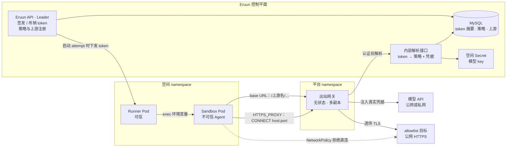
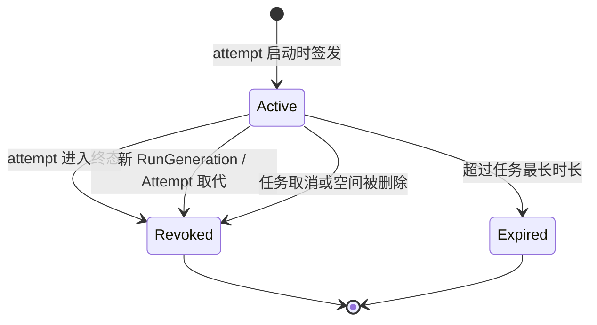

# Agent 出站网关设计

> 状态：Draft / Proposal。第 1 节的决策已于 2026-11-05 确认，尚未实现。本文中的字段、路由、标签和配置名都是概念示例，不能直接执行，也不构成 API、数据库或部署承诺；实现 PR 冻结后以 Current 文档为准。
>
> 基线：`origin/main` `0d85462`（2026-11-05）。本文替代 [Gateway Trait 设计](gateway-trait-design.md) §11.1 的出站方向：出站不再是组件 DSL 中的声明，而是由 Eruun 控制平面统一管理、经出站网关执行的平台能力；`traits.gateway` 只负责入站（G9 已同步修订）。

## 1. 决策记录

| 编号 | 决策 | 状态 |
| --- | --- | --- |
| E1 | 出站网关是 Sandbox 的唯一出口：Sandbox Pod 的 NetworkPolicy 只放行 DNS 与网关。可信 Runner 保留现有基线与 /32 放行；Application 组件（webservice 等）不受影响 | 已确认（2026-11-05） |
| E2 | 两种转发模式：带凭据的上游走反向代理，Sandbox 以 base URL 指向 `http://<网关>/<上游名>`，网关替换认证头；其他目标走 `HTTPS_PROXY` 的 CONNECT allowlist，只匹配 `host:port`，不解密 TLS | 已确认（2026-11-05） |
| E3 | 每个 attempt 一个出站 token：控制平面签发，绑定 TaskID、RunGeneration、Attempt；attempt 进入终态或被新 generation 取代即失效。Sandbox 中的模型 API key 环境变量填入这个 token，CLI 不改，也拿不到真实 key | 已确认（2026-11-05） |
| E4 | 策略两层：平台默认 allowlist，空间追加；带凭据的上游由平台注册（名称、base URL、认证方式）；任务以 `SecretSelectorSpec` 引用本空间 Secret，不新增第二种 Secret 引用写法 | 已确认（2026-11-05） |
| E5 | 网关不读 Kubernetes Secret：凭 token 调 Eruun 内部接口换取策略与凭据，按 attempt 短期缓存；Secret 读取权限只留在 Eruun server。内部接口必须认证调用方，因为它返回凭据明文 | 已确认（2026-11-05） |
| E6 | 网关为 Eruun 仓库中的独立 Go 程序（概念名 `cmd/egress-gateway`），无状态、多副本、Helm 部署；它是新的部署组件，不是新的运行时角色，不参与 Leader 选举 | 已确认（2026-11-05） |
| E7 | 首期审计记录每次请求的空间、任务、上游或 host、状态码、字节数和时长；token 用量解析留待后续 | 已确认（2026-11-05） |
| E8 | 首期上游只有 OpenAI 兼容 API 与 Anthropic 两类模型 API；git 写回仍属 R5，不在首期。集群内 Sandbox 到网关一段先用 HTTP，不向 Sandbox 注入 CA | 已确认（2026-11-05） |
| E9 | 一次性 Agent 任务（Draft PR [#222](https://github.com/PixelCores/Eruun/pull/222) 的 `agent-task-design.md`）第一版仍按其 D7 推进，不等网关；网关落地后 D7 改为注入出站 token，`envs` 规则相应调整。G9 改为 `traits.gateway` 只管入站 | 已确认（2026-11-05） |

## 2. 背景

### 2.1 现状

Eruun 的空间网络隔离由两条 NetworkPolicy 组成：

| 策略 | 位置 | 覆盖对象 | 出站 |
| --- | --- | --- | --- |
| 空间基线 | `infrastructure/workspace/namespace.go` `networkPolicy` | namespace 内全部 Pod | 同 namespace、DNS（53），以及公网 TCP 80/443（排除私网、保留网段与 `ClusterCIDRs`） |
| 评测 Runner | `infrastructure/workspace/evaluation.go` | 带 `eruun.io/evaluation-runner=true` 的 Runner Pod | 管理员配置的单地址加端口（Eruun API、Kubernetes API 的 /32） |

Sandbox（`agents.kruise.io` Sandbox，Pod 带 `eruun.io/task-id` 与 `eruun.io/sandbox-id` 标签，见 `jobs/sandbox_runtime.go`）只受空间基线约束。结果是：

- Sandbox 中由模型驱动的不可信代码可以访问任意公网 HTTPS 目标，数据外泄没有边界。
- 私网或集群内的模型端点、私有 git 不可达，因为基线屏蔽私网；要放行就得给整个空间开私网。
- 模型 key 必须进入 Sandbox（Agent 任务设计 D7），Agent 能读到并带出长期凭据。
- 平台看不到某个任务访问了哪些外部目标。

### 2.2 定位

传统编排默认工作负载可信，网络关心“别人怎样访问我”。Agent 的代码不可信、短生命周期、以出站为主，且需要使用不应交给它的凭据。对 Agent Runtime 而言，出站网关相当于 Agent 的网络系统调用边界：Agent 只能经它访问外部，凭据由它代为使用，访问记录由它产出。这与 [AI Runtime 愿景](ai-runtime-vision.md) §3.3 中“网络访问”“凭据委派”的边界一致。

实现原则沿用入站：Eruun 定义面向 Agent 的能力，底层用云原生组件强制（原生 NetworkPolicy），只在生态缺少 Agent 语义的地方自建（按任务身份的凭据注入与审计）。

### 2.3 目标与非目标

目标：

- Sandbox 的全部出站经过网关，绕过网关的连接在网络层被拒绝。
- 模型 API 的长期凭据不进入 Sandbox；Sandbox 只持有绑定当前 attempt 的短期 token。
- 访问策略集中在 Eruun 控制平面，MySQL 是唯一来源；网关只持有派生缓存。
- 私网或集群内上游只能由平台注册，经网关访问；Sandbox 自身仍不可达私网。
- 每次出站请求可按空间与任务审计。

非目标（首期）：

- TLS 解密与内容审查；CONNECT 通道内的数据网关看不到。
- 非 HTTP 协议（SSH git、数据库 TCP 等）。
- Application 组件的出站管控；webservice 等保持空间基线。
- git 写回、PR 创建等外部副作用（R5）。
- token 用量计费与限流。
- 服务网格或透明代理。

## 3. 架构



| 组件 | 职责 | 不做什么 |
| --- | --- | --- |
| Eruun API（Leader） | 签发与吊销 token；保存平台上游、平台默认 allowlist、空间追加 allowlist；校验任务对上游与 Secret 的引用 | 不在请求路径上 |
| 内部解析接口 | 认证网关后，按 token 返回空间、任务、生效的 allowlist 和该任务绑定的上游凭据 | 不对 Sandbox 或用户开放 |
| 出站网关 | 认证 Sandbox 请求、匹配策略、注入凭据、转发、审计 | 不读 Kubernetes 资源，不持久化状态 |
| Runner | 把 token、base URL、`HTTPS_PROXY` 放进 Agent 进程的 exec 环境 | 不把 token 写入 Sandbox 的 Pod spec 或文件 |
| NetworkPolicy | 让 Sandbox 只能连 DNS 与网关；限制网关自身的出站范围 | — |

网关的多副本之间不共享状态；任一副本都能凭 token 独立完成解析，所以副本可以随意扩缩和重启。

## 4. 出站 token

### 4.1 签发与传递

Runner 启动一个 attempt 时，控制平面为它生成一个随机 token（32 字节），MySQL 只保存摘要以及绑定字段：空间、TaskID、RunGeneration、Attempt、签发与失效时间。原值只返回给当前合法的 Runner，由 Runner 在启动 Agent 的那次 exec 中注入：

- 模型 key 环境变量（如 `ANTHROPIC_API_KEY`、`OPENAI_API_KEY`）的值为 token；
- base URL 环境变量指向网关上对应的上游路径；
- `HTTPS_PROXY` 为带 token 的网关代理地址，`NO_PROXY` 不包含任何公网目标。

这条路径与 D7 现在传递模型 key 的路径相同，只是传递的值从长期 key 换成了 attempt 级 token。Runner 采集结果时对 token 原值做脱敏，与 Agent 任务设计中对能力 token、git 凭据的处理一致。

### 4.2 生命周期



有效性的判断与 Runner 授权使用同一组事实：token 绑定的 RunGeneration 与 Attempt 必须仍是任务当前的执行身份。被 fencing 取代的旧 Sandbox 即使还在运行，其出站请求也会在缓存过期后被拒绝。吊销写入 MySQL；网关侧的生效延迟等于缓存 TTL（见 §6.2）。

## 5. 转发模式与策略

### 5.1 带凭据的上游（反向代理）

平台注册的每个上游有名称、base URL 和认证方式。Sandbox 请求 `http://<网关>/<上游名>/<路径>` 时，网关：

1. 从请求的认证头（`x-api-key` 或 `Authorization: Bearer`）中取出 token 并解析；
2. 确认该任务绑定了这个上游；
3. 删除请求中所有认证相关的头，按上游认证方式写入真实凭据（Anthropic 为 `x-api-key`，OpenAI 兼容为 `Authorization: Bearer`）；
4. 以 TLS 连接上游 base URL，流式转发请求与响应，不缓冲 SSE。

上游可以是私网或集群内地址（自建模型代理、vLLM 服务等），这是 Sandbox 访问私网目标的唯一途径，并且只能由平台注册。

### 5.2 allowlist 目标（CONNECT）

其余 HTTPS 访问（包仓库、公开 git、文档站点等）通过 `HTTPS_PROXY` 的 CONNECT 进入网关。网关从 `Proxy-Authorization` 中取出 token 并解析，然后按 `host:port` 匹配平台默认 allowlist 与空间追加 allowlist：

- 拒绝 IP 字面量目标；
- 解析域名后，若结果落在私网、保留网段或集群网段内则拒绝，防止 DNS rebinding 借 allowlist 访问内网；
- 建立 TCP 隧道后只透传字节，不终止 TLS。

首期只支持 CONNECT；明文 HTTP 的转发代理请求直接拒绝。

### 5.3 策略来源

| 层 | 由谁维护 | 内容 | 约束 |
| --- | --- | --- | --- |
| 平台上游 | 系统管理员（`systemAdmin`） | 名称、base URL、认证方式 | 允许私网地址；首期两类认证方式 |
| 平台默认 allowlist | 系统管理员 | `host:port` 列表（可含通配子域） | 只能是公网目标 |
| 空间追加 allowlist | 空间 owner 或 admin | `host:port` 列表 | 只能是公网目标；不能放宽平台禁止的范围 |
| 任务绑定 | 提交任务的用户 | 使用哪些上游，以及各自引用的空间 Secret | 提交时校验上游存在、Secret 与 key 存在 |

生效策略 = 平台默认 ∪ 空间追加，在 token 解析时计算。三层都存放在 MySQL，管理方式（管理员 API、系统设置或 Console 页面）由实现 PR 确定。

概念示例（不可执行）：任务声明使用某个上游，并引用本空间 Secret 作为该上游的凭据。

```json
{
  "upstreams": [
    {"name": "anthropic", "credential": {"name": "model-keys", "key": "anthropic"}}
  ]
}
```

## 6. 凭据解析与网关部署

### 6.1 内部解析接口

网关凭 Sandbox 提供的 token 调用 Eruun 内部接口。接口在一次调用里校验 token 摘要与执行身份，读取任务绑定的 Secret，返回空间、任务、生效 allowlist 与上游凭据。

- **调用方认证**：网关使用自己的 ServiceAccount 投射 token（专用 audience），Eruun 通过 TokenReview 确认调用方是网关的 ServiceAccount。网关的 ServiceAccount 不绑定任何 Kubernetes 权限。
- **服务位置**：接口与其他业务 API 一样由 Leader 提供。Leader 切换期间新 token 暂时无法解析，已缓存的 token 不受影响。
- **Secret 读取**：沿用 Eruun server 现有的平台身份；网关永远拿不到 Secret 资源本身，只拿到被绑定上游所需的那一个值。

### 6.2 缓存

网关按 token 摘要缓存解析结果，TTL 取 30 秒量级：它同时是吊销生效延迟和凭据轮换生效延迟的上限。解析失败（token 无效、已吊销）短期负缓存，避免 Sandbox 用失效 token 反复打到控制平面。具体数值由实现 PR 依据压测确定。

### 6.3 部署

网关由 Eruun Helm chart 部署在平台 namespace，独立 Deployment 加 Service，多副本、无状态。网关自身的 NetworkPolicy：

- 入站只允许带 Sandbox 标签的 Pod 访问代理端口；
- 出站允许 DNS、Eruun 内部接口、公网 TCP 443，以及已注册私网上游的地址与端口。

网关处在模型流式请求的必经路径上，副本数、连接超时与长连接（SSE 可能持续数十分钟）的行为需要专门验证（§10）。

## 7. 网络层强制

NetworkPolicy 的允许规则取并集，空间基线覆盖全部 Pod 且放行公网 80/443，所以只给 Sandbox 加一条更窄的策略不会生效。需要两处改动：

| 策略 | 选择器 | 出站 | 入站 |
| --- | --- | --- | --- |
| 空间基线（修改） | 不带 `eruun.io/sandbox-id` 的 Pod | 不变 | 不变 |
| Sandbox 策略（新增） | 带 `eruun.io/sandbox-id` 的 Pod | DNS；平台 namespace 中网关 Pod 的代理端口 | 与基线相同（同 namespace） |

Runner 与 Application 组件的网络行为不变。Sandbox 选择器同时覆盖一次性 Agent 任务与 Harbor 评测的 Sandbox：两者都运行不可信 Agent，但 Harbor trial 中的 Agent 需要先改为经网关访问模型，否则强制生效后会失去模型连通，因此强制必须在接入完成后最后落地（§9）。

NetworkPolicy 能否在 ACS Agent Sandbox（虚拟节点）上实际执行尚未确认。这是 E1 成立的前提：若不执行，Sandbox 仍能直连公网，网关退化为“建议走的路”，需要改用 ACS 侧的网络隔离能力，本文的强制方案也要重新设计。

## 8. 失败、恢复与安全边界

### 8.1 失败与恢复

| 场景 | 行为 |
| --- | --- |
| 网关全部不可用 | Sandbox 出站全部失败，没有绕过路径；任务按 Agent 自身的报错与现有超时失败 |
| Eruun 内部接口不可用（含 Leader 切换） | 已缓存 token 在 TTL 内继续工作；新 token 与缓存过期的 token 返回 503 |
| 网关副本重启 | 丢失缓存，下一次请求重新解析，不影响正确性 |
| attempt 被新 generation 取代 | 旧 token 在缓存过期后被拒绝，旧 Sandbox 无法继续调用模型或访问外部 |
| 上游返回错误 | 原样透传状态码与响应体，网关不重试，避免重复计费与重复副作用 |
| 凭据轮换 | 更新空间 Secret 后，在缓存 TTL 内对新请求生效 |

### 8.2 安全边界

- **token 泄露**：token 只在当前 attempt 有效，只能访问该任务绑定的上游与生效 allowlist，泄露范围限于一个 attempt。
- **集群内明文**：Sandbox 到网关一段是 HTTP（E8），同节点或网络路径上的嗅探可以拿到 token；短生命周期与 attempt 绑定限制了影响，后续可在 Sandbox 注入 CA 后切到 TLS。
- **网关被攻破**：攻击者能拿到缓存中所有活跃任务的上游凭据。缓解措施是网关不持有 Kubernetes 权限、缓存短、出站受 NetworkPolicy 限制。
- **不解密 TLS 的代价**：CONNECT 通道内容不可见，借允许的域名（含模型 API 本身、公开 git）外带数据无法阻止；allowlist 缩小的是可达范围，不是内容审查。
- **请求走私与头注入**：网关只接受规范化后的单个认证头，转发前删除所有逐跳头与认证头。

## 9. 与现有设计的关系与实施拆分

| 相关设计 | 关系 |
| --- | --- |
| [Gateway Trait 设计](gateway-trait-design.md) | G9 修订为 `traits.gateway` 只管入站；§11.1 指向本文 |
| 一次性 Agent 任务（Draft PR #222） | D7 第一版保留；网关落地后改为注入出站 token，模型 key 的 `envs` 规则改为上游绑定；R5 中的“模型代理”由本文承接 |
| 评测 Runner 出站策略 | 保留为平台内部策略，不并入网关 |
| [AI Runtime 愿景](ai-runtime-vision.md) | §3.3 网络访问与凭据委派的具体实现路径 |

实施按依赖顺序拆分，每一步都可独立合并与回退：

1. **控制平面**：上游、allowlist、token 的存储与签发吊销；内部解析接口与网关身份认证。
2. **网关**：`cmd/egress-gateway` 的反向代理、CONNECT、缓存与审计日志；Helm 部署与网关自身的 NetworkPolicy。
3. **接入**：Agent 任务与 Harbor Runner 改为注入 token、base URL 和 `HTTPS_PROXY`；任务提交校验上游绑定。
4. **强制**：空间基线排除 Sandbox，新增 Sandbox 策略。只在第 3 步在真实环境验证通过后落地。

## 10. 测试与验证边界

单元测试覆盖：token 签发、摘要校验、generation 与 attempt 取代后失效；生效策略的计算；认证头替换与删除；CONNECT 对 IP 字面量、私网解析结果与未授权 host 的拒绝；缓存 TTL 与负缓存；内部接口对非网关调用方的拒绝；NetworkPolicy 渲染（基线排除 Sandbox，Sandbox 策略只放行 DNS 与网关）。

本地与 fake 测试不能证明、必须在真实环境验收的事项：

- ACS Agent Sandbox 上 NetworkPolicy 的实际执行：Sandbox 内直连公网 443 必须失败，经网关访问必须成功。
- Codex 与 Claude Code 是否都按环境变量使用 base URL 与 `HTTPS_PROXY`，以及只拿到 token 时是否能正常工作；建议并入 S0 实验。
- SSE 长连接经网关反向代理的行为：首个 token 前长时间无输出、持续数十分钟的流、客户端取消时上游连接是否关闭。
- 网关吞吐与副本数：并发任务规模下的连接数、延迟和内存占用。
- TokenReview 在目标集群上对投射 token audience 的校验。

## 11. 待定问题

- 平台上游与 allowlist 的管理入口（管理员 API、系统设置或 Console）及其权限模型。
- 审计日志是否需要持久化到 MySQL 或对象存储，以及保留时长。
- 集群内一段切换到 TLS 的时机与 CA 注入方式。
- git 上游（只读 clone 改走网关、写回）何时纳入，与 R5 的审批和审计边界一起设计。
- 是否允许 Application 组件选择性接入网关。
