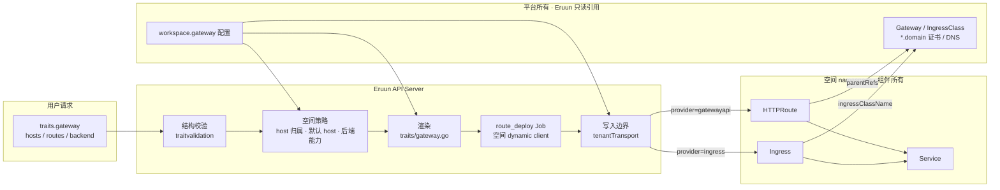
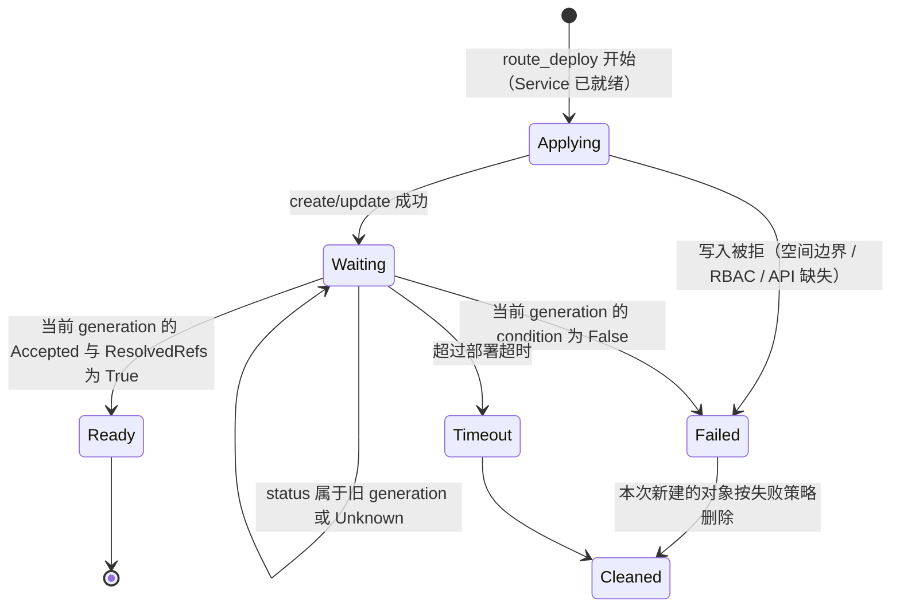

# Gateway Trait 与网络入口设计

> 状态：Draft / Proposal。本文替代原 `gateway-abstraction-design.md` 与 `gateway-trait-implementation-plan.md`。当前 `main` 仍只有 `traits.ingress`；第 1 节的决策已全部确认，但本文的类型、字段、配置和 Job 类型都未实现，不构成 API 或部署承诺。
>
> 基线：`origin/main` `a73d15f`（2026-10-23）。Eruun 尚未发布，本方案直接替换 `traits.ingress`，不保留兼容字段、别名或迁移窗口。

## 1. 决策记录

| 编号 | 决策 | 状态 |
| --- | --- | --- |
| G1 | `traits.gateway` 直接替换 `traits.ingress`，不做双轨与数据迁移 | 已确认（2026-10-23） |
| G2 | 渲染后端为 `gatewayapi`（主路径，Istio、Envoy Gateway、kgateway 等经 Gateway API 接入）和 `ingress`；首期不生成 Istio `VirtualService` | 已确认（2026-10-23） |
| G3 | 后端由平台配置决定；用户 DSL 不出现 provider、class、gateway 引用或注解；不做运行时自动探测 | 已确认（2026-10-23） |
| G4 | 首期只做南北向 HTTP 入口（含 SSE、WebSocket）：host、path、超时、rewrite；服务网格与出站策略进入后续阶段 | 已确认（2026-10-23） |
| G5 | TLS 在平台入口终止，证书由平台提供；Trait 不带证书字段 | 已确认（2026-10-23） |
| G6 | 首期 backend 只能指向本组件的 Service；不做跨组件 backend 和按权重分流 | 已确认（2026-10-23） |
| G7 | host 改为单层名称 `<前缀>-<空间 namespace>.<domain>`，平台一张 `*.<domain>` 证书覆盖全部空间 | 已确认（2026-10-23） |
| G8 | 删除按 host 区分路由的能力：一个组件的所有 host 共用同一组路由 | 已确认（2026-10-23） |

## 2. 背景

### 2.1 现状链路

`traits.ingress` 是 Kubernetes Ingress 的镜像。一个组件的入口从保存到删除经过以下各层，每一层都只认 `networking.k8s.io/v1 Ingress`：

| 层 | 位置 | 当前行为 |
| --- | --- | --- |
| 公共契约 | `domain/spec/traits.go` `IngressTraitsSpec` | 用户可写 `name`、`namespace`、`label`、`annotations`、`ingressClassName`、`defaultPathType`、`tls`、`routes`；路由级可写 `host` |
| 默认值 | `domain/spec/ingress_defaults.go` | 推导 backend Service 与端口；rewrite 写死为 `nginx.ingress.kubernetes.io/*` 注解 |
| 校验 | `service/internal/traitvalidation` | host 格式、routes 非空、backend 引用歧义 |
| 共享 Job DSL | `domain/spec/job.go` `validateJobTraits`、`evaluation_component.go` | command step 与 evaluation 各自拒绝 ingress |
| 空间策略 | `infrastructure/workspace/transport.go` `prepareTraitIngresses` | 拒绝注解与外来 class，写入 `ingressClassName`、namespace 和默认 host `<组件>.<namespace>.<ingressDomain>`，并持久化进组件 Traits |
| 渲染 | `workflow/traits/ingress.go` | 生成 `*networkingv1.Ingress`；嵌套在 init/sidecar Traits 中也会生成（`processor.go` 对 ingress 不检查 `nested`） |
| Job 构建 | `event/workflow/job_builder_component.go` | 入口对象作为 AdditionalObjects 先于同组件 Service 进入 `JobPriorityHigh`，生成 `ingress_deploy` Job |
| 执行 | `job/jobdeploy/ingress.go` | typed client 创建/更新；按 host/path 重叠和旧名字前缀 `ing-` 打分复用已有 Ingress |
| 写入边界 | `workspace/transport.go` `prepareIngress` | 校验最终载荷的 class、host 后缀、无注解、无 defaultBackend |
| 清理 | `job/jobcleanup`、`application_resource_cleanup.go` | typed client 按名字或受管 label 删除 |
| 展示 | `assembler/v1/component_service.go`、`component_link.go`、gRPC `AppDTOComponentIngressInfo` | `ingresses` 视图与 `externalLinks` |
| Schema | `dto/v1/json_schema.go` | 反射生成结构，必填、枚举与组合约束按定义手写 |
| 导入 | `service/conversion/kube_convert_traits.go` | YAML 中的 Ingress 转为 `traits.ingress`，复制 annotations、TLS、pathType；named port 与非 Service backend 有损转换并给出警告 |
| RBAC | Helm ClusterRole、`deploy/eruun-stack.yaml`、空间 Role | 只授权 `networking.k8s.io/ingresses` |

### 2.2 问题

1. **公共契约暴露实现**：`ingressClassName`、`annotations`、`namespace` 都是 Kubernetes Ingress 或某个 Controller 的细节。空间策略已经禁止注解、强制 class 和 namespace，这几个字段对用户只剩“写错就被拒绝”的作用。
2. **写死 ingress-nginx**：rewrite 只能通过 nginx 注解实现。ingress-nginx 已于 2026 年 3 月停止维护，不再发布安全修复，Kubernetes 官方推荐迁移到 Gateway API（见参考资料）。
3. **字段失效**：`IngressRoute.Weight` 与 `Headers` 被接受和存储，但 `convertBackend` 从不使用。
4. **就绪判断为空**：`ingressReady` 只判断对象非 nil，路由是否被 Controller 接受、backend 是否可解析都不可见。
5. **配置错误被掩盖**：backend 端口为空时 `convertBackend` 回退到 80，配置错误看起来像可部署的路由。
6. **兼容逻辑残留**：`findReusableIngressName` 按旧命名前缀 `ing-` 和路由重叠打分，复用别的 Ingress 名字；在确定性命名下没有存在理由。
7. **平台配置写入用户数据**：空间策略把 `ingressClassName` 等平台值写进组件 Traits 并持久化，平台更换入口实现后，存量组件的 spec 与平台配置不一致。
8. **证书无法统一**：默认 host `<组件>.<namespace>.<domain>` 有两级子域，一张 `*.<domain>` 通配证书覆盖不了，只能每个空间一张证书。
9. **长请求无法通用表达**：LLM 长上下文预填充或推理模型首个 token 前可能长时间无输出，Agent 工具调用也可能是长请求；当前契约没有可移植的请求超时。

## 3. 目标与非目标

目标：

- 一个与工作负载类型无关的入口 Trait。LLM 服务、Agent 应用和普通 Web 服务都用同一个 `traits.gateway` 声明对外暴露，不按产品名新增 Trait。
- 平台在部署配置中选择入口实现，同一份应用 spec 在 Ingress 集群和 Gateway API（含 Istio）集群中都可部署。
- 每个 Trait 字段在所选后端上要么正确生效，要么在 Try/保存时明确失败；不静默丢弃字段。
- 删掉 Ingress 专属的兼容与注解逻辑，入口链路只有一种 Job 类型。
- 平台用一张通配证书即可为全部空间提供 HTTPS。

非目标：

- 不安装或管理 Istio、Gateway Controller、GatewayClass、Gateway、证书和 DNS；它们归平台所有。
- 首期不做跨组件路由、按权重分流、header 匹配、镜像流量、重试和限流；不生成 `VirtualService`、`GRPCRoute`、`TCPRoute`。
- 不做 Eruun 自己的服务网格或流量控制平面：Eruun 声明流量意图，翻译为集群已安装的入口 API。

### 3.1 删除的能力

以下能力在当前 `traits.ingress` 中存在，本方案明确不再提供：

| 能力 | 当前形态 | 处理 |
| --- | --- | --- |
| 按 host 区分路由（G8） | 路由级 `host` | 删除；一个组件的 hosts 共用 routes，需要不同路由时拆成不同组件 |
| 一个组件多个入口对象 | `ingress` 数组、`name` | 删除；每个组件一个入口对象 |
| backend 指向任意 Service（G6） | `backend.serviceName` 可写任意名字 | 删除；只能指向本组件的 Service |
| 应用自带证书（G5） | `tls[].secretName` | 删除；TLS 在平台入口终止 |
| Controller 注解与 class | `annotations`、`ingressClassName` | 删除；空间策略原本就禁止注解、强制 class |
| 不可移植的路径匹配 | `ImplementationSpecific`、regex rewrite | 删除；只保留 `prefix`、`exact` 与前缀替换 |
| 嵌套入口 | init/sidecar 中的 `ingress` | 删除；只允许组件顶层 |
| 自定义标签 | `label` | 删除；只写 Eruun 受管 label |

`Weight` 与 `Headers` 从未生效，不列为能力删除。

## 4. 架构



职责边界：

- **结构校验**只检查与平台无关的结构：路径、匹配方式、超时格式、backend 引用、嵌套位置。
- **空间策略**负责与平台配置相关的检查：host 归属、默认 host、当前后端是否支持所用字段。它不把 class、parentRef 等平台值写进 spec。
- **渲染**读取平台配置，生成 HTTPRoute 或 Ingress。
- **写入边界**对最终载荷做最后校验，防止任何上游路径绕过策略。
- **平台资源**只被引用，组件删除时永不清理，与“组件清理只删除自己拥有的资源”约束一致。

Try/保存的结论只对当时的平台配置成立。所有节点读取同一份账号配置 Secret；平台配置变化后重新部署，按新配置渲染，与 `nodePool` 在 Try/保存时检查引用、部署时重新解析的做法一致。

## 5. 公共契约

### 5.1 类型

`Traits.Ingress []IngressTraitsSpec` 删除，新增单个对象：

```go
// pkg/apiserver/domain/spec/traits.go
type Traits struct {
	// ...
	Gateway *GatewayTraitSpec `json:"gateway,omitempty"`
}

// pkg/apiserver/domain/spec/gateway.go

// GatewayTraitSpec exposes a component through the platform gateway.
type GatewayTraitSpec struct {
	Hosts  []string           `json:"hosts,omitempty"`
	Routes []GatewayRouteSpec `json:"routes"`
}

// GatewayRouteSpec forwards one path to a Service of the same component.
type GatewayRouteSpec struct {
	Path    string              `json:"path,omitempty"`
	Match   string              `json:"match,omitempty"`
	Rewrite string              `json:"rewrite,omitempty"`
	Timeout string              `json:"timeout,omitempty"`
	Backend *GatewayBackendSpec `json:"backend,omitempty"`
}

// GatewayBackendSpec selects a Service and port declared by the component.
type GatewayBackendSpec struct {
	Service string `json:"service,omitempty"`
	Port    int32  `json:"port,omitempty"`
}

const (
	GatewayMatchPrefix = "prefix"
	GatewayMatchExact  = "exact"
)
```

`traits.gateway` 只允许出现在 Application/Workflow 组件的顶层 Traits。出现在 `init[].traits`、`sidecar[].traits`、command Job step 或 evaluation 中时校验失败；`validateJobTraits` 与 evaluation 的拒绝条件从 `Ingress` 改为 `Gateway`，不能随旧字段一起删除。

### 5.2 字段规则与默认值

| 字段 | 规则 | 默认值 |
| --- | --- | --- |
| `hosts` | 每项为单层名称 `<前缀>-<空间 namespace>.<domain>`（见 6.2），最多 8 项，去重 | 空时生成 `<组件名>-<空间 namespace>.<domain>` |
| `routes` | 1–16 项；`path`+`match` 组合在组件内唯一 | 无，必填 |
| `routes[].path` | 以 `/` 开头，不含 `?`、`#`、`..`、连续 `//` | `/` |
| `routes[].match` | `prefix` 或 `exact`，大小写与空白在 spec 边界规范化 | `prefix` |
| `routes[].rewrite` | 以 `/` 开头；只允许与 `match: prefix` 同用；把匹配到的前缀替换为该值 | 不改写 |
| `routes[].timeout` | 请求总时限，覆盖从收到请求到响应结束的全过程。格式为 Gateway API Duration 子集 `^([0-9]{1,5}(h|m|s|ms)){1,4}$`；取 `0s`（不限时）或 1s–1h | 不设置，沿用入口实现的默认值 |
| `routes[].backend.service` | 本组件某个非 `external` Service Trait 的 `name` | 按下方规则推导 |
| `routes[].backend.port` | 必须是被解析 Service 声明的端口 | 按下方规则推导 |

`timeout` 是总时限，不是读空闲超时：持续输出的 SSE 会在总时限到达时被断开。流式接口应设置覆盖最长生成时长的值，或设为 `0s`。

backend 推导沿用现有 `ResolveIngressBackend` 的规则，改名为 `ResolveGatewayBackend`：

1. `service` 为空：取本组件唯一的非 `external` Service Trait；没有 Service Trait 时取组件默认 Service（`naming.ServiceName`）。本组件有多个非 `external` Service Trait 时报错，要求填写 `service`。
2. `port` 为空：取被解析 Service 的第一个端口；默认 Service 取 `properties.ports` 第一项。仍为空则报错，不再回退到 80。

### 5.3 校验错误

沿用 `apisv1.ValidationError` 与 Try/DryRun 链路。新增错误码，删除 `MISSING_INGRESS_ROUTES`：

| 错误码 | 字段示例 | 触发 |
| --- | --- | --- |
| `MISSING_GATEWAY_ROUTES` | `components[0].traits.gateway.routes` | routes 为空 |
| `INVALID_GATEWAY_ROUTE` | `...routes[1].path` | 路径、match、rewrite、timeout 格式或组合错误；路由重复 |
| `INVALID_GATEWAY_BACKEND` | `...routes[0].backend.port` | Service 不存在、为 external、端口未声明、默认 backend 有歧义 |
| `INVALID_GATEWAY_HOST` | `...gateway.hosts[0]` | host 不是本空间的单层名称；默认 host 超长 |
| `GATEWAY_NOT_ALLOWED` | `components[0].sidecar[0].traits.gateway` | 嵌套位置、command step 或 evaluation 中使用 gateway；平台未配置 gateway |
| `GATEWAY_UNSUPPORTED` | `...routes[0].timeout` | 当前平台后端不支持该字段（见 6.3） |

`INVALID_GATEWAY_HOST`、`GATEWAY_UNSUPPORTED` 和“平台未配置 gateway”依赖平台配置，由一个只读函数产生字段级错误：

```go
// pkg/apiserver/domain/service/internal/traitvalidation/gateway.go
func ValidateGatewayPlatform(traits spec.Traits, namespace, componentName string, cfg *spec.GatewayConfig, field string) []apisv1.ValidationError
```

Try、创建应用、`/version` 更新和模板克隆在现有调用 `workspace.ValidateTraits` 的位置调用它。当前 Try 把空间策略错误统一包装成组件级 `INVALID_TRAIT_CONFIG`（`validation/validation.go`），gateway 的平台相关错误不再走这条包装，直接返回字段路径。`workspace.ValidateTraits` 保留默认 host 的填充，并对同样的规则返回 `bcode.ErrForbidden`，作为保存路径的最后一道检查。

版本 Diff 的 DryRun 当前在调用 `UpdateVersion` 之前返回（`application_diff_update.go`），不执行任何空间策略。这是已有问题，影响所有空间策略而非仅入口，另起任务处理，不在本方案范围内。

### 5.4 示例

LLM 服务（OpenAI 兼容接口，长时间生成）：

```json
{
  "name": "qwen",
  "type": "webservice",
  "image": "vllm/vllm-openai:v0.11.0",
  "properties": { "ports": [{ "port": 8000 }] },
  "traits": {
    "gateway": {
      "routes": [{ "path": "/v1", "timeout": "0s" }]
    }
  }
}
```

backend 省略，解析为 `qwen` 组件默认 Service 的 8000 端口；host 省略，由空间策略生成 `qwen-eruun-ws-<32 位 hex>.<domain>`。

Agent 应用（UI 与 API 同一组件，API 去掉前缀转发）：

```json
{
  "name": "agent",
  "type": "webservice",
  "properties": { "ports": [{ "port": 3000 }, { "port": 8080 }] },
  "traits": {
    "gateway": {
      "hosts": ["chat-eruun-ws-<32 位 hex>.apps.example.com"],
      "routes": [
        { "path": "/", "backend": { "port": 3000 } },
        { "path": "/api", "rewrite": "/", "timeout": "120s", "backend": { "port": 8080 } }
      ]
    }
  }
}
```

## 6. 平台配置与渲染

### 6.1 平台配置

`WorkspaceConfig` 的 `ingressDomain`、`ingressClass`、`ingressNamespace` 删除，替换为一个 `gateway` 对象。它仍位于 `ERUUN_AUTH_CONFIG_FILE` 加载的账号配置中，因为 host 归属、NetworkPolicy 和写入边界都由空间层执行：

```go
// pkg/apiserver/domain/spec/accounts.go
type WorkspaceConfig struct {
	// ...
	Gateway *GatewayConfig `json:"gateway,omitempty"`
}

type GatewayProvider string

const (
	GatewayProviderGatewayAPI GatewayProvider = "gatewayapi"
	GatewayProviderIngress    GatewayProvider = "ingress"
)

// GatewayConfig selects the platform-owned entry point for all workspaces.
type GatewayConfig struct {
	Provider GatewayProvider `json:"provider"`
	Domain   string          `json:"domain"`
	// ProxyNamespace hosts the data-plane Pods admitted by workspace NetworkPolicy.
	ProxyNamespace string            `json:"proxyNamespace"`
	ParentRef      *GatewayParentRef `json:"parentRef,omitempty"`
	ClassName      string            `json:"className,omitempty"`
}

type GatewayParentRef struct {
	Namespace   string `json:"namespace"`
	Name        string `json:"name"`
	SectionName string `json:"sectionName,omitempty"`
}
```

配置示例：

```json
{
  "workspace": {
    "gateway": {
      "provider": "gatewayapi",
      "domain": "apps.example.com",
      "proxyNamespace": "istio-ingress",
      "parentRef": { "namespace": "istio-ingress", "name": "public" }
    }
  }
}
```

```json
{
  "workspace": {
    "gateway": {
      "provider": "ingress",
      "domain": "apps.example.com",
      "proxyNamespace": "ingress-nginx",
      "className": "nginx"
    }
  }
}
```

加载时校验（`AccountConfig` 现有校验位置，失败则启动失败）：

- `gateway` 省略：所有空间拒绝 `traits.gateway`，与当前“不设置域名则拒绝 Ingress”一致。
- `provider` 必须是两个枚举值之一；`domain`、`proxyNamespace` 必填且为 DNS-1123 名称。
- `gatewayapi` 必须有 `parentRef`，不得有 `className`；`ingress` 必须有 `className`，不得有 `parentRef`。

`proxyNamespace` 与 `parentRef.namespace` 分开：Istio 把网关 Pod 部署在 Gateway 所在 namespace，Envoy Gateway 默认部署在自己的控制器 namespace，两者不总是相同。

启动时 Leader 检查所选后端的 API 是否存在（`gatewayapi` 检查 `gateway.networking.k8s.io/v1` 的 `httproutes`），缺失时 readiness 失败并在日志写明原因；不回退到另一个后端。API 存在不代表 Controller 支持全部字段，后者是部署前提（6.4）。

### 6.2 Host 命名

空间 namespace 固定为 `eruun-ws-<去掉连字符的 workspace ID>`（`account/account.go`、`account/workspaces.go`），长度 41。host 采用单层名称：

```text
<前缀>-<空间 namespace>.<domain>
例：qwen-eruun-ws-0f3c…9a.apps.example.com
```

- **归属**：host 的第一段必须以 `-<当前空间 namespace>` 结尾，其余部分必须等于 `.<domain>`。所有空间 namespace 等长且前缀相同，一个 host 只可能属于一个空间，不存在后缀歧义。
- **长度**：第一段最长 63 字符，扣除 `-` 与 namespace 后前缀最长 21 字符。默认 host 用组件名作前缀，组件名超过 21 字符时报 `INVALID_GATEWAY_HOST`，要求显式填写 `hosts`；不截断、不加哈希。
- **证书与 DNS**：平台只需一条 `*.<domain>` 泛解析和一张 `*.<domain>` 通配证书。Gateway API 下由平台 Gateway 的 HTTPS 监听器（hostname `*.<domain>`）终止 TLS；Ingress 下由 Controller 的默认证书（如 ingress-nginx `--default-ssl-certificate`）或前置负载均衡终止 TLS，Eruun 渲染的 Ingress 不带 `tls`。
- 代价：host 中带有 41 字符的 namespace，可读性差；前缀长度受限。

### 6.3 后端能力矩阵

| Trait 字段 | `gatewayapi`（HTTPRoute） | `ingress` |
| --- | --- | --- |
| `hosts` | `spec.hostnames` | 每个 host 一条 `rules[]`，规则内容相同 |
| `path` + `match: prefix` | `matches[].path` `PathPrefix` | `pathType: Prefix` |
| `path` + `match: exact` | `matches[].path` `Exact` | `pathType: Exact` |
| `rewrite` | `filters[]` `URLRewrite` `ReplacePrefixMatch` | **不支持**，`GATEWAY_UNSUPPORTED` |
| `timeout` | `rules[].timeouts.request` | **不支持**，`GATEWAY_UNSUPPORTED` |
| `backend` | `backendRefs[]`（单项） | `backend.service` |
| 平台引用 | `spec.parentRefs` = `parentRef` | `spec.ingressClassName` = `className` |

`ingress` 后端只承担基础 host/path 转发，不写任何 Controller 专属注解。需要超时或 rewrite 的平台应使用 `gatewayapi`。

### 6.4 `gatewayapi` 的部署前提

`timeouts.request` 与 `URLRewrite` 在 Gateway API 中属于 Extended 支持能力，`timeouts` 自 v1.2.0 进入 Standard Channel。Eruun 不探测这些能力，把它们作为平台前提写入部署文档：

- 集群安装 Gateway API Standard Channel CRD，版本不低于 v1.2.0。
- Controller 支持 `HTTPRouteRequestTimeout` 与 `HTTPRoutePathRewrite`。验收覆盖的 Controller 及版本在实现 PR 中记录（首期以 Istio 的 Gateway API 模式验收）。
- 平台 Gateway 的 `allowedRoutes.namespaces` 允许空间 namespace（建议用空间 namespace 的 owner label 作为 selector），HTTPS 监听器 hostname 为 `*.<domain>`。

Try/保存只保证平台配置与应用 spec 能判定的部分；不满足前提的集群会在部署时由 HTTPRoute status 报告失败（7.2）。

### 6.5 渲染

```go
// pkg/apiserver/workflow/traits/gateway.go

// processGateway renders the component route for the configured provider.
func processGateway(ctx *TraitContext, gateway *spec.GatewayTraitSpec) (*TraitResult, error)

func buildHTTPRoute(name, namespace string, hosts []string, routes []spec.GatewayRouteSpec, ref spec.GatewayParentRef) *unstructured.Unstructured

func buildIngress(name, namespace string, hosts []string, routes []spec.GatewayRouteSpec, className string) *networkingv1.Ingress
```

- `TraitContext` 增加 `gateway *spec.GatewayConfig`，由 Job 构建方从 `Cfg.Accounts.Workspace.Gateway` 注入，做法与已有的 `nodePool` 相同；`processor.go` 只在非嵌套调用时处理 gateway。
- 入口对象名 `naming.GatewayRouteName(component, appName)`，替换 `naming.IngressName`，每个组件一个，确定性生成；`application_resource_validation.go` 的资源名冲突检查改用它。
- HTTPRoute 用 `unstructured.Unstructured` 构建，不引入 `sigs.k8s.io/gateway-api` 依赖；用 golden 测试固定输出。
- 生成的 HTTPRoute 示例（对应 5.4 Agent 应用）：

```yaml
apiVersion: gateway.networking.k8s.io/v1
kind: HTTPRoute
metadata:
  name: agent-<app>
  namespace: eruun-ws-<32 位 hex>
  labels: { ...Eruun 受管 label... }
spec:
  parentRefs:
    - { group: gateway.networking.k8s.io, kind: Gateway, namespace: istio-ingress, name: public }
  hostnames: [chat-eruun-ws-<32 位 hex>.apps.example.com]
  rules:
    - matches: [{ path: { type: PathPrefix, value: / } }]
      backendRefs: [{ name: <agent 默认 Service>, port: 3000 }]
    - matches: [{ path: { type: PathPrefix, value: /api } }]
      filters:
        - type: URLRewrite
          urlRewrite: { path: { type: ReplacePrefixMatch, replacePrefixMatch: / } }
      timeouts: { request: 120s }
      backendRefs: [{ name: <agent 默认 Service>, port: 8080 }]
```

## 7. 执行、状态与清理

### 7.1 Job 类型与执行顺序

`ingress_deploy` 删除，新增 `route_deploy`（`config.JobDeployRoute`），Ingress 与 HTTPRoute 共用：

```go
// pkg/apiserver/event/workflow/job/jobdeploy/route.go
type DeployRouteJobCtl struct {
	jobexec.DeployNamespacedResourceJobBase
}

func NewDeployRouteJobCtl(job *model.JobTask, runtime *jobexec.Runtime, shareLocker locker.Locker) *DeployRouteJobCtl

func (c *DeployRouteJobCtl) Run(ctx context.Context) error
func (c *DeployRouteJobCtl) Clean(ctx context.Context)
```

- **顺序**：路由 Job 不再作为 AdditionalObjects 进入 `JobPriorityHigh`，而是放入 `JobPriorityNormal`。`controller_run.go` 按优先级顺序执行、前一档全部完成才进入下一档，因此路由总在同组件 Service（`JobPriorityHigh`）创建之后执行；G6 保证路由不依赖其他组件。
- **载荷**：`JobInfo` 统一为 `*unstructured.Unstructured`（Ingress 也转换为 unstructured），按两个固定 GVR 分支写入：`networking.k8s.io/v1 ingresses` 或 `gateway.networking.k8s.io/v1 httproutes`。
- **客户端**：dynamic client 从空间的 scoped REST config 创建（`workspace/namespace.go` 的 `TenantClient` 已带 impersonation 与 `tenantTransport`），因此所有写入都经过写入边界；`tenantTransport` 按 URL 中的资源名识别资源，两个 GVR 的资源名分别是 `ingresses` 与 `httproutes`。
- **调和**：创建与更新复用 `jobexec.ReconcileTrackedResource`（泛型参数不限类型）、共享资源保护和受管 label 合并；`findReusableIngressName` 及其打分逻辑删除。
- **跟踪与清理**：沿用现有 Created/Observed 跟踪；`Clean` 回调从 Job 载荷确定 GVR。不把通用清理跟踪改造成按 GVR 记录。
- `controller_run.go` 失败清理触发表、`job.go` 写权限表、`job_scheduler_resources.go`、`jobexec/workspace_task.go` 中的 `JobDeployIngress` 全部替换；资源类型 `domainspec.ResourceIngress` 改为 `ResourceRoute`。

### 7.2 就绪判断

| 后端 | 成功 | 失败 | 继续等待 |
| --- | --- | --- | --- |
| `gatewayapi` | `status.parents[]` 中与 `parentRef` 匹配的项，`Accepted` 与 `ResolvedRefs` 均为 `True`，且两个 condition 的 `observedGeneration` 等于对象当前 `metadata.generation` | 上述匹配项中属于当前 generation 的任一 condition 为 `False`；错误带上 condition 的 `reason` 与 `message` | 匹配项缺失、condition 缺失、为 `Unknown`、或 `observedGeneration` 落后于当前 generation |
| `ingress` | 对象存在（Ingress 没有通用的接受状态） | — | — |

超过部署超时返回 `StatusTimeout`，与现有部署 Job 一致。因为 Service 已在前一优先级创建，`ResolvedRefs=False` 表示真实的配置或平台问题，可以立即失败。



首期只在部署时检查路由状态，不新增 HTTPRoute Informer；组件状态查询不反映部署之后的入口故障。

### 7.3 清理、归属与后端切换

- 组件删除、版本更新移除组件、失败清理：按受管 label 列出当前后端 GVR 下的对象并删除，只删本组件拥有的对象。
- `application_update_version_cleanup.go` 中的 `versionUpdateCleanupIngressTraits` 改为比较 `traits.gateway`；G6 下路由只依赖本组件，组件变化即触发入口重渲染，没有跨组件的依赖需要追踪。
- **后端切换**：平台从 `ingress` 改为 `gatewayapi`（或反向）时，必须先清理旧环境：删除全部应用或销毁旧集群环境，再以新配置部署。只修改配置后重新部署会留下旧后端的入口对象，不算完成切换。本方案不为此增加跨后端的清理扫描。

### 7.4 写入边界与权限

`tenantTransport` 增加 `httproutes` 校验，Ingress 校验改读新配置：

- `httproutes`：`parentRefs` 必须恰好等于平台 `parentRef`；`hostnames` 全部满足 6.2 的归属规则；`backendRefs` 只能是同 namespace 的 core `Service` 且只有一项；`filters` 只允许 `URLRewrite`；规则中不允许 `sessionPersistence`、`retry` 等首期之外的字段。
- `ingresses`：`ingressClassName` 必须等于 `className`；无注解、无 `defaultBackend`、无 `tls`；host 满足 6.2 的归属规则。
- 空间 Role、Helm ClusterRole 与 `deploy/eruun-stack.yaml`：按平台 provider 只授予一种入口资源的读写权限，`gatewayapi` 为 `gateway.networking.k8s.io/httproutes`（就绪判断通过 GET 主资源读取 status，不需要 status 子资源）；`helm_template_test.sh` 与 `eruun_stack_test.go` 同步。
- 空间基线 NetworkPolicy 的入站放行来源由 `ingressNamespace` 改为 `gateway.proxyNamespace`。

## 8. 查询、展示、Schema 与导入

- 组件 DTO 的 `ingresses []ComponentIngressInfo` 改为 `gateway *ComponentGatewayInfo`，返回解析后的 hosts 与 routes（含推导出的 Service 与端口），不返回平台内部名字。gRPC 中的 `AppDTOComponentIngressInfo`、`AppSpecIngress*` 同步替换并重新生成。
- `externalLinks` 的类型由 `ingress` 改为 `gateway`，值仍为可访问的 `host + path`；没有 gateway 时继续回退到 Service 链接。
- canonical JSON Schema（`dto/v1/json_schema.go`）为 `GatewayTraitSpec`、`GatewayRouteSpec` 手写必填、数量、枚举、范围与组合约束；契约测试覆盖新格式被接受、`traits.ingress` 被拒绝、嵌套 gateway 被拒绝。
- YAML 导入：Ingress 转为 `traits.gateway`。新契约不支持的输入在导入时明确报错并列出原因：annotations、TLS、`ImplementationSpecific`、不同 host 的规则不一致、指向其他组件 Service 的 backend、同一组件有多个 Ingress。现有的 named port 与非 Service backend 有损转换改为报错。HTTPRoute 导入首期返回“不支持”。
- 模板克隆、`examples/` 下所有含 `ingress` 字段或 `ingresses` 响应视图的文件（按内容扫描，不只按文件名）、`components-api-sidecar-field.md`、`validation-api-guide.md`、`account-auth-workspaces.md`、`deploy/accounts.example.json` 同步改写。

## 9. 改动清单

| 区域 | 改动 |
| --- | --- |
| spec | 新增 `gateway.go`；删除 `IngressTraitsSpec` 系列类型、`model/ingress.go`、`ingress_defaults.go` 中的 nginx 注解与 pathType 逻辑；`WorkspaceConfig` 换为 `Gateway`；`job.go` 与 `evaluation_component.go` 的拒绝条件改为 gateway |
| 校验 | `traitvalidation` 改为 gateway 结构规则、新错误码与 `ValidateGatewayPlatform`；Try 链路直接返回其字段级错误；资源名冲突检查改用 `GatewayRouteName` |
| 空间 | `prepareTraitIngresses` 改为 `prepareTraitGateway`（填默认 host、检查归属与后端能力）；`tenantTransport` 增加 `httproutes`；Role 与 NetworkPolicy 读新配置 |
| 渲染 | `traits/ingress.go` 改为 `traits/gateway.go`；processor 只在顶层处理 gateway |
| Workflow | `route_deploy` Job 放入 `JobPriorityNormal`、就绪判断、清理；删除 `jobdeploy/ingress.go` 与 `jobinfo.IngressFromJobInfo` |
| 应用服务 | 删除、版本更新清理、模板克隆、YAML 转换中的 Ingress 分支 |
| 接口 | DTO、assembler、`externalLinks`、canonical JSON Schema、proto 与生成代码 |
| 部署 | Helm RBAC、`deploy/eruun-stack.yaml`、`accounts.example.json`、启动时 API 存在性检查及对应测试 |
| 文档 | 本文定稿为 Current 后，更新 `架构文档.md`、`architecture-diagrams.md`、`account-auth-workspaces.md`、`validation-api-guide.md`、`helm-deployment.md`、`docs/README.md` |

建议拆成两个 PR：PR 1 替换契约、host 命名与 `ingress` 后端（含 `route_deploy`、执行顺序、Schema、导入、示例，删除兼容逻辑）；PR 2 增加 `gatewayapi` 后端、写入边界与 RBAC。两个 PR 都不涉及数据库 schema。

## 10. 测试与验证边界

单元测试：

- spec：字段规范化、默认 backend 推导（多 Service 歧义、端口缺失报错）、timeout（含 `0s`）与 path 格式、rewrite 组合。
- host：默认 host、21 字符边界、其他空间 namespace 的 host 被拒绝、domain 不符被拒绝。
- 共享 DSL：init/sidecar、command step、evaluation 携带 gateway 均失败。
- 渲染：两种后端的 golden 输出；不支持字段在 `ingress` 后端报 `GATEWAY_UNSUPPORTED`。
- Job 构建：路由 Job 位于 `JobPriorityNormal`，同组件 Service 位于 `JobPriorityHigh`。
- 空间：`tenantTransport` 对 `parentRefs`、`hostnames`、`backendRefs`、`filters`、Ingress `tls` 的篡改拒绝。
- Job 执行：fake dynamic client 下的创建、更新、当前 generation `Accepted=False` 失败、旧 generation `False` 继续等待、超时、失败清理只删除本次新建的对象。
- Try：gateway 的平台相关错误带字段路径，不再是组件级 `INVALID_TRAIT_CONFIG`。
- 接口：DTO、`externalLinks`、gRPC 映射、canonical Schema 契约；YAML 导入的转换与各类报错。

真实环境验收（本地与 fake 测试不能证明）：

- Istio（Gateway API 模式）：HTTPRoute 被接受；`timeout` 到达时请求被终止；`0s` 时持续超过 10 分钟的 SSE 不被断开；首个 token 前长时间无输出的请求不被断开；WebSocket 升级成功；`*.<domain>` 证书在单层 host 上校验通过。
- ingress-nginx 或其他 Ingress Controller：基础 host/path 转发、默认证书 HTTPS。
- 空间 Role 下 HTTPRoute 的写入与 status 读取；NetworkPolicy 放行网关 Pod 流量。

## 11. 后续阶段

| 阶段 | 内容 | 前置条件 |
| --- | --- | --- |
| 应用级入口与灰度 | 跨组件路由与按权重分流作为应用级能力设计（路由属于应用而非某个组件），需要定义版本更新时的依赖重渲染、被引用组件删除时的拒绝规则，以及 `weight` 的显式取值（含 0）语义 | 模型灰度有明确需求 |
| 服务网格成员 | 空间级 `mesh` 配置（如 Istio ambient 的 `istio.io/dataplane-mode=ambient` namespace label），由空间初始化写入；mTLS 由网格默认提供 | 首期上线后有东西向需求 |
| 出站策略 | Agent 出站 allowlist，基于空间 NetworkPolicy 扩展，与 `ai-runtime-vision.md` 的“网络访问默认拒绝”一起设计 | Agent 凭据与审计边界确定 |
| 模型感知路由 | Gateway API Inference Extension 的 `InferencePool` 作为路由目标（Istio 对其支持为 beta） | 选定目标版本并确认 API 稳定性 |
| 更多协议 | gRPC（`GRPCRoute`）、header 匹配、重试 | 有明确工作负载需求 |
| Istio 专属能力 | 只在 Gateway API 无法表达时生成 `VirtualService` | 同上 |

## 参考资料

- [Ingress NGINX Retirement: What You Need to Know](https://kubernetes.io/blog/2025/11/11/ingress-nginx-retirement/)
- [Ingress NGINX: Statement from the Kubernetes Steering and Security Response Committees](https://www.kubernetes.io/blog/2026/01/29/ingress-nginx-statement/)
- [Gateway API HTTPRoute](https://gateway-api.sigs.k8s.io/api-types/httproute/)
- [Istio: Kubernetes Gateway API Inference Extension](https://istio.io/latest/docs/tasks/traffic-management/ingress/gateway-api-inference-extension/)
