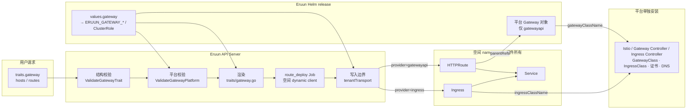
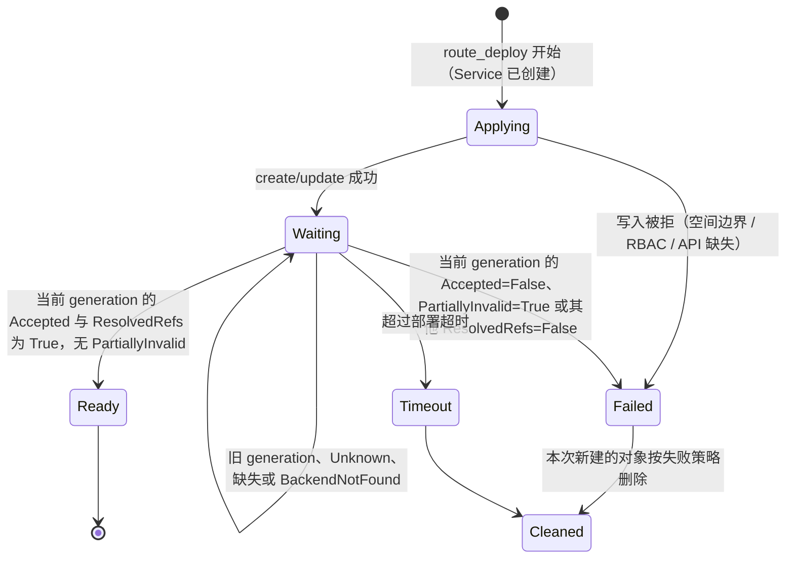

# Gateway Trait 与网络入口设计

> 状态：Draft / Proposal。本文替代原 `gateway-abstraction-design.md` 与 `gateway-trait-implementation-plan.md`。当前 `main` 仍只有 `traits.ingress`；第 1 节的决策已全部确认，但本文的类型、字段、配置和 Job 类型都未实现，不构成 API 或部署承诺。
>
> 基线：`origin/main` `a73d15f`（2026-10-23）。Eruun 尚未发布，本方案直接替换 `traits.ingress`，不保留兼容字段、别名或迁移窗口。本文经 Codex 两轮独立审核与一轮设计讨论（R1–R14、S1–S8）。

## 1. 决策记录

| 编号 | 决策 | 状态 |
| --- | --- | --- |
| G1 | `traits.gateway` 直接替换 `traits.ingress`，不做双轨与数据迁移 | 已确认（2026-10-23） |
| G2 | 入站渲染后端为 `gatewayapi`（主路径，Istio、Envoy Gateway、kgateway 等经 Gateway API 接入）和 `ingress`；首期不生成 Istio `VirtualService` | 已确认（2026-10-23） |
| G3 | 后端由平台在部署时选定（见 G10）；用户 DSL 不出现 provider、class、gateway 引用或注解；不做运行时自动探测 | 已确认（2026-10-23） |
| G4 | 首期只实现南北向 HTTP 入站（含 SSE、WebSocket）：host、path、超时、rewrite；服务网格与出站进入后续阶段 | 已确认（2026-10-23） |
| G5 | TLS 在平台入口终止，证书由平台提供；Trait 不带证书字段 | 已确认（2026-10-23） |
| G6 | 首期 backend 只能指向本组件的 Service；不做跨组件 backend 和按权重分流 | 已确认（2026-10-23） |
| G7 | host 为单层名称 `<前缀>-<空间 namespace>.<domain>`，平台一张 `*.<domain>` 证书覆盖全部空间 | 已确认（2026-10-23） |
| G8 | 删除按 host 区分路由的能力：一个组件的所有 host 共用同一组路由 | 已确认（2026-10-23） |
| G9 | `gateway` 定义为组件跨空间边界的入站与出站声明，`service` 只负责集群内端点；首期只实现入站，出站方向写入本文（§11.1），Schema 不预留 `egress` 字段 | 已确认（2026-10-23） |
| G10 | 入站后端在 Helm 安装时选定：`values.yaml` 的 `gateway` 是唯一来源，同时渲染服务端配置（`ERUUN_GATEWAY_*`）与 ClusterRole 中所选后端的规则，账号配置 Secret 不再保存入口配置；`gatewayapi` 时由 chart 创建平台 `Gateway` 对象；网络组件（Istio、Gateway Controller、Ingress Controller）仍由平台单独安装 | 已确认（2026-10-23） |

## 2. 背景

### 2.1 现状链路

`traits.ingress` 是 Kubernetes Ingress 的镜像。一个组件的入口从保存到删除经过以下各层，每一层都只认 `networking.k8s.io/v1 Ingress`：

| 层 | 位置 | 当前行为 |
| --- | --- | --- |
| 公共契约 | `domain/spec/traits.go` `IngressTraitsSpec` | 用户可写 `name`、`namespace`、`label`、`annotations`、`ingressClassName`、`defaultPathType`、`tls`、`routes`；路由级可写 `host` |
| 默认值 | `domain/spec/ingress_defaults.go` | 推导 backend Service 与端口；rewrite 写死为 `nginx.ingress.kubernetes.io/*` 注解 |
| 校验 | `service/internal/traitvalidation` | host 格式、routes 非空、backend 引用歧义 |
| 共享 Job DSL | `domain/spec/job.go` `validateJobTraits`、`evaluation_component.go` | command step 与 evaluation 各自拒绝 ingress |
| 空间策略 | `infrastructure/workspace/transport.go` `prepareTraitIngresses` | 拒绝注解与外来 class，写入 `ingressClassName`、namespace 和默认 host `<组件>.<namespace>.<ingressDomain>`，并持久化进组件 Traits |
| 渲染 | `workflow/traits/ingress.go` | 生成 `*networkingv1.Ingress`；嵌套在 init/sidecar Traits 中也会生成（`processor.go` 对 ingress 不检查 `nested`）；应用内 `job`/`scheduledjob` 也会渲染（`jobdeploy/generate_batch.go`），但不会为它们创建 Service |
| Job 构建 | `event/workflow/job_builder_component.go` | 入口对象作为 AdditionalObjects 先于同组件 Service 进入 `JobPriorityHigh`，生成 `ingress_deploy` Job |
| 执行 | `job/jobdeploy/ingress.go` | 经空间 `TenantClient`（固定 impersonation）创建/更新；按 host/path 重叠和旧名字前缀 `ing-` 打分复用已有 Ingress |
| 写入边界 | `workspace/transport.go` `prepareIngress` | 校验最终载荷的 class、host 后缀、非空 host、无注解、无 defaultBackend |
| 清理 | `job/jobcleanup`、`application_resource_cleanup.go` | 经空间身份按名字或受管 label 删除 |
| 展示 | `assembler/v1/component_service.go`、`component_link.go`、gRPC `AppDTOComponentIngressInfo` | `ingresses` 视图与 `externalLinks` |
| Schema | `dto/v1/json_schema.go` | 反射生成结构，必填、枚举与组合约束按定义手写 |
| 导入 | `service/conversion/kube_convert_traits.go` | YAML 中的 Ingress 转为 `traits.ingress`，复制 annotations、TLS、pathType；named port 与非 Service backend 有损转换并给出警告 |
| RBAC | Helm ClusterRole、`deploy/eruun-stack.yaml`、空间 Role | 平台 ClusterRole 与空间 Role 都含 `networking.k8s.io/ingresses` 读写；平台另有 `roles` 的 `bind`/`escalate` 与 `*/* list` |

### 2.2 问题

1. **公共契约暴露实现**：`ingressClassName`、`annotations`、`namespace` 都是 Kubernetes Ingress 或某个 Controller 的细节。空间策略已经禁止注解、强制 class 和 namespace，这几个字段对用户只剩“写错就被拒绝”的作用。
2. **写死 ingress-nginx**：rewrite 只能通过 nginx 注解实现。ingress-nginx 已于 2026 年 3 月停止维护，不再发布安全修复，Kubernetes 官方推荐迁移到 Gateway API（见参考资料）。
3. **字段失效**：`IngressRoute.Weight` 与 `Headers` 被接受和存储，但 `convertBackend` 从不使用。
4. **就绪判断为空**：`ingressReady` 只判断对象非 nil，路由是否被 Controller 接受、backend 是否可解析都不可见。
5. **配置错误被掩盖**：backend 端口为空时 `convertBackend` 回退到 80；`job`/`scheduledjob` 组件可以挂入口却没有 Service，生成指向不存在后端的路由。
6. **兼容逻辑残留**：`findReusableIngressName` 按旧命名前缀 `ing-` 和路由重叠打分，复用别的 Ingress 名字；在确定性命名下没有存在理由。
7. **平台配置写入用户数据**：空间策略把 `ingressClassName`、默认 host（含平台域名）写进组件 Traits 并持久化，平台更换入口实现或域名后，存量组件的 spec 与平台配置不一致。
8. **证书无法统一**：默认 host `<组件>.<namespace>.<domain>` 有两级子域，一张 `*.<domain>` 通配证书覆盖不了，只能每个空间一张证书。
9. **长请求无法通用表达**：LLM 长上下文预填充或推理模型首个 token 前可能长时间无输出，Agent 工具调用也可能是长请求；当前契约没有可移植的请求超时。
10. **配置来源分裂**：入口配置（`ingressDomain`、`ingressClass`、`ingressNamespace`）在账号配置 Secret 中，Helm 只接收 Secret 名字，ClusterRole 却由 Helm 静态渲染，两边互不知道对方；平台 Gateway 的 `allowedRoutes` 要匹配 Eruun 空间 namespace 的 label，这一 Eruun 内部约定也只能靠平台手工对齐。

## 3. 概念、目标与非目标

### 3.1 概念边界

| Trait | 负责 | 不负责 |
| --- | --- | --- |
| `service` | 组件在集群内的服务端点：Service 名、端口、协议 | 跨空间边界的访问 |
| `gateway` | 组件跨越空间边界的流量声明：**入站**（向空间外提供什么访问入口）与**出站**（需要访问空间外的哪些目标） | 网络组件、平台 `Gateway` 对象、证书、DNS、网络策略资源本身；它们由平台或 Eruun 的 Helm release 管理，不归任何组件所有 |

- 首期 `gateway` 只有入站部分（`hosts`、`routes`）。出站的方向与约束见 §11.1，Schema 不预留字段，需求明确后直接扩展契约。
- “跨空间”不等于“经过实体网关”：访问另一空间中的模型 Service 同样跨空间，可能直接走集群网络，但仍属于 `gateway` 出站声明与空间策略管辖。
- 入站与出站的适用条件不同：入站要求组件有承载 HTTP 的 Service；出站将适用于任何运行 Pod 的组件，包括一次性 Agent 任务。两部分分别定义适用条件、默认行为与执行时序，不共用检查。
- Service Trait 的 `node`（NodePort）与 `public`（LoadBalancer）类型是 L4 跨边界暴露，与本划分冲突。当前空间写入边界只允许 ClusterIP，这两种类型在空间应用部署中不可用，但导入、类型映射与资源生成仍使用它们。是否删除属于对外能力变更，另行逐项确认，不在本方案范围内。

### 3.2 目标

- 一个与工作负载类型无关的入站声明。LLM 服务、Agent 应用和普通 Web 服务都用同一个 `traits.gateway` 声明对外暴露，不按产品名新增 Trait。
- 平台在 Helm 安装时选择入口实现，同一份应用 spec 在 Ingress 集群和 Gateway API（含 Istio）集群中都可部署；入口配置、权限与平台 `Gateway` 对象来自同一份 values。
- 每个 Trait 字段在所选后端上要么正确生效，要么在 Try/保存时明确失败；不静默丢弃字段。
- 平台配置（后端、域名、平台网关引用）只在校验、渲染与展示时读取，不写入组件 spec。
- 删掉 Ingress 专属的兼容与注解逻辑，入口链路只有一种 Job 类型。
- 平台用一张通配证书即可为全部空间提供 HTTPS。

### 3.3 非目标

- 不安装或管理网络组件（Istio、Gateway Controller、Ingress Controller）、GatewayClass、Gateway API CRD、证书和 DNS；它们由平台单独安装。Eruun 的 Helm chart 只在 `gatewayapi` 时创建平台 `Gateway` 对象（§6.6）。
- 首期不实现出站，不做跨组件路由、按权重分流、header 匹配、镜像流量、重试和限流；不生成 `VirtualService`、`GRPCRoute`、`TCPRoute`。
- 不做 Eruun 自己的服务网格或流量控制平面：Eruun 声明流量意图，翻译为集群已安装的网络 API。

### 3.4 删除的能力

以下能力在当前 `traits.ingress` 中存在，本方案明确不再提供：

| 能力 | 当前形态 | 处理 |
| --- | --- | --- |
| 按 host 区分路由（G8） | 路由级 `host` | 删除；一个组件的 hosts 共用 routes，需要不同路由时拆成不同组件 |
| 一个组件多个入口对象 | `ingress` 数组、`name` | 删除；每个组件一个入口对象 |
| backend 指向任意 Service（G6） | `backend.serviceName` 可写任意名字 | 删除；只能指向本组件的 Service |
| 应用自带证书（G5） | `tls[].secretName` | 删除；TLS 在平台入口终止 |
| Controller 注解与 class | `annotations`、`ingressClassName` | 删除；空间策略原本就禁止注解、强制 class |
| 不可移植的路径匹配 | `ImplementationSpecific`、regex rewrite | 删除；只保留 `prefix`、`exact` 与前缀替换 |
| 嵌套入口 | init/sidecar 中的 `ingress` | 删除；只允许组件顶层 |
| 非常驻组件的入口 | 应用内 `job`/`scheduledjob` 可挂 ingress | 删除；它们没有 Service，任务实例的入口生命周期尚未设计 |
| 自定义标签 | `label` | 删除；只写 Eruun 受管 label |

`Weight` 与 `Headers` 从未生效，不列为能力删除。

## 4. 架构



职责边界：

- **结构校验**只检查与平台无关的规则：组件类型、嵌套位置、路径、匹配方式、超时格式、backend 引用、端口协议。
- **平台校验**检查与平台配置相关的规则：平台是否配置了 gateway、host 归属与长度、当前后端是否支持所用字段。它只读，不修改 spec。
- **渲染**读取平台配置，计算最终 hosts，生成 HTTPRoute 或 Ingress。
- **写入边界**对最终载荷做最后校验，防止任何上游路径绕过策略。
- **平台 `Gateway` 对象**归 Eruun 的 Helm release 所有，网络组件归平台所有；组件只引用它们，组件删除时永不清理，与“组件清理只删除自己拥有的资源”约束一致。

Try/保存的结论只对当时的平台配置成立。所有节点由同一个 Helm release 注入相同的 `ERUUN_GATEWAY_*`（`helm upgrade` 滚动更新期间新旧节点并存，见 §7.3）；平台配置变化（`helm upgrade`）后重新部署，按新配置渲染，与 `nodePool` 在 Try/保存时检查引用、部署时重新解析的做法一致。

## 5. 公共契约

### 5.1 类型

`Traits.Ingress []IngressTraitsSpec` 删除，新增单个对象：

```go
// pkg/apiserver/domain/spec/traits.go
type Traits struct {
	// ...
	Gateway *GatewayTraitSpec `json:"gateway,omitempty"`
}

// pkg/apiserver/domain/spec/gateway.go

// GatewayTraitSpec declares traffic that crosses the workspace boundary.
// Only inbound routing is defined in the first phase.
type GatewayTraitSpec struct {
	Hosts  []string           `json:"hosts,omitempty"`
	Routes []GatewayRouteSpec `json:"routes"`
}

// GatewayRouteSpec forwards one path to a Service of the same component.
type GatewayRouteSpec struct {
	Path    string              `json:"path,omitempty"`
	Match   string              `json:"match,omitempty"`
	Rewrite string              `json:"rewrite,omitempty"`
	Timeout string              `json:"timeout,omitempty"`
	Backend *GatewayBackendSpec `json:"backend,omitempty"`
}

// GatewayBackendSpec selects a Service and port declared by the component.
type GatewayBackendSpec struct {
	Service string `json:"service,omitempty"`
	Port    int32  `json:"port,omitempty"`
}

const (
	GatewayMatchPrefix = "prefix"
	GatewayMatchExact  = "exact"
)
```

适用位置与组件：

- `traits.gateway` 只允许出现在 Application/Workflow 组件的顶层 Traits。出现在 `init[].traits`、`sidecar[].traits`、command Job step 或 evaluation 中时校验失败；`validateJobTraits` 与 evaluation 的拒绝条件从 `Ingress` 改为 `Gateway`，不能随旧字段一起删除。
- 首期入站只允许 `webservice` 与 `store`：组件必须有 Eruun 管理、指向自身工作负载的 Service，被路由的端口为 TCP。`config`、`secret`、`job`、`scheduledjob` 携带 gateway 时返回 `GATEWAY_NOT_ALLOWED`。端口承载的是否确为 HTTP 无法静态证明，由部署时的路由状态（§7.2）与验收发现。
- 拒绝 `job`/`scheduledjob` 的理由是**任务实例的入口生命周期尚未设计**（Service 选择哪个执行实例、路由何时开放与撤销、重试和并行如何隔离），不是“一次性任务不需要入站”。有具体场景（交互式任务界面、第三方回调）时另行设计。
- 首期 `routes` 必填。将来加入出站后，允许只声明出站的 gateway，届时 `routes` 改为仅在声明入站时必填（§11.1）。

### 5.2 字段规则与默认值

| 字段 | 规则 | 默认值 |
| --- | --- | --- |
| `hosts` | 每项为单层名称 `<前缀>-<空间 namespace>.<domain>`（§6.2），最多 8 项，去重 | 空时为 `<组件名>-<空间 namespace>.<domain>`；默认值在校验、渲染、展示时计算，不写入 spec |
| `routes` | 1–16 项；`path`+`match` 组合在组件内唯一 | 无，必填 |
| `routes[].path` | 以 `/` 开头，不含 `?`、`#`、`..`、连续 `//` | `/` |
| `routes[].match` | `prefix` 或 `exact`，大小写与空白在 spec 边界规范化 | `prefix` |
| `routes[].rewrite` | 以 `/` 开头；只允许与 `match: prefix` 同用；把匹配到的前缀替换为该值 | 不改写 |
| `routes[].timeout` | 请求超时，语义同 Gateway API `HTTPRouteTimeouts.request`；格式为 Gateway API Duration 子集 `^([0-9]{1,5}(h|m|s|ms)){1,4}$`；取 `0s` 或 1s–1h | 不设置，沿用入口实现的默认值 |
| `routes[].backend.service` | 本组件某个非 `external` Service 的**有效名**：Service Trait 写了 `name` 即该名，未写则为生成名 `naming.ServiceName(...)`；组件默认 Service 同样以生成名引用 | 按下方规则推导 |
| `routes[].backend.port` | 必须是被解析 Service 声明的 TCP 端口 | 按下方规则推导 |

超时语义按 Gateway API 规范表述，不做更强的承诺：

- `timeout` 尽量覆盖整个请求—响应过程，实现可以从完整收到请求后开始计时；它不是读空闲超时，持续输出的 SSE 会在到达时限时被断开。
- `0s` 按规范**应当**禁用请求超时；无法完全禁用的实现可以使用其最大可配置时长。`0s` 只针对请求超时，不改变空闲超时等平台配置。
- 流式接口应设置覆盖最长生成时长的值，或设为 `0s`。若需要“`0s` 时连接永不因超时断开”这类更强保证，作为所选 Controller 的验收前提（§6.4），不写入 Trait 契约。

backend 推导由 `ResolveGatewayBackend` 实现，替换 `ResolveIngressBackend`：

1. `service` 为空：取本组件唯一的非 `external` Service Trait 的有效名；没有 Service Trait 时取组件默认 Service 的生成名。本组件有多个非 `external` Service Trait 时报错，要求填写 `service`。
2. `service` 已填：必须等于本组件某个非 `external` Service 的有效名，否则报错。
3. `port` 为空：取被解析 Service 的第一个端口；默认 Service 取 `properties.ports` 第一项。仍为空则报错。

`ResolveIngressBackend` 现有的以下宽松分支全部删除，不随改名保留：

- 显式填写 name 与 port 时不校验引用直接返回；
- 全部 Service 都是 `external` 时仍选取其中一个；
- 把选中 Service 的端口填给另一个显式名称的 backend；
- 端口为空时由 `convertBackend` 回退到 80。

### 5.3 校验与错误

沿用 `apisv1.ValidationError` 与 Try/DryRun 链路。新增错误码，删除 `MISSING_INGRESS_ROUTES`：

| 错误码 | 字段示例 | 触发 |
| --- | --- | --- |
| `MISSING_GATEWAY_ROUTES` | `components[0].traits.gateway.routes` | routes 为空 |
| `INVALID_GATEWAY_ROUTE` | `components[0].traits.gateway.routes[1].path` | 路径、match、rewrite、timeout 格式或组合错误；路由重复 |
| `INVALID_GATEWAY_BACKEND` | `components[0].traits.gateway.routes[0].backend.port` | Service 不存在、为 external、端口未声明或非 TCP、默认 backend 有歧义 |
| `INVALID_GATEWAY_HOST` | `components[0].traits.gateway.hosts[0]` | host 不是本空间的单层名称；默认 host 超长 |
| `GATEWAY_NOT_ALLOWED` | `components[0].traits.sidecar[0].traits.gateway` | 嵌套位置、command step、evaluation、首期不支持的组件类型中使用 gateway；平台未配置 gateway |
| `GATEWAY_UNSUPPORTED` | `components[0].traits.gateway.routes[0].timeout` | 当前平台后端不支持该字段（§6.3） |

两个只读函数，规则各只有一处实现：

```go
// pkg/apiserver/domain/spec/gateway.go

// GatewayHosts returns the effective hosts, computing the default when the trait
// declares none, and rejects hosts outside the workspace.
func GatewayHosts(gateway *GatewayTraitSpec, componentName, namespace string, cfg *GatewayConfig) ([]string, error)

// pkg/apiserver/domain/service/internal/traitvalidation/gateway.go

// ValidateGatewayTrait checks platform-independent rules.
func ValidateGatewayTrait(traits spec.Traits, componentType config.JobType, properties spec.Properties, field string) []apisv1.ValidationError

// ValidateGatewayPlatform checks rules that depend on the platform gateway configuration.
func ValidateGatewayPlatform(traits spec.Traits, componentName, namespace string, cfg *spec.GatewayConfig, field string) []apisv1.ValidationError
```

调用位置与错误落点：

| 路径 | 调用 | 错误返回 |
| --- | --- | --- |
| Try（普通组件） | 现有 `traitvalidation.ValidateTraits` 内调用 `ValidateGatewayTrait`；在 `validation.go` 现有空间检查处调用 `ValidateGatewayPlatform` | 字段级 `ValidationError`，不再包装成组件级 `INVALID_TRAIT_CONFIG` |
| Try（模板组件） | 模板展开（`ResolveComponentsWithSourceIndexes`）完成后，对展开结果调用两个函数，按返回的源索引生成字段路径 | 同上 |
| 创建应用、`/version` 更新、模板克隆 | 在现有调用 `workspace.ValidateTraits` 的位置调用两个函数 | 第一条错误经 `bcode.WithSafeClientMessage(bcode.ErrApplicationConfig, "<field>: <message>")` 返回，与 `nodepool`、`jobs` 现有做法一致；这些消息不含敏感信息 |

`workspace.ValidateTraits` 中的 `prepareTraitIngresses` 删除，不替换：gateway 没有需要写回 spec 的平台值，默认 host 由 `GatewayHosts` 在用到时计算。因此模板展开不会因为 gateway 平台规则提前返回，Try 能对展开结果给出字段级错误。最终载荷仍由 `tenantTransport`（§7.4）兜底。

版本 Diff 的 DryRun 当前在调用 `UpdateVersion` 之前返回（`application_diff_update.go`），不执行任何空间策略。这是已有问题，影响所有空间策略而非仅入口，另起任务处理，不在本方案范围内。

### 5.4 示例

LLM 服务（OpenAI 兼容接口，长时间生成）：

```json
{
  "name": "qwen",
  "type": "webservice",
  "image": "vllm/vllm-openai:v0.11.0",
  "properties": { "ports": [{ "port": 8000 }] },
  "traits": {
    "gateway": {
      "routes": [{ "path": "/v1", "timeout": "0s" }]
    }
  }
}
```

backend 省略，解析为 `qwen` 组件默认 Service 的 8000 端口；host 省略，有效 host 为 `qwen-eruun-ws-<32 位 hex>.<domain>`。

Agent 应用（UI 与 API 同一组件，API 去掉前缀转发）：

```json
{
  "name": "agent",
  "type": "webservice",
  "properties": { "ports": [{ "port": 3000 }, { "port": 8080 }] },
  "traits": {
    "gateway": {
      "hosts": ["chat-eruun-ws-<32 位 hex>.apps.example.com"],
      "routes": [
        { "path": "/", "backend": { "port": 3000 } },
        { "path": "/api", "rewrite": "/", "timeout": "120s", "backend": { "port": 8080 } }
      ]
    }
  }
}
```

## 6. 平台配置与渲染

### 6.1 平台配置

入站后端在 Helm 安装时选定（G10）。`values.yaml` 的 `gateway` 是唯一来源，chart 用它渲染三样东西：服务端配置（`ERUUN_GATEWAY_*` 环境变量）、ClusterRole 中所选后端的规则（§7.4）、`gatewayapi` 时的平台 `Gateway` 对象（§6.6）。`WorkspaceConfig` 的 `ingressDomain`、`ingressClass`、`ingressNamespace` 从账号配置 Secret 中删除，不再保存任何入口配置。

```yaml
# deploy/helm/eruun/values.yaml
gateway:
  # "" 关闭入站（traits.gateway 被拒绝）；ingress 或 gatewayapi
  provider: ""
  domain: ""            # 例如 apps.example.com
  # 网关数据面 Pod 所在 namespace，空间基线 NetworkPolicy 放行它的入站流量。
  # ingress 必填；gatewayapi 省略时等于 gatewayapi.namespace（Istio 把网关 Pod 部署在 Gateway 所在 namespace）
  proxyNamespace: ""
  ingress:
    className: ""       # IngressClass，例如 nginx
  gatewayapi:
    namespace: ""       # 平台 Gateway 对象所在 namespace，需已存在，例如 istio-ingress
    className: ""       # GatewayClass，例如 istio
    tlsSecretName: ""   # *.<domain> 通配证书 Secret，位于 gatewayapi.namespace
```

`proxyNamespace` 与 `gatewayapi.namespace` 分开：Istio 把网关 Pod 部署在 Gateway 所在 namespace，Envoy Gateway 默认部署在自己的控制器 namespace，两者不总是相同。

服务端用现有 flag 与 `ERUUN_` 环境变量机制接收（`pkg/apiserver/config`）：

| flag | 环境变量 | 来源 |
| --- | --- | --- |
| `--gateway-provider` | `ERUUN_GATEWAY_PROVIDER` | `gateway.provider` |
| `--gateway-domain` | `ERUUN_GATEWAY_DOMAIN` | `gateway.domain` |
| `--gateway-proxy-namespace` | `ERUUN_GATEWAY_PROXY_NAMESPACE` | `gateway.proxyNamespace`，`gatewayapi` 时缺省为 `gatewayapi.namespace` |
| `--gateway-ingress-class` | `ERUUN_GATEWAY_INGRESS_CLASS` | `gateway.ingress.className` |
| `--gateway-parent-namespace` | `ERUUN_GATEWAY_PARENT_NAMESPACE` | `gateway.gatewayapi.namespace` |
| `--gateway-parent-name` | `ERUUN_GATEWAY_PARENT_NAME` | chart 创建的 Gateway 名（§6.6），不由用户填写 |

```go
// pkg/apiserver/domain/spec/gateway.go
type GatewayProvider string

const (
	GatewayProviderGatewayAPI GatewayProvider = "gatewayapi"
	GatewayProviderIngress    GatewayProvider = "ingress"
)

// GatewayConfig is the inbound entry point selected when the platform is installed.
type GatewayConfig struct {
	Provider       GatewayProvider
	Domain         string
	ProxyNamespace string
	IngressClass   string
	// ParentRef names the platform Gateway listener that workspace routes attach to.
	ParentRef GatewayParentRef
}

type GatewayParentRef struct {
	Namespace   string
	Name        string
	SectionName string
}

// pkg/apiserver/config/config.go
type Config struct {
	// ...
	Gateway spec.GatewayConfig
}
```

`ParentRef.SectionName` 不暴露为 flag，由 `Config.Validate` 在入口处按 provider 派生：`gatewayapi` 时填为 chart 渲染的 HTTPS 监听器名 `https`，其他 provider 保持为空，然后再按规则表校验。启动顺序是 `ApplyEnvOverrides` → `Config.Validate` → `Run` → 服务装配（`buildIoCContainer`），派生若放到服务装配，校验时它仍为空，合法的 `gatewayapi` 配置会被拒绝。这与 `AccountConfig.Validate` 填写 `DNSNamespace` 默认值的做法一致；服务装配只复制已经完整的 `Config.Gateway`。

平台配置随现有的空间策略对象传递，不新增传参链路：

```go
// pkg/apiserver/domain/spec/accounts.go
type WorkspaceConfig struct {
	// ...
	// Gateway is filled from Config.Gateway during server assembly and is never
	// decoded from the account configuration Secret.
	Gateway GatewayConfig `json:"-"`
}
```

- 现有所有携带 `WorkspaceConfig` 的路径因此自动拿到入口配置，不需要逐个改构造点：`workspace.Manager` 的各构造点（`controller_run.go`、`workflow.go` 等）、`TenantClient` 与 `APIClient` 包装的 `tenantTransport`/`requestTransport`、`PrepareResource` 重新构造的 `tenantTransport`、任务准备阶段的 `PrepareTask`、空间 Role 与 NetworkPolicy 生成。
- 校验、渲染与展示读 `Config.Gateway`；`WorkspaceConfig.Gateway` 是服务装配时从校验完成的 `Config.Gateway` 复制的同一个值。
- `WorkspaceConfig` 因此是空间策略的运行时视图：`Gateway` 来自服务端配置，其余字段来自账号配置 Secret。
- 账号配置按现有方式严格解码（`DisallowUnknownFields`）。Secret 中残留 `ingressDomain` 等旧字段，或写入 `gateway` 字段，都会让启动失败，不会被静默忽略。

**一致性规则**：每种 provider 的必填、禁止与派生字段如下。

| 字段 | `provider=""` | `ingress` | `gatewayapi` |
| --- | --- | --- | --- |
| `domain` | 禁止 | 必填，DNS-1123 子域名 | 必填，DNS-1123 子域名 |
| `proxyNamespace` | 禁止 | 必填，DNS-1123 label | 可省略，派生为 `gatewayapi.namespace` |
| `ingress.className` | 禁止 | 必填，DNS-1123 子域名 | 禁止 |
| `gatewayapi.namespace` | 禁止 | 禁止 | 必填，DNS-1123 label |
| `gatewayapi.className` | 禁止 | 禁止 | 必填，DNS-1123 子域名 |
| `gatewayapi.tlsSecretName` | 禁止 | 禁止 | 必填，DNS-1123 子域名 |
| `ParentRef`（仅服务端） | 空 | 空 | namespace 为 `gatewayapi.namespace`，name 为 chart 的 Gateway 名，sectionName 为 `https` |

- **Helm**：在现有 `eruun.validateRuntime` 中按整张表 `fail`；`provider` 只能是三个取值之一。
- **服务端**：`Config.Validate` 按表中进入服务端的字段校验（`provider`、`domain`、`proxyNamespace`、`ingress.className`，以及派生后的 `ParentRef` 三个字段），未知 `provider` 报错。`gatewayapi.className` 与 `tlsSecretName` 只由 chart 使用，服务端看不到，只能由 Helm 校验。
- 两个校验入口都保留：不经 Helm 启动时需要服务端校验，chart 又有服务端看不到的字段。两者重叠的部分用同一组边界用例测试（§10），防止规则分叉。
- **禁止覆盖**：`ERUUN_GATEWAY_*` 加入 `eruun.validateRuntime` 现有的禁止覆盖名单，`values.env` 设置它们时渲染失败。`runtime-deployments.yaml` 把 `values.env` 排在内置变量之后，同名变量会覆盖 chart 渲染的值；服务端校验发现不了这种“各自合法、彼此不同”的配置。

**“唯一来源”的范围**：上述保证只对 Helm 管理的部署成立。

- **一键安装器**：`INSTALL_MODE=helm` 分支把脚本的 `GATEWAY_PROVIDER`、`GATEWAY_DOMAIN` 等环境变量写入它生成的 `gateway` values，未设置时保持关闭，与 chart 默认一致；选择 `gatewayapi` 时，在 `rollout status` 之外再等待 Gateway 就绪（§6.4 第 3 步）。`INSTALL_MODE=manifest`（默认）分支使用静态清单，只支持 `ingress`，设置任一 `GATEWAY_*` 时直接失败。两个分支都要测试。
- **静态清单**：`deploy/eruun-stack.yaml` 固定 `ingress` 后端，直接写出 `ERUUN_GATEWAY_*` 与 ClusterRole 规则，两者的一致由清单本身与 `eruun_stack_test.go` 保证。
- **本地运行**：不经部署清单运行（`go run ./cmd/main.go`）时，`--gateway-*` flag 由使用者自行提供，`Config.Validate` 是唯一的检查。
- `gatewayapi` 只能通过 Helm 安装，因为它依赖 chart 创建的 Gateway 对象。

`provider` 只选择入站实现。将来的出站实现由独立的平台配置选择（§11.1），不复用本字段。

启动时 Leader 用**平台客户端**通过 Discovery 检查所选后端的 API：`gatewayapi` 请求 `GET /apis/gateway.networking.k8s.io/v1`，确认资源列表含 `httproutes`；`ingress` 请求 `GET /apis/networking.k8s.io/v1`，确认含 `ingresses`。

- 该请求只读 API 元数据，需要非资源 URL 的 `get` 权限，默认由 `system:discovery` 授予已认证身份，不需要新增 RBAC。`TenantClient` 会拒绝不带 namespace 的 URL，不能用于此检查。
- API 不存在时 readiness 失败并写明原因；返回 403 时报告“无法检查”，不能误报为 API 不存在。不回退到另一个后端。
- API 存在不代表 Controller 支持全部字段，后者是部署前提（§6.4）。`gatewayapi` 下缺少 CRD 时 `helm install` 本身就会因无法创建 Gateway 对象而失败；启动检查覆盖的是安装后 CRD 被移除等情况。

### 6.2 Host 命名

空间 namespace 固定为 `eruun-ws-<去掉连字符的 workspace ID>`，个人空间（`account/account.go`）与团队空间（`account/workspaces.go`）相同，长度 41。host 采用单层名称：

```text
<前缀>-<空间 namespace>.<domain>
例：qwen-eruun-ws-0f3c…9a.apps.example.com
```

- **归属**：host 的第一段必须以 `-<当前空间 namespace>` 结尾，其余部分必须等于 `.<domain>`。所有空间 namespace 等长且前缀相同，一个 host 只可能属于一个空间，不存在后缀歧义。
- **长度**：第一段最长 63 字符，扣除 `-` 与 namespace 后前缀最长 21 字符。默认 host 用组件名作前缀，组件名超过 21 字符时报 `INVALID_GATEWAY_HOST`，要求显式填写 `hosts`；不截断、不加哈希。
- **证书与 DNS**：平台只需一条 `*.<domain>` 泛解析和一张 `*.<domain>` 通配证书。
  - Gateway API：chart 创建的平台 Gateway 用 HTTPS 监听器（hostname `*.<domain>`，证书 `gatewayapi.tlsSecretName`）终止 TLS，并用 HTTP 监听器加一条重定向路由把 HTTP 统一跳转到 HTTPS（§6.6）。
  - Ingress：Eruun 渲染的 Ingress 不带 `tls`，HTTPS 由 Controller 的默认证书（如 ingress-nginx `--default-ssl-certificate`）或前置负载均衡提供。不带 `tls` 时 ingress-nginx 不会自动把 HTTP 重定向到 HTTPS，重定向由平台全局配置（如 ingress-nginx 的 `force-ssl-redirect`）或前置负载均衡负责。其他 Ingress Controller 在无 `tls` 段时是否提供默认证书，是平台部署前提。
- 代价：host 中带有 41 字符的 namespace，可读性差；前缀长度受限；`ingress` 后端下 HTTP 到 HTTPS 的重定向依赖平台配置。

### 6.3 后端能力矩阵

| Trait 字段 | `gatewayapi`（HTTPRoute） | `ingress` |
| --- | --- | --- |
| 有效 hosts | `spec.hostnames` | 每个 host 一条 `rules[]`，规则内容相同 |
| `path` + `match: prefix` | `matches[].path` `PathPrefix` | `pathType: Prefix` |
| `path` + `match: exact` | `matches[].path` `Exact` | `pathType: Exact` |
| `rewrite` | `filters[]` `URLRewrite` `ReplacePrefixMatch` | **不支持**，`GATEWAY_UNSUPPORTED` |
| `timeout` | `rules[].timeouts.request` | **不支持**，`GATEWAY_UNSUPPORTED` |
| `backend` | `backendRefs[]`（单项） | `backend.service` |
| 平台引用 | `spec.parentRefs` = chart 创建的 Gateway 的 `https` 监听器 | `spec.ingressClassName` = `IngressClass` |

`ingress` 后端只承担基础 host/path 转发，不写任何 Controller 专属注解。需要超时或 rewrite 的平台应使用 `gatewayapi`。

### 6.4 `gatewayapi` 的部署前提与安装顺序

`timeouts.request` 与 `URLRewrite` 在 Gateway API 中属于 Extended 支持能力，`timeouts` 自 v1.2.0 进入 Standard Channel。Eruun 不探测这些能力，把它们作为平台前提写入部署文档。Gateway 的外部地址要等 chart 创建 Gateway 之后才会分配，所以 DNS 必须在安装之后配置。安装按以下顺序进行：

1. **平台准备**：
   - 安装 Gateway API Standard Channel CRD，版本不低于 v1.2.0。
   - 安装 Gateway Controller（首期以 Istio 的 Gateway API 模式验收），提供 `gatewayapi.className` 指定的 GatewayClass。Controller 须支持 `HTTPRouteRequestTimeout`、`HTTPRoutePathRewrite` 与 `HTTPRouteSchemeRedirect`；验收覆盖的 Controller 及版本在实现 PR 中记录，包括其 `0s` 的实际行为。
   - 创建 `gatewayapi.namespace`，在其中放好 `gatewayapi.tlsSecretName` 指定的 `*.<domain>` 证书 Secret（可由 cert-manager 签发）。
2. **`helm install`/`helm upgrade`**：chart 创建 Gateway 与重定向路由（§6.6）。CRD 不存在时，安装会因无法创建 Gateway 对象而直接失败。
3. **检查 Gateway**：确认 Gateway 的 `Accepted`、`Programmed` 为 True，`https`/`http` 两个监听器的 `Programmed` 与 `ResolvedRefs`（证书引用）为 True，重定向路由的 `Accepted` 为 True，再从 Gateway 的 `status.addresses` 取得外部地址（Istio 会为 Gateway 自动创建 LoadBalancer Service）。部署文档给出对应的 `kubectl wait` 命令，安装器的 helm 分支执行同样的等待；Eruun 运行时不监控 Gateway。
4. **配置 DNS**：把 `*.<domain>` 泛解析指向第 3 步得到的地址。
5. **验收入口**：对任一 `*.<domain>` 名称检查 HTTPS 证书校验通过，HTTP 请求被 301 重定向到 HTTPS。

Gateway 的监听器与 `allowedRoutes` 由 chart 渲染（§6.6），不需要平台手工对齐空间 namespace 的 label。

Try/保存只保证平台配置与应用 spec 能判定的部分。部署时的 HTTPRoute status（§7.2）只反映单个路由是否被 Gateway 接受、backend 能否解析，不覆盖 DNS、Gateway 地址、监听器证书与重定向路由；这些由上面第 3–5 步验收。

### 6.5 渲染

```go
// pkg/apiserver/workflow/traits/gateway.go

// processGateway renders the component route for the configured provider.
func processGateway(ctx *TraitContext, gateway *spec.GatewayTraitSpec) (*TraitResult, error)

func buildHTTPRoute(name, namespace string, hosts []string, routes []spec.GatewayRouteSpec, ref spec.GatewayParentRef) *unstructured.Unstructured

func buildIngress(name, namespace string, hosts []string, routes []spec.GatewayRouteSpec, className string) *networkingv1.Ingress
```

- `TraitContext` 增加 `gateway *spec.GatewayConfig`，由 Job 构建方从 `Cfg.Gateway` 注入，做法与已有的 `nodePool` 相同；`processor.go` 只在非嵌套调用时处理 gateway。
- hosts 由 `spec.GatewayHosts` 计算，与校验、展示使用同一函数。
- 入口对象名 `naming.GatewayRouteName(component, appName)`，替换 `naming.IngressName`，每个组件一个，确定性生成；`application_resource_validation.go` 的资源名冲突检查改用它。
- HTTPRoute 用 `unstructured.Unstructured` 构建，不引入 `sigs.k8s.io/gateway-api` 依赖；用 golden 测试固定输出。
- 生成的 HTTPRoute 示例（对应 §5.4 Agent 应用）：

```yaml
apiVersion: gateway.networking.k8s.io/v1
kind: HTTPRoute
metadata:
  name: agent-<app>
  namespace: eruun-ws-<32 位 hex>
  labels: { ...Eruun 受管 label... }
spec:
  parentRefs:
    - { group: gateway.networking.k8s.io, kind: Gateway, namespace: istio-ingress, name: eruun, sectionName: https }
  hostnames: [chat-eruun-ws-<32 位 hex>.apps.example.com]
  rules:
    - matches: [{ path: { type: PathPrefix, value: / } }]
      backendRefs: [{ name: <agent 默认 Service>, port: 3000 }]
    - matches: [{ path: { type: PathPrefix, value: /api } }]
      filters:
        - type: URLRewrite
          urlRewrite: { path: { type: ReplacePrefixMatch, replacePrefixMatch: / } }
      timeouts: { request: 120s }
      backendRefs: [{ name: <agent 默认 Service>, port: 8080 }]
```

### 6.6 Helm chart 创建的平台 Gateway

`gateway.provider=gatewayapi` 时，chart 新增模板 `templates/gateway.yaml`，在 `gatewayapi.namespace` 中渲染两个对象。网络组件本身（Istio 或其他 Controller、GatewayClass、CRD）不在 chart 中。

```yaml
apiVersion: gateway.networking.k8s.io/v1
kind: Gateway
metadata:
  name: eruun                      # 即 ERUUN_GATEWAY_PARENT_NAME
  namespace: istio-ingress         # gatewayapi.namespace
spec:
  gatewayClassName: istio          # gatewayapi.className
  listeners:
    - name: https                  # 空间路由只能挂到这个监听器
      protocol: HTTPS
      port: 443
      hostname: "*.apps.example.com"
      tls:
        mode: Terminate
        certificateRefs: [{ name: wildcard-apps-tls }]   # gatewayapi.tlsSecretName
      allowedRoutes:
        kinds: [{ kind: HTTPRoute }]
        namespaces:
          from: Selector
          selector:
            matchExpressions:
              - { key: eruun.io/workspace-id, operator: Exists }
    - name: http                   # 只服务下面的重定向路由
      protocol: HTTP
      port: 80
      hostname: "*.apps.example.com"
      allowedRoutes:
        kinds: [{ kind: HTTPRoute }]
        namespaces: { from: Same }
---
apiVersion: gateway.networking.k8s.io/v1
kind: HTTPRoute
metadata:
  name: eruun-https-redirect
  namespace: istio-ingress
spec:
  parentRefs: [{ name: eruun, sectionName: http }]
  hostnames: ["*.apps.example.com"]
  rules:
    - filters:
        - type: RequestRedirect
          requestRedirect: { scheme: https, statusCode: 301 }
```

- **空间选择器**：`eruun.io/workspace-id` 是空间初始化时写在 namespace 上的 owner label（`workspace/namespace.go` 的 `OwnerLabel`）。chart 模板与 `OwnerLabel` 用同一个常量值，Helm 模板测试固定它。防伪造的保证只在仓库定义的权限内成立：
  - 空间 Role 不含 namespace 权限，空间执行身份不能给任何 namespace 打这个 label；
  - 平台身份只在新建空间 namespace 时写入它，并拒绝接管归属不符的已有 namespace。
  - 集群中其他拥有 namespace 写权限的身份仍可给任意 namespace 打上该 label，让其中的 HTTPRoute 挂到 `https` 监听器。管控这类身份是平台的责任，选择器不构成对所有集群身份的防伪保证。
- **监听器隔离**：HTTPS 监听器只接受空间 namespace 的 HTTPRoute；HTTP 监听器只接受 Gateway 所在 namespace 的重定向路由，空间路由不能挂到明文监听器上。`tenantTransport` 要求 `parentRefs` 恰好指向 `https` 监听器（§7.4）。
- **归属与生命周期**：Gateway 与重定向路由归 Eruun 的 Helm release 所有，`helm uninstall` 或把 `provider` 改离 `gatewayapi` 会删除它们，挂在上面的空间路由随之失效。组件删除永不触及它们。修改 `domain` 等同重建环境：已有路由的 hostnames 与新监听器不再匹配，按 §7.3 先清理再部署。
- **`ingress` 后端**：chart 不创建任何网络对象，只渲染 `ERUUN_GATEWAY_*` 与 ClusterRole 规则；IngressClass 与 Controller 由平台提供。

## 7. 执行、状态与清理

### 7.1 Job 类型与执行顺序

`ingress_deploy` 删除，新增 `route_deploy`（`config.JobDeployRoute`），Ingress 与 HTTPRoute 共用：

```go
// pkg/apiserver/event/workflow/job/jobdeploy/route.go
type DeployRouteJobCtl struct {
	jobexec.DeployNamespacedResourceJobBase
}

func NewDeployRouteJobCtl(job *model.JobTask, runtime *jobexec.Runtime, shareLocker locker.Locker) *DeployRouteJobCtl

func (c *DeployRouteJobCtl) Run(ctx context.Context) error
func (c *DeployRouteJobCtl) Clean(ctx context.Context)
```

- **顺序**：路由 Job 不再作为 AdditionalObjects 进入 `JobPriorityHigh`，而是放入 `JobPriorityNormal`，与工作负载同档。`controller_run.go` 在每个执行组内按优先级逐档执行，前一档全部结束并检查结果后才进入下一档；StepByStep、DAG 与多步骤都遵守这一屏障。因此路由总在同组件 Service（`JobPriorityHigh`）创建之后执行；G6 保证路由不依赖其他组件。HTTPRoute 解析引用只要求 Service 存在，不要求工作负载 Pod 就绪，所以与工作负载同档没有问题。
- **载荷**：`JobInfo` 统一为 `*unstructured.Unstructured`（Ingress 也转换为 unstructured），按两个固定 GVR 分支写入：`networking.k8s.io/v1 ingresses` 或 `gateway.networking.k8s.io/v1 httproutes`。
- **客户端**：dynamic client 从空间的 scoped REST config 创建。`TenantClient` 的 REST config 固定 impersonation 空间执行身份 `eruun-runner` 并挂载 `tenantTransport`，因此即使清理 helper 使用新的 context，所有读写仍以空间身份执行并经过写入边界。`tenantTransport` 按 URL 中的资源名识别资源，两个 GVR 的资源名分别是 `ingresses` 与 `httproutes`。
- **调和**：创建与更新复用 `jobexec.ReconcileTrackedResource`（泛型参数不限类型）、共享资源保护和受管 label 合并；`findReusableIngressName` 及其打分逻辑删除。
- **跟踪与清理**：沿用现有 Created/Observed 跟踪；`Clean` 回调从 Job 载荷确定 GVR。不把通用清理跟踪改造成按 GVR 记录。
- `controller_run.go` 失败清理触发表、`job.go` 写权限表、`job_scheduler_resources.go`、`jobexec/workspace_task.go` 中的 `JobDeployIngress` 全部替换；资源类型 `domainspec.ResourceIngress` 改为 `ResourceRoute`。

### 7.2 就绪判断

`gatewayapi` 只看 `status.parents[]` 中与 `Config.Gateway.ParentRef` 匹配的那一项，且只采信 `observedGeneration` 等于对象当前 `metadata.generation` 的 condition：

| 结果 | 条件 |
| --- | --- |
| 成功 | `Accepted=True`、`ResolvedRefs=True`，且没有 `PartiallyInvalid=True` |
| 失败 | `Accepted=False`；`PartiallyInvalid=True`（部分规则被丢弃）；`ResolvedRefs=False` 且 `reason` 不是 `BackendNotFound`。错误带上 condition 的 `type`、`reason` 与 `message` |
| 继续等待 | 匹配项缺失；必需 condition 缺失或为 `Unknown`；condition 的 `observedGeneration` 落后于当前 generation；`ResolvedRefs=False` 且 `reason` 为 `BackendNotFound` |

- `BackendNotFound` 继续等待的原因：Service 在前一档刚创建时，Controller 可能尚未观察到它；若 HTTPRoute 此前因缺少 Service 处于 `ResolvedRefs=False`，本次只补建 Service 而路由 spec 不变，generation 不变，旧结论仍会通过 generation 检查。backend 已在 Try/保存时校验，真实缺失只会在超时后失败。
- `ingress` 后端：对象存在即成功（Ingress 没有通用的接受状态）。
- 超过部署超时返回 `StatusTimeout`，与现有部署 Job 一致。



首期只在部署时检查路由状态，不新增 HTTPRoute Informer；组件状态查询不反映部署之后的入口故障。

### 7.3 清理、归属与后端切换

- 组件删除、版本更新移除组件、失败清理：以空间身份按受管 label 列出当前后端 GVR 下的对象并删除，只删本组件拥有的对象。
- `application_update_version_cleanup.go` 中的 `versionUpdateCleanupIngressTraits` 改为比较 `traits.gateway`；G6 下路由只依赖本组件，组件变化即触发入口重渲染，没有跨组件的依赖需要追踪。
- **后端切换**：后端只能通过 `helm upgrade` 修改 `gateway.provider` 切换，在维护窗口内按以下顺序进行。只修改配置后重新部署会留下旧后端的入口对象，不算完成切换；本方案不为此增加跨后端的清理扫描。
  1. **停止新增执行**：由运维方暂停对外 API 访问（Eruun 没有内置的暂停开关），等待进行中的 Workflow 与 Job 全部结束。窗口内仍可能有 cron 触发的空间 Job，它们会按执行节点的配置调和空间 Role；第 4 步之后由新节点再次调和即恢复一致，前提是第 5 步之前不部署任何入口。
  2. **在旧配置下清理**：旧配置与旧空间 Role 仍然有效时，删除全部应用（或销毁旧集群环境）。空间 Role 按期望规则整体更新，先切配置会移除旧入口资源的删除权限，平台的通用 `list` 只能发现残留，不能清理。
  3. **`helm upgrade` 切换 provider**：从 `gatewayapi` 切走时 chart 会删除平台 Gateway 与重定向路由；切到 `gatewayapi` 时按 §6.4 完成第 1、3–5 步。
  4. **确认全部节点切换完成**，同时满足两个条件：
     - `kubectl rollout status` 确认新 revision 滚动完成；
     - 旧 ReplicaSet 所属的 runtime Pod 全部消失，包括仍处于 Terminating 的 Pod（例如按 `pod-template-hash` 列出旧 revision 的 Pod，直到为空）。

     只看 `rollout status` 不够：它统计的副本不含正在终止的 Pod，旧 Pod 还在 Terminating 时它就可能返回成功。Eruun 的 Worker 停止接单后会让已开始的执行继续（默认 drain 60 秒、终止宽限 90 秒），这些旧执行仍可能经 `Manager.Ensure` 按旧 provider 重写空间 Role 与 NetworkPolicy。chart 默认 4 个副本、滚动更新，`helm upgrade` 返回时旧 Pod 也可能仍在运行。
  5. **恢复执行并重新部署**：首次部署时空间 Role 与 NetworkPolicy 按新配置调和。

### 7.4 写入边界与权限

`tenantTransport` 增加 `httproutes` 校验，Ingress 校验改读新配置：

- `httproutes`：`parentRefs` 必须恰好是一项，指向 chart 创建的 Gateway 的 `https` 监听器（`ParentRef` 的 namespace、name、sectionName）；`hostnames` 必须是**非空**列表（省略、`null`、空数组都拒绝），每项满足 §6.2 的归属规则，因为空 `hostnames` 会匹配 `*.<domain>` 监听器下的任意 host；`backendRefs` 只能是同 namespace 的 core `Service` 且只有一项；`filters` 只允许 `URLRewrite`；规则中不允许 `sessionPersistence`、`retry` 等首期之外的字段。
- `ingresses`：`ingressClassName` 必须等于 `IngressClass`；无注解、无 `defaultBackend`、无 `tls`；每条 rule 的 host 非空且满足 §6.2 的归属规则。

权限（G10）：

- **平台 ClusterRole**（Helm `serviceaccount-rbac.yaml`）按 `gateway.provider` 渲染所选后端的一条显式规则：`ingress` 为 `networking.k8s.io/ingresses`，`gatewayapi` 为 `gateway.networking.k8s.io/httproutes`，`provider` 为空时两者都不渲染。部署方审阅 Helm 输出即可看到 Eruun 会操作哪种入口资源。静态清单 `deploy/eruun-stack.yaml` 固定 `ingress`，保留 `ingresses` 规则。
- **verbs 对齐**：创建 Role 时，授予者必须持有被授予的全部权限（含每个 verb），否则需要 `escalate`。现在空间 Role 的入口规则带 `watch`（`workspace/namespace.go`），而 Helm ClusterRole 与静态清单的入口规则没有。入口没有 Informer，就绪判断与清理都用 GET/LIST，用不到 `watch`，因此删除空间 Role 入口规则中的 `watch`。ClusterRole 与空间 Role 的入口规则统一为 `get`、`list`、`create`、`update`、`patch`、`delete`，Helm、静态清单与 `namespace.go` 三处同步，测试固定两者相等。在此前提下，**入口规则**的授予不依赖 `escalate`；空间 Role 中的其他规则不在本方案范围内。
- **空间 Role**（`workspace/namespace.go` 运行时生成）读 `WorkspaceConfig.Gateway`（与 `Config.Gateway` 是同一个值），只授予同一种入口资源的读写。就绪判断通过 GET 主资源读取 status，不需要 status 子资源。
- 入口资源的读写全部以空间身份执行：生产代码中 14 处 typed Ingress 调用经 `TenantClient`（Workflow）或 `requestTransport` 按 scope 设置的 `Impersonate-User`（API 请求）；`route_deploy` 的 dynamic client 同样从空间 scoped config 创建。平台身份唯一触及入口资源的是删除空空间前的通用枚举（`Manager.DeleteEmpty`），由现有 `*/* list` 覆盖。
- 现有 `roles` 的 `bind`/`escalate` 与 `*/* list` 不在本方案范围内调整，平台的有效权限上限不因本方案改变。
- NetworkPolicy 等策略资源仍由平台 Manager 管理，`tenantTransport` 继续禁止空间客户端操作 `networkpolicies`、`roles`、`rolebindings`。空间基线 NetworkPolicy 的入站放行来源由 `ingressNamespace` 改为 `WorkspaceConfig.Gateway.ProxyNamespace`。

## 8. 查询、展示、Schema 与导入

- 组件 DTO 的 `ingresses []ComponentIngressInfo` 改为 `gateway *ComponentGatewayInfo`，返回有效 hosts 与 routes（含推导出的 Service 有效名与端口），不返回平台内部名字。有效 hosts 依赖平台配置，assembler 需要接收 `Config.Gateway`。gRPC 中的 `AppDTOComponentIngressInfo`、`AppSpecIngress*` 同步替换并重新生成。
- `externalLinks` 的类型由 `ingress` 改为 `gateway`，值仍为可访问的 `host + path`；没有 gateway 时继续回退到 Service 链接。
- canonical JSON Schema（`dto/v1/json_schema.go`）为 `GatewayTraitSpec`、`GatewayRouteSpec` 手写必填、数量、枚举、范围与组合约束；契约测试覆盖新格式被接受、`traits.ingress` 被拒绝、嵌套 gateway 被拒绝、`egress` 等未知字段被拒绝。
- YAML 导入：Ingress 转为 `traits.gateway`。新契约不支持的输入在导入时明确报错并列出原因：annotations、TLS、`ImplementationSpecific`、不同 host 的规则不一致、指向其他组件 Service 的 backend、同一组件有多个 Ingress、指向 `job`/`scheduledjob` 组件。现有的 named port 与非 Service backend 有损转换改为报错。HTTPRoute 导入首期返回“不支持”。
- 模板克隆、`examples/` 下所有含 `ingress` 字段或 `ingresses` 响应视图的文件（按内容扫描，不只按文件名）、`components-api-sidecar-field.md`、`validation-api-guide.md`、`account-auth-workspaces.md`（删除 `workspace.ingress*` 三个字段的说明）、`helm-deployment.md`（新增 `gateway` values 与平台前提）、`deploy/accounts.example.json`（删除三个 ingress 字段）同步改写。

## 9. 改动清单

| 区域 | 改动 |
| --- | --- |
| spec | 新增 `gateway.go`（Trait 类型、`GatewayConfig`、`GatewayHosts`、`ResolveGatewayBackend`）；删除 `IngressTraitsSpec` 系列类型、`model/ingress.go`、`ingress_defaults.go`；`WorkspaceConfig` 删除 `ingressDomain`、`ingressClass`、`ingressNamespace` 及其加载校验；`job.go` 与 `evaluation_component.go` 的拒绝条件改为 gateway |
| 配置 | `pkg/apiserver/config` 新增 `Config.Gateway` 与 6 个 `--gateway-*` flag（§6.1）及 `Config.Validate` 中按 §6.1 规则表的校验；服务装配把它赋给 `WorkspaceConfig.Gateway`（`json:"-"`），并注入 Job 构建、校验与 assembler |
| 校验 | `traitvalidation` 新增 `ValidateGatewayTrait`、`ValidateGatewayPlatform` 与新错误码；Try 的普通与模板路径返回字段级错误；保存路径用 `WithSafeClientMessage` 返回第一条错误；资源名冲突检查改用 `GatewayRouteName` |
| 空间 | 删除 `prepareTraitIngresses`；`tenantTransport` 增加 `httproutes`，Ingress 规则读 `WorkspaceConfig.Gateway` 并拒绝 `tls`；空间 Role 按 provider 授权，入口规则删除 `watch`；NetworkPolicy 读 `ProxyNamespace`。`PrepareResource`、`APIClient` 等现有路径随 `WorkspaceConfig` 自动拿到配置，无需改签名 |
| 渲染 | `traits/ingress.go` 改为 `traits/gateway.go`；processor 只在顶层处理 gateway；`job`/`scheduledjob` 不再渲染入口 |
| Workflow | `route_deploy` Job 放入 `JobPriorityNormal`、就绪判断、清理；删除 `jobdeploy/ingress.go` 与 `jobinfo.IngressFromJobInfo` |
| 应用服务 | 删除、版本更新清理、模板克隆、YAML 转换中的 Ingress 分支 |
| 接口 | DTO、assembler（注入 `Config.Gateway`）、`externalLinks`、canonical JSON Schema、proto 与生成代码 |
| Helm | `values.yaml` 新增 `gateway`；`runtime-deployments.yaml` 渲染 `ERUUN_GATEWAY_*`；`serviceaccount-rbac.yaml` 按 provider 渲染一条入口规则；新增 `templates/gateway.yaml`（Gateway 与 HTTPS 重定向路由，仅 `gatewayapi`）；`eruun.validateRuntime` 按 §6.1 规则表 `fail`，并把 `ERUUN_GATEWAY_*` 加入禁止覆盖名单；入口规则 verbs 与空间 Role 一致；`helm_template_test.sh` 覆盖三种 provider |
| 静态清单与安装器 | `deploy/eruun-stack.yaml` 固定 `ingress` 后端并写出 `ERUUN_GATEWAY_*`，入口规则 verbs 同步；安装器 helm 分支把 `GATEWAY_*` 环境变量写入 `gateway` values，`gatewayapi` 时等待 Gateway 就绪；`accounts.example.json` 删除三个 ingress 字段；`eruun_stack_test.go`、`all_in_one_install_quickstart_test.sh` 覆盖两种安装模式 |
| 启动 | Leader 的 Discovery 检查（§6.1） |
| 文档 | 本文定稿为 Current 后，更新 `架构文档.md`、`architecture-diagrams.md`、`account-auth-workspaces.md`、`validation-api-guide.md`、`helm-deployment.md`、`docs/README.md` |

建议拆成两个 PR：

- **PR 1**：替换契约、host 命名、`Config.Gateway` 与 Helm `gateway` values（先支持 `ingress`）、`ingress` 后端、`route_deploy`、执行顺序、校验与错误落点、Schema、导入、示例、空间 Role 与 ClusterRole 调整，删除兼容逻辑。
- **PR 2**：`gatewayapi` 后端、chart 的 `templates/gateway.yaml`、`httproutes` 写入边界与 Discovery 检查。

两个 PR 都不涉及数据库 schema。

## 10. 测试与验证边界

单元测试：

- spec：字段规范化、`ResolveGatewayBackend`（未命名 Service Trait 以生成名引用、多 Service 歧义、external 被拒、端口缺失或非 TCP 报错、旧宽松分支不再生效）、timeout（含 `0s`）与 path 格式、rewrite 组合。
- host：`GatewayHosts` 的默认 host、21 字符边界、其他空间 namespace 的 host 被拒绝、domain 不符被拒绝；默认 host 不写入 spec。
- 适用范围：init/sidecar、command step、evaluation、`config`/`secret`/`job`/`scheduledjob` 携带 gateway 均返回 `GATEWAY_NOT_ALLOWED`。
- 渲染：两种后端的 golden 输出；不支持字段在 `ingress` 后端报 `GATEWAY_UNSUPPORTED`。
- Job 构建：路由 Job 位于 `JobPriorityNormal`，同组件 Service 位于 `JobPriorityHigh`。
- 空间：`tenantTransport` 对 `parentRefs`、`backendRefs`、`filters`、Ingress `tls` 的篡改拒绝；HTTPRoute `hostnames` 省略、`null`、空数组均被拒绝；空间 Role 按 provider 只含一种入口资源。
- Job 执行：fake dynamic client 下的创建、更新；当前 generation `Accepted=False`、`PartiallyInvalid=True` 立即失败；旧 generation 的 `False`、`Unknown`、`BackendNotFound` 继续等待；超时；失败清理只删除本次新建的对象。
- Try 与保存：普通 Try 与模板 Try 的 gateway 错误带字段路径；创建与 `/version` 返回的安全消息含字段路径（HTTP 层测试）。
- 配置：`Config.Validate` 与 Helm `fail` 用同一组边界用例覆盖 §6.1 规则表中两者重叠的部分（各 provider 的缺失、多余与格式错误，未知 provider）；`provider` 为空时 gateway 被拒绝；账号配置 Secret 含 `ingressDomain` 等旧字段或 `gateway` 字段时启动失败；`PrepareResource`、`APIClient` 路径拿到的 `WorkspaceConfig.Gateway` 非空；按真实启动顺序（`ApplyEnvOverrides` → `Config.Validate`），只设置 `gatewayapi` 所需 flag 的配置通过校验且 `ParentRef.SectionName` 为 `https`，`ingress` 与空 provider 下它保持为空。
- Helm 模板：`provider` 为空时不渲染入口规则、Gateway 与 `ERUUN_GATEWAY_*` 中的后端值；`ingress` 只渲染 `ingresses` 规则、不渲染 Gateway；`gatewayapi` 只渲染 `httproutes` 规则，并渲染含 `https`/`http` 监听器、`eruun.io/workspace-id` 选择器的 Gateway 与重定向路由；values 不一致时 `fail`；`values.env` 设置任一 `ERUUN_GATEWAY_*` 时 `fail`；入口规则 verbs 与 `namespace.go` 生成的空间 Role 入口规则相等。
- 安装器：manifest 与 helm 两种模式都渲染出一致的 `ERUUN_GATEWAY_*` 与入口规则。
- 启动检查：Discovery 返回 API 缺失时 readiness 失败；返回 403 时报告无法检查。
- 接口：DTO、`externalLinks`、gRPC 映射、canonical Schema 契约（含 `egress` 被拒）；YAML 导入的转换与各类报错。

真实环境验收（本地与 fake 测试不能证明）：

- Istio（Gateway API 模式）：`helm install` 创建的 Gateway 被 Controller 接受并分配外部地址；HTTP 请求被 301 重定向到 HTTPS；非空间 namespace 的 HTTPRoute 无法挂到 `https` 监听器；HTTPRoute 被接受；部分规则无效时报告失败；先建路由后补 Service 能恢复；`timeout` 到达时请求被终止；`0s` 时持续超过 10 分钟的 SSE 与首个 token 前长时间无输出的请求的实际行为；WebSocket 升级成功；`*.<domain>` 证书在单层 host 上校验通过。
- ingress-nginx 或其他 Ingress Controller：基础 host/path 转发、默认证书 HTTPS、HTTP 请求的重定向行为符合平台配置。
- RBAC：用 `kubectl auth can-i --as=system:serviceaccount:<release namespace>:<Eruun ServiceAccount>` 逐个 verb 确认平台身份直接持有入口规则的全部权限（现有 `escalate` 会掩盖缺口，不能只看 Role 创建成功）；ClusterRole 只含所选后端规则时，空间 Role 的创建与绑定成功，空间身份下 HTTPRoute/Ingress 的写入、status 读取与清理正常；空空间删除检查仍能发现入口残留；NetworkPolicy 放行网关 Pod 流量。
- 后端切换：按 §7.3 的顺序清理后 `helm upgrade` 切换 provider；在旧 revision 的 Pod（含 Terminating）全部消失之前不恢复执行；之后旧 Gateway 已被删除，新空间 Role 只含新入口资源。

## 11. 后续阶段

### 11.1 出站方向（G9，未冻结）

出站将作为 `gateway` 的一部分，声明组件需要访问的空间外目标（外部模型 API、MCP Server、工具、模型权重仓库，或集群内其他空间与平台提供的服务）。以下是已确定的方向与约束，字段结构与语义在需求明确后另行设计：

- **适用范围**：任何运行 Pod 的组件，包括 `job`/`scheduledjob` 等一次性 Agent 任务；不要求组件有 Service。加入后允许只声明出站的 gateway，`routes` 改为仅在声明入站时必填。
- **现状基线**：空间基线 NetworkPolicy（`workspace/namespace.go` `networkPolicy`）已允许所有 Pod 访问公网 TCP 80/443，屏蔽集群网段与私有网段，只放行同 namespace 与 DNS。
- **收紧需要改基线**：NetworkPolicy 的允许规则取并集，保留覆盖全部 Pod 的公网放行再加组件 allowlist 不会更窄；按组件收紧必须同时调整基线覆盖的对象。跨空间访问还需要目标侧入站策略允许。
- **平台选择实现，但不承诺等价**：

| 实现 | 能表达 | 不能承诺 |
| --- | --- | --- |
| 原生 NetworkPolicy | IP/CIDR、端口、协议、Pod/namespace 选择 | 动态 FQDN、HTTP Host、TLS 服务身份 |
| CNI FQDN 策略（如 Cilium `toFQDNs`） | 按观察到的 DNS 结果维护允许 IP，可结合端口 | HTTP Host/TLS 身份；集群内 Service 应按端点规则而非外部 FQDN |
| Istio ServiceEntry + `outboundTrafficPolicy: REGISTRY_ONLY` | 为代理登记目标，限制经代理的未知目标 | 不可绕过的安全边界（官方明确它不是强安全边界） |
| Istio egress gateway + 网络层阻断 | 集中转发，网络层阻断绕过网关的连接 | 仅创建网关即强制经过网关 |

- 平台只能支持部分语义时（例如只有 CIDR/端口），收到不支持的声明必须明确拒绝，不降级。
- 出站实现由独立的平台配置选择，不复用入站的 `provider`；入站用 Gateway API、出站用 CNI 策略可以同时存在。
- 出站声明不能自行获取空间策略禁止的访问（例如集群内网段）；平台配置决定允许申请的范围。
- NetworkPolicy 等策略资源仍由平台 Manager 写入，不交给空间执行身份。
- 评测 Runner 现有的按标签出站放行（`workspace/evaluation.go`，由管理员配置的单地址与端口）保留为平台内部策略，不并入用户声明；语义相同时可复用校验或渲染代码。
- 进入设计前需要用户回答：
  1. 出站声明是“让正常应用能访问这些目标”，还是“保证不可信 Agent 也无法访问未声明目标”？后者要求网络层强制执行，`REGISTRY_ONLY` 单独不能满足。
  2. 按域名限制时，放行的是“该域名解析出的 IP 与端口”，还是必须精确到“指定 HTTP Host/TLS 服务身份”？
  3. 省略出站声明时继承空间基线，还是拒绝全部；空列表的含义。

### 11.2 其他方向

| 阶段 | 内容 | 前置条件 |
| --- | --- | --- |
| 应用级入口与灰度 | 跨组件路由与按权重分流作为应用级能力设计（路由属于应用而非某个组件），需要定义版本更新时的依赖重渲染、被引用组件删除时的拒绝规则，以及 `weight` 的显式取值（含 0）语义 | 模型灰度有明确需求 |
| 任务实例入站 | 一次性任务的交互界面或回调入口：Service 选择哪个执行实例、路由开放与撤销时机、重试与并行隔离 | 有具体交互或回调场景 |
| Service L4 暴露类型 | 依 §3.1 的概念边界，评估 Service Trait `node`/`public` 的去留 | 用户逐项确认 |
| Eruun 自身入口 | Eruun API 与控制台通过所选后端暴露：`gatewayapi` 时挂到同一 Gateway，`ingress` 时由 chart 渲染 Ingress。现在 Helm chart 没有 API 入口模板，静态清单写死了一个 `ingressClassName: ingress-nginx` 的 Ingress | 首期入口落地后 |
| 服务网格成员 | 空间级 `mesh` 配置（如 Istio ambient 的 `istio.io/dataplane-mode=ambient` namespace label），由空间初始化写入；mTLS 由网格默认提供 | 首期上线后有东西向需求 |
| 模型感知路由 | Gateway API Inference Extension 的 `InferencePool` 作为路由目标（Istio 对其支持为 beta） | 选定目标版本并确认 API 稳定性 |
| 更多协议 | gRPC（`GRPCRoute`）、header 匹配、重试 | 有明确工作负载需求 |
| Istio 专属能力 | 只在 Gateway API 无法表达时生成 `VirtualService` | 同上 |

## 参考资料

- [Ingress NGINX Retirement: What You Need to Know](https://kubernetes.io/blog/2025/11/11/ingress-nginx-retirement/)
- [Ingress NGINX: Statement from the Kubernetes Steering and Security Response Committees](https://www.kubernetes.io/blog/2026/01/29/ingress-nginx-statement/)
- [Gateway API HTTPRoute](https://gateway-api.sigs.k8s.io/api-types/httproute/)
- [Kubernetes RBAC：Privilege escalation prevention](https://kubernetes.io/docs/reference/access-authn-authz/rbac/#privilege-escalation-prevention-and-bootstrapping)
- [Istio: Kubernetes Gateway API Inference Extension](https://istio.io/latest/docs/tasks/traffic-management/ingress/gateway-api-inference-extension/)
