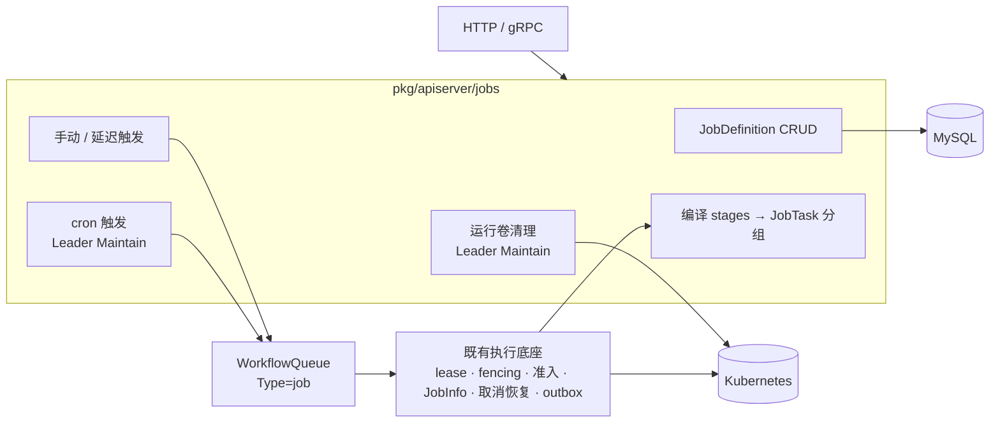
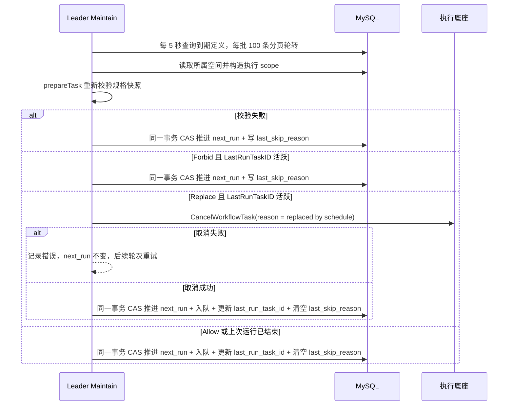
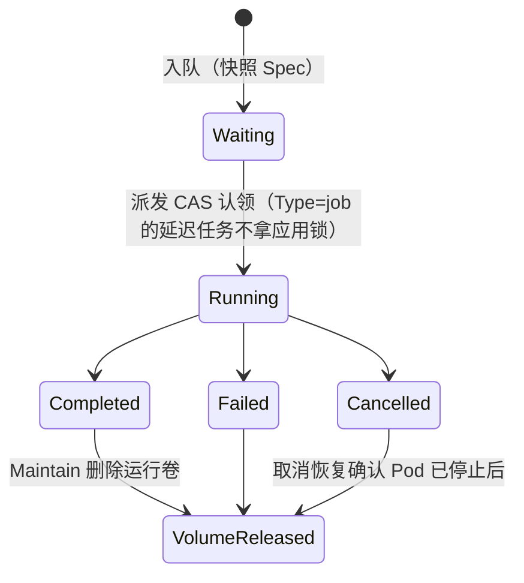

# 自定义 Job 模块设计

> 状态：Implemented Reference。第 1、2、3 阶段（DSL 与编译、定义与手动/延迟触发、cron 与并发策略）均已实现。2026-10-17 已与用户确认方向（方案 A、stages、K8s `backoffLimit`）及 cron 契约。当前可用行为与示例见 [`workspace-jobs-api.md`](workspace-jobs-api.md)。

## 1. 背景与问题

设计前的独立 Job 由 `POST /api/v1/jobs` 写入一条 `WorkflowQueue{Type: job, AppID: ""}`，派发、租约、fencing、JobInfo 和恢复都借用 Workflow 运行时。执行本身不依赖 AppID，但用户需要的四项能力，要么缺失，要么只在 Application 语义下才存在：

| 能力 | 现状 | 卡住的位置 |
| --- | --- | --- |
| 定时执行 | 只有 `WorkflowSchedule{AppID, WorkflowID}` | 触发要拿应用调度锁、经过 `EnsureAppWorkflowIdle`（每个应用同时只有一个活跃任务）和 StatefulSet 清理 fence，这是部署场景的串行语义（`domain/service/workflow/workflow.go` 的 schedule dispatch） |
| 延迟执行 | 独立 Job 不支持 | `ClaimTaskForDispatch` 处理 `ExecuteAt > 0` 时要求 AppID 非空（`workflow_dispatch.go`） |
| 失败重试 | 只有 OOM 重试 | `JobRetryPolicy` 注释写明其他负载失败都直接停止（`workflow/config/job_retry_policy.go`） |
| 多步骤 | 独立 Job 只有一个步骤 | Workflow 步骤按名字引用 Application 组件 |
| 负载定义 | `CommandJobSpec` 只有 image/command/args/timeout | 命令 Job 只处理部分 traits，不创建附属存储 |

在 Application 内用 `type: job` 组件绕过这些限制，又会引入版本、组件状态、应用锁等部署语义，与一次性或周期性的计算任务不匹配。

## 2. 目标与非目标

**目标**

- `pkg/apiserver/jobs` 扩展为自定义 Job 模块，负责 Job 的定义、触发、编译和查询；独立 command Job 与独立评测都迁入该模块。
- 支持可复用的定义、手动/延迟/cron 触发、cron 并发策略、stages 多步骤、每次运行独享的共享工作卷，并复用现有 traits。
- 执行底座继续使用 `WorkflowQueue` 的 lease、generation/token fencing、派发 CAS、全局 Job 准入、取消恢复和结果 outbox，协议不做修改。

**非目标**

- Application 内的 `type: job` 组件仍由应用 Workflow 负责。
- 不支持任意 `dependsOn` DAG、平台级重跑、跨步骤的对象存储产物、补跑错过的触发、cron 时区设置。
- 不新增运行角色，也不另写一套派发或租约机制。

## 3. 架构



职责边界：

- **Job 模块**负责定义的生命周期、触发决策（包括并发策略和幂等）、把规格编译成 JobTask，以及在运行结束后清理运行自己的卷。
- **执行底座**负责运行记录的所有权与恢复，和现在一样。运行记录仍是 `WorkflowQueue`，MySQL 仍是唯一事实源。
- **traits 处理器**被复用：把步骤临时适配成 `ApplicationComponent{Name, Namespace, Traits}`。当前处理器只读取这两个字段，不依赖 AppID。

## 4. 数据模型

第 2 阶段新增一张定义表，第 3 阶段在同表加入调度字段。定义的创建和整体替换复用一次性提交的完整规格校验：

```go
// JobDefinition stores a reusable Job specification. Runs copy Spec and Revision
// into WorkflowQueue so later updates or deletion cannot change queued work.
type JobDefinition struct {
	ID                string `json:"id" gorm:"primaryKey;type:varchar(24);column:id"`
	WorkspaceID       string `json:"workspaceId" gorm:"type:varchar(36);column:workspace_id;not null;uniqueIndex:idx_job_definition_name,priority:1"`
	Name              string `json:"name" gorm:"type:varchar(128);column:name;not null;uniqueIndex:idx_job_definition_name,priority:2"`
	Revision          uint64 `json:"revision" gorm:"column:revision;not null"`
	Spec              string `json:"-" gorm:"type:longtext;column:spec;not null"`
	Creator           string `json:"creator" gorm:"type:varchar(128);column:creator"`
	Cron              string `json:"cron" gorm:"type:varchar(64);column:cron;not null;default:''"`
	ConcurrencyPolicy string `json:"concurrencyPolicy" gorm:"type:varchar(16);column:concurrency_policy;not null;default:''"`
	ScheduleEnabled   bool   `json:"scheduleEnabled" gorm:"column:schedule_enabled;not null;default:false;index:idx_job_definition_next_run,priority:1"`
	NextRun           int64  `json:"nextRun" gorm:"column:next_run;not null;default:0;index:idx_job_definition_next_run,priority:2"`
	LastRunTaskID     string `json:"lastRunTaskId" gorm:"type:varchar(255);column:last_run_task_id;not null;default:''"`
	LastSkipReason    string `json:"lastSkipReason" gorm:"type:varchar(255);column:last_skip_reason;not null;default:''"`
	BaseModel
}
```

`WorkflowQueue` 新增两列：

```go
JobDefinitionID       string `json:"jobDefinitionId,omitempty" gorm:"type:varchar(24);column:job_definition_id;index"`
JobDefinitionRevision uint64 `json:"jobDefinitionRevision,omitempty" gorm:"column:job_definition_revision"`
```

一次性运行的定义 ID 为空、revision 为 0。`JobSpec` 列继续保存本次运行的完整规格快照。定义 ID 与运行 ID 都沿用 12 个随机字节编码为 24 字符十六进制的方式；`(WorkspaceID, Name)` 唯一。定义初始 `Revision=1`，整体替换在行锁事务内加 1；每次触发将读取到的定义 Spec 与 Revision 一起写入新运行，后续修改或删除定义均不改写已有运行，删除也不清空运行中的定义 ID。

模型已注册到 `model.BuiltinModels()`，由既有启动流程执行 schema 迁移。相对第 1 阶段，第 2 阶段的 MySQL 8 增量 DDL 如下，供人工管理 schema 的部署使用；若启动迁移已完成，不重复执行：

```sql
CREATE TABLE eruun_job_definition (
  id varchar(24) NOT NULL,
  workspace_id varchar(36) NOT NULL,
  name varchar(128) NOT NULL,
  revision bigint unsigned NOT NULL,
  spec longtext NOT NULL,
  creator varchar(128) NULL,
  create_time datetime(3) NULL,
  update_time datetime(3) NULL,
  PRIMARY KEY (id),
  UNIQUE KEY idx_job_definition_name (workspace_id, name)
);

ALTER TABLE eruun_workflow_queue
  ADD COLUMN job_definition_id varchar(24) NULL,
  ADD COLUMN job_definition_revision bigint unsigned NULL,
  ADD INDEX idx_eruun_workflow_queue_job_definition_id (job_definition_id);
```

相对第 2 阶段，第 3 阶段的完整增量 DDL 为：

```sql
ALTER TABLE eruun_job_definition
  ADD COLUMN cron varchar(64) NOT NULL DEFAULT '',
  ADD COLUMN concurrency_policy varchar(16) NOT NULL DEFAULT '',
  ADD COLUMN schedule_enabled tinyint(1) NOT NULL DEFAULT 0,
  ADD COLUMN next_run bigint NOT NULL DEFAULT 0,
  ADD COLUMN last_run_task_id varchar(255) NOT NULL DEFAULT '',
  ADD COLUMN last_skip_reason varchar(255) NOT NULL DEFAULT '',
  ADD INDEX idx_job_definition_next_run (schedule_enabled, next_run);
```

不建立指向定义表的外键或级联删除关系，历史运行在定义删除后仍保留归属信息。本地验证使用 SQLite；上述 DDL、MySQL 行锁与并发唯一约束仍需部署方在隔离 MySQL 环境验收。

`Cron` 使用 WorkflowSchedule 的同一个五段解析器，由导出的 `workflow.NextScheduleRun` 计算 UTC 下一次触发时间。提供 schedule 时，`ConcurrencyPolicy` 默认为 `Forbid`，只允许 `Forbid`、`Allow`、`Replace`；没有 schedule 时，除 LastRunTaskID 外的调度字段均为空值或零值（LastRunTaskID 保留最近一次定时运行，供重新启用后的并发判断使用）。`ScheduleEnabled=true` 必须有合法的非空 Cron，禁用但填写了 Cron 也必须通过解析校验。`ScheduleEnabled` 与 `NextRun` 组成 `idx_job_definition_next_run` 复合索引。`LastRunTaskID` 只记录最近一次定时触发，`LastSkipReason` 保存本次跳过原因并截断到 255 字节。

## 5. DSL

一次性运行和定义共用 `spec.JobSpec`。Eruun 尚未发布，请求体直接改为 stages，不保留旧的单 `spec` 写法：

```json
{
  "name": "nightly-etl",
  "volume": {"size": "20Gi", "storageClass": "<storage-class>", "accessMode": "ReadWriteOnce"},
  "stages": [
    {"name": "fetch", "steps": [
      {"name": "download", "type": "command",
       "spec": {"image": "busybox:1.37.0", "command": ["sh", "-c"], "args": ["wget -O /workspace/raw <url>"], "timeoutSeconds": 600},
       "traits": {"resources": {"cpu": "500m", "memory": "512Mi"}},
       "retry": {"backoffLimit": 2}}
    ]},
    {"name": "score", "steps": [
      {"name": "benchmark", "type": "job",
       "traits": {"eval": {"env": "ack", "agent": "oracle", "taskPackageId": "<id>"}}}
    ]}
  ]
}
```

```go
type JobSpec struct {
	Name   string     `json:"name"`
	Volume *JobVolume `json:"volume,omitempty"`
	Stages []JobStage `json:"stages"`
}

type JobVolume struct {
	Size         string `json:"size"`
	StorageClass string `json:"storageClass,omitempty"`
	AccessMode   string `json:"accessMode,omitempty"` // ReadWriteOnce (default) | ReadWriteMany
}

type JobStage struct {
	Name  string    `json:"name"`
	Steps []JobStep `json:"steps"`
}

type JobStep struct {
	Name   string          `json:"name"`
	Type   string          `json:"type"` // command | job (with traits.eval)
	Spec   json.RawMessage `json:"spec,omitempty"`
	Traits spec.Traits     `json:"traits,omitempty"`
	Retry  *JobStepRetry   `json:"retry,omitempty"`
}

type JobStepRetry struct {
	BackoffLimit int32 `json:"backoffLimit"` // command only: 0..10, written to batchv1.JobSpec.BackoffLimit
}
```

校验规则（提交时一次性完成，fail-fast）：

- stage 名、step 名均不能为空，各自在本 Job 内唯一；至少一个 stage，每个 stage 至少一个 step。每个 step 生成的 `eruun-job-<taskID>-<step>` 必须复用现有 Kubernetes 命名和长度校验；当前 taskID 长度下 step 名上限为 28 字节。
- command step 拒绝 `ingress`、`service`、`rollout`、`share`；顶层以及 init/sidecar 嵌套 traits 都检查 AdditionalObjects。`persistent` 存储只能引用已有 PVC，不允许 `tmpCreate`、`size` 或 `storageClass`；`ApplyTraits` 为此产生的 PVC 对象不编译为 JobTask，Eruun 不创建该 PVC，Pod 只引用已有 claim。
- 除上述已有 PVC 引用外，任何 AdditionalObjects（包括新建 PVC、RBAC 的 ServiceAccount/Role/Binding、Ingress 等）均在提交时拒绝，错误中指出具体 trait。共享存储由顶层 `volume` 承担。
- `type: job` step 沿用 `NormalizeEvaluationTraits` 的现有限制，不接受 command `spec`，不挂载运行 volume。不接受 step 的 `retry`（包括 `backoffLimit: 0`）；Runner Job 的 `BackoffLimit` 固定为 0，评测恢复由 `traits.eval.recovery` 控制。同一 task 支持多个评测执行，结果操作必须显式选择 `executionKey`；复用现有 Runner 授权与恢复协议。
- 一个 stage 内有多个步骤并声明了 `volume` 时，`accessMode` 必须是 `ReadWriteMany`。声明 volume 后，`workspace` 卷名和 `/workspace` 路径保留给运行卷，顶层和 init/sidecar traits 的 storage 均不能占用。
- volume 的 `storageClass` 继续受既有 `workspace.storageClasses` 白名单约束；省略时仅在管理员允许默认存储类的情况下可用。该权限校验沿用资源准备流程，不新增存储授权入口。
- command step 的 `retry.backoffLimit` 范围为 0–10，默认 0，写入 Kubernetes Job 的 `BackoffLimit`。现有 `jobRetryPolicy` 属于 Application properties，并非共享 Traits 字段；独立 command 的执行器 OOM 策略保持 `stop`，本阶段不新增 OOM 重试配置。
- 所有写入 Kubernetes label 的值都按 [`kubernetes-label-normalization.md`](kubernetes-label-normalization.md) 归一化。

## 6. API

以下接口已实现。定义创建和更新直接接收内联 `JobSpec`（`name`、可选 `volume`、`stages`），外加可选的 `schedule` 对象，不接收 revision 请求参数或局部更新。schedule 属于定义，不写入 JobSpec；一次性 `POST /jobs` 和定义 `/runs` 请求均严格拒绝 schedule。

```json
{
  "name": "nightly-report",
  "stages": [{"name": "main", "steps": [{
    "name": "report", "type": "command",
    "spec": {"image": "busybox:1.37.0", "command": ["sh", "-c"], "args": ["echo report"], "timeoutSeconds": 300}
  }]}],
  "schedule": {"cron": "0 2 * * *", "concurrencyPolicy": "Forbid", "enabled": true}
}
```

| 方法与路由 | 权限 | 作用 |
| --- | --- | --- |
| `POST /api/v1/job-definitions` | member | 创建定义，返回 201 和详情，初始 revision 为 1 |
| `GET /api/v1/job-definitions`、`GET /api/v1/job-definitions/:definitionID` | viewer | 列表与详情：id、name、revision、spec、creator、createTime、updateTime，以及已配置时的 schedule |
| `PUT /api/v1/job-definitions/:definitionID` | member | 整体替换规格与 schedule，省略 schedule 清空调度；事务内 revision 加 1，已入队运行不受影响 |
| `DELETE /api/v1/job-definitions/:definitionID` | member | 只删除定义并停止后续定时触发，返回 200；已有运行保留并可继续查询 |
| `POST /api/v1/job-definitions/:definitionID/runs` | member | 手动或延迟触发，接收可省略的 executeAt，返回与 POST /jobs 相同的 202 Accepted |
| `POST /api/v1/jobs` | member | 一次性运行（内联 JobSpec），可带 executeAt |
| `GET /api/v1/jobs?definitionId=<id>` | viewer | 列出当前空间的独立运行，可选 definitionId 过滤，删除定义后仍可按原 ID 查询 |

两种列表均使用 `page` / `pageSize`，默认 1 / 20，page 范围 1–10000000，pageSize 为 1–100；响应 `data` 包含 `items`、`total`、`page`、`pageSize`，按创建时间倒序。所有查询限定当前授权空间；viewer 只能读，写入和触发需要 member。

定义详情的 `schedule` 包含 `cron`、`concurrencyPolicy`、`enabled`、`nextRun`、`lastRunTaskId`、`lastSkipReason`；没有 schedule 时省略整个字段。创建启用调度时，从当前时刻计算 NextRun。整体替换时只有 cron 或 enabled 变化才重算，禁用置 0；只改规格或 concurrencyPolicy 保留 NextRun，避免跳过已经到期但尚未处理的触发。保留 schedule 的更新也保留 lastRunTaskId 和 lastSkipReason；省略 schedule 时清空 Cron、ConcurrencyPolicy、ScheduleEnabled、NextRun 和 LastSkipReason，但保留 LastRunTaskID，以便之后重新启用时 Forbid/Replace 仍能识别仍在运行的上一次触发。enabled 默认为 false，暂停和恢复通过整体替换该值完成。

`executeAt` 使用 Unix 秒，两个提交入口共同调用 `workflow.NormalizeExecuteAt`：负数拒绝，省略、0 或过去时间归一化为 0，未来时间保留。入队状态均为 Waiting；调度查询以数据库时钟选择已到期运行。定义与一次性运行共用 Normalize、BuildTask、每步 PrepareTask / 评测校验及入队事务，不创建占位应用。定义同名冲突使用 HTTP 409、业务码 34005。

`/jobs/:taskID` 下现有的详情、取消、结果、交付和保留期接口保持不变。gRPC 按 [`grpc-api.md`](grpc-api.md) 的对照表同步增加对应 RPC。

## 7. 主要流程

### 7.1 cron 触发（已实现）



- `jobs.Service.Maintain` 的 cron 循环与现有循环同样受 Leader 任期 context 控制，间隔为 5 秒。查询 `schedule_enabled AND next_run <= now`，每批 100 条；满批后推进页码，空批或不足一批时回到第一页，与 `DispatchWorkflowSchedules` 一样跨轮轮转，避免失败定义长期占住首批。禁用、未填写 cron 或已删除的定义不触发。
- 每条定义先读取所属空间并构造已授权的执行 scope，再用第 2 阶段的 `prepareTask` 重新校验快照及资源策略。校验失败时在一个事务中 CAS 推进 `next_run` 并写入截断到 255 字节的 `last_skip_reason`，本次不入队。Forbid 的跳过采用相同事务边界。
- 并发策略只检查 `LastRunTaskID` 对应运行的 `model.IsWorkflowActiveStatus`；手动、延迟运行及更早的定时运行不参与本次判断。Forbid 在该运行活跃时跳过，Allow 仍入队。Replace 通过注入的现有 `service.WorkflowService` 调用 `CancelWorkflowTask`，reason 固定为 `replaced by schedule`；取消成功后才开始入队事务。取消失败不推进 `next_run`，记录错误后在后续轮次重试。先取消、后入队确保不会因在这两个步骤之间崩溃而遗留未经取消的旧运行和新运行。
- CAS 条件包含 `next_run = 被认领的旧值`，未命中即跳过；推进 `next_run`、共用 `enqueue` 入队、更新 `last_run_task_id` 和清空 `last_skip_reason` 在同一事务内完成。`enqueue` 接收事务句柄，Submit、Run 和 cron 共用它。新运行写入定义 ID、Revision、规格快照和定义 Creator；幂等键为 `jobdef:<definitionID>:<被认领的 nextRun>`，插入时幂等键冲突视为本次已处理，不重复入队。
- 错过的触发不补跑，下一次时间从处理时的当前时刻计算，与现有 WorkflowSchedule 一致。单条失败记录具体错误并继续处理下一条，Leader 任期取消时停止。

### 7.2 运行与卷的生命周期



- 声明了 `volume` 时，编译阶段把 PVC 放进第一个 stage 的最高优先级 JobTask，名称为 `eruun-job-<taskID>-work`，并打上 `eruun.io/job-task=<归一化后的 taskID>` 标签；所有 command step 都挂载到 `/workspace`，eval step 不挂载。
- SQL 回滚无法撤销 Kubernetes 副作用，所以卷的删除不放在运行流程里。`Maintain` 以集群中带 `eruun.io/job-task` 标签的存活 PVC 为待办，跨 namespace 按每页 100 个的 `Limit/Continue` 列表分页，不再扫描历史运行。由 label 值读取 `WorkflowQueue`，不存在时记 V(2) 日志并保留 PVC；只有 `Type == job`、`AppID` 为空、JobSpec 声明了 volume、PVC 名称等于该运行卷名且 namespace 等于所属空间 namespace 时才允许清理，其余身份或声明不匹配记录错误并跳过。运行进入终态后幂等删除，取消运行仍等待既有取消恢复确认 Job 已停止；删除附带 UID 和 ResourceVersion 前置条件，失败则下一轮重试，清理规模只随存活卷数量增长。
- stage 内任一步骤失败后，后续 stage 不再执行，沿用 `cleanup_failed` 失败策略。

## 8. 运行时改动

| 位置 | 改动 |
| --- | --- |
| `jobs.BuildTask` | 把 stages 编译成按 stage 分组的 JobTask；步骤通过临时 `ApplicationComponent` 复用 `traits.ApplyTraits`；仅 command 写入可配置的 `BackoffLimit` |
| `event/workflow.GenerateJobTasks` | 每个 stage 生成一个 `StepExecution`（多个步骤用 `DAG`，单个用 `StepByStep`） |
| `ClaimTaskForDispatch` | `Type == job` 的延迟任务直接 CAS 认领，不拿应用锁，不检查 fence |
| `jobs.Service.Maintain` | 运行卷清理，以及每 5 秒执行的 cron 触发、并发策略和分页轮转 |
| `jobs.Service.Submit` | 一次性运行、手动/延迟定义触发和 cron 共用可接收事务句柄的入队路径 |

lease、generation/token、reaper、全局准入和取消恢复都不改。

## 9. 实施阶段

每个阶段一个 PR，按顺序合并：

1. **DSL 与编译（已实现）**：`JobSpec` 改为 stages，加入 volume、traits 复用和 `backoffLimit`；一次性 `/jobs` 切到新请求体；增加运行卷清理；同步 `workspace-jobs-api.md` 和示例。
2. **定义与手动/延迟触发（已实现）**：新增 `JobDefinition` 表与 CRUD、`/runs` 手动和延迟触发、一次性提交的 executeAt、独立运行列表、`WorkflowQueue` 的定义 ID / Revision 两列，以及 `ClaimTaskForDispatch` 对 Job 的放行；HTTP / gRPC 同步提供这些能力。
3. **cron（已实现）**：定义 schedule 的 HTTP / gRPC 请求与响应、UTC 五段 cron 校验与 NextRun 更新规则、`Maintain` 的定时触发、三种并发策略、CAS 与幂等入队、`last_run_task_id` 和 `last_skip_reason`。

## 10. 风险与验证

- `/jobs` 请求体是破坏性变更，升级前需要排空旧格式的 Waiting/Queued 运行，并完成或取消旧运行、确认 Kubernetes Job 已停止；本阶段不迁移旧持久化快照。
- 同一 stage 内的并行步骤配 RWO 卷会在提交时被拒绝；RWX 的可用性由存储类决定，需要在目标集群验证。
- Replace 等待现有取消调用成功后入队；旧 Pod 的停止和资源收尾继续由既有取消恢复完成，取消调用返回不等于 Pod 已全部停止。新旧运行使用各自的卷。
- 本地和 fake 测试不能证明真实 MySQL 隔离、PVC 挂载与回收、cron 在 Leader 切换时只触发一次；这些需要在真实集群上验收。
