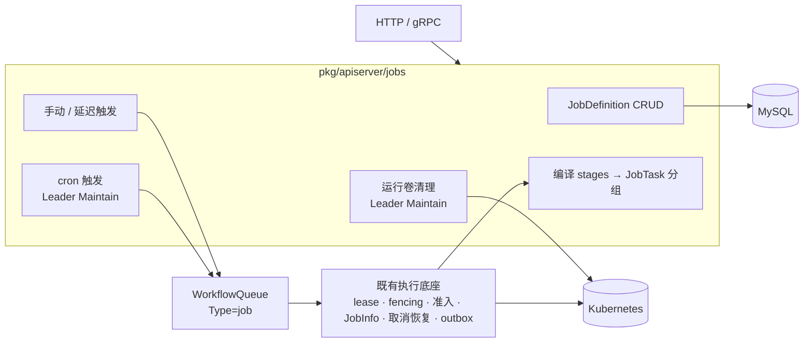
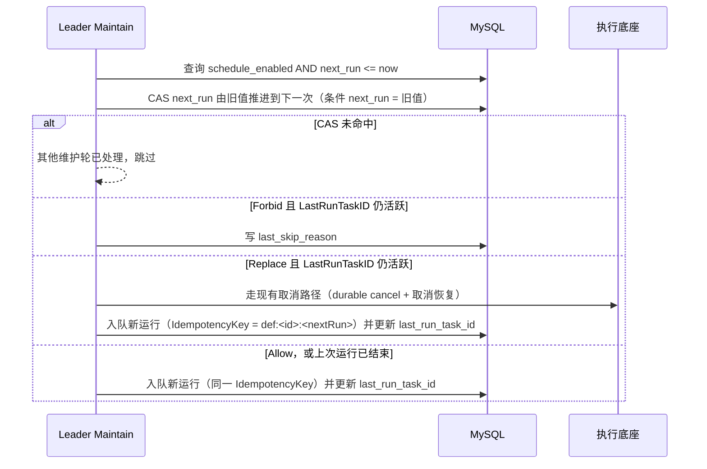
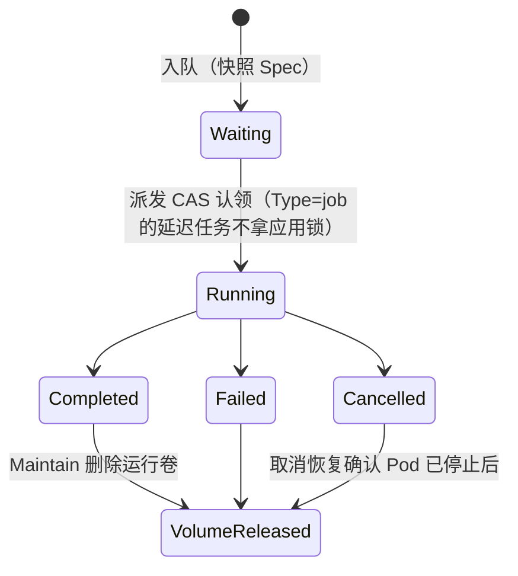

# 自定义 Job 模块设计

> 状态：第 1 阶段（DSL 与编译）为 Implemented Reference；第 2、3 阶段（定义、延迟与 cron 触发）仍为 Draft / Proposal。2026-10-17 已与用户确认方向（方案 A、stages、K8s `backoffLimit`）。当前可用行为以 [`workspace-jobs-api.md`](workspace-jobs-api.md) 为准；本文第 4、6 节涉及定义与触发的表、字段、路由尚未实现。

## 1. 背景与问题

设计前的独立 Job 由 `POST /api/v1/jobs` 写入一条 `WorkflowQueue{Type: job, AppID: ""}`，派发、租约、fencing、JobInfo 和恢复都借用 Workflow 运行时。执行本身不依赖 AppID，但用户需要的四项能力，要么缺失，要么只在 Application 语义下才存在：

| 能力 | 现状 | 卡住的位置 |
| --- | --- | --- |
| 定时执行 | 只有 `WorkflowSchedule{AppID, WorkflowID}` | 触发要拿应用调度锁、经过 `EnsureAppWorkflowIdle`（每个应用同时只有一个活跃任务）和 StatefulSet 清理 fence，这是部署场景的串行语义（`domain/service/workflow/workflow.go` 的 schedule dispatch） |
| 延迟执行 | 独立 Job 不支持 | `ClaimTaskForDispatch` 处理 `ExecuteAt > 0` 时要求 AppID 非空（`workflow_dispatch.go`） |
| 失败重试 | 只有 OOM 重试 | `JobRetryPolicy` 注释写明其他负载失败都直接停止（`workflow/config/job_retry_policy.go`） |
| 多步骤 | 独立 Job 只有一个步骤 | Workflow 步骤按名字引用 Application 组件 |
| 负载定义 | `CommandJobSpec` 只有 image/command/args/timeout | 命令 Job 只处理部分 traits，不创建附属存储 |

在 Application 内用 `type: job` 组件绕过这些限制，又会引入版本、组件状态、应用锁等部署语义，与一次性或周期性的计算任务不匹配。

## 2. 目标与非目标

**目标**

- `pkg/apiserver/jobs` 扩展为自定义 Job 模块，负责 Job 的定义、触发、编译和查询；独立 command Job 与独立评测都迁入该模块。
- 支持可复用的定义、手动/延迟/cron 触发、cron 并发策略、stages 多步骤、每次运行独享的共享工作卷，并复用现有 traits。
- 执行底座继续使用 `WorkflowQueue` 的 lease、generation/token fencing、派发 CAS、全局 Job 准入、取消恢复和结果 outbox，协议不做修改。

**非目标**

- Application 内的 `type: job` 组件仍由应用 Workflow 负责。
- 不支持任意 `dependsOn` DAG、平台级重跑、跨步骤的对象存储产物、补跑错过的触发、cron 时区设置。
- 不新增运行角色，也不另写一套派发或租约机制。

## 3. 架构



职责边界：

- **Job 模块**负责定义的生命周期、触发决策（包括并发策略和幂等）、把规格编译成 JobTask，以及在运行结束后清理运行自己的卷。
- **执行底座**负责运行记录的所有权与恢复，和现在一样。运行记录仍是 `WorkflowQueue`，MySQL 仍是唯一事实源。
- **traits 处理器**被复用：把步骤临时适配成 `ApplicationComponent{Name, Namespace, Traits}`。当前处理器只读取这两个字段，不依赖 AppID。

## 4. 数据模型

新增一张表：

```go
// JobDefinition is a reusable Job specification. Every trigger snapshots Spec
// into the run so later edits never change a queued or running execution.
type JobDefinition struct {
	ID                string `json:"id" gorm:"primaryKey;type:varchar(24)"`
	WorkspaceID       string `json:"workspaceId" gorm:"type:varchar(36);not null;uniqueIndex:idx_job_definition_name,priority:1"`
	Name              string `json:"name" gorm:"type:varchar(128);not null;uniqueIndex:idx_job_definition_name,priority:2"`
	Revision          uint64 `json:"revision" gorm:"not null"`
	Spec              string `json:"-" gorm:"type:longtext;not null"`
	Cron              string `json:"cron,omitempty" gorm:"type:varchar(64)"`
	ConcurrencyPolicy string `json:"concurrencyPolicy,omitempty" gorm:"type:varchar(16)"`
	ScheduleEnabled   bool   `json:"scheduleEnabled" gorm:"index:idx_job_definition_next_run,priority:1"`
	NextRun           int64  `json:"nextRun,omitempty" gorm:"index:idx_job_definition_next_run,priority:2"`
	LastRunTaskID     string `json:"lastRunTaskId,omitempty" gorm:"type:varchar(255)"`
	LastSkipReason    string `json:"lastSkipReason,omitempty" gorm:"type:varchar(255)"`
	Creator           string `json:"creator" gorm:"type:varchar(128)"`
	BaseModel
}
```

`WorkflowQueue` 新增两列：

```go
JobDefinitionID       string `json:"jobDefinitionId,omitempty" gorm:"type:varchar(24);column:job_definition_id;index"`
JobDefinitionRevision uint64 `json:"jobDefinitionRevision,omitempty" gorm:"column:job_definition_revision"`
```

一次性运行的这两列为空。`JobSpec` 列继续保存本次运行的完整规格快照。

`ConcurrencyPolicy` 取值为 `Forbid`（默认）、`Allow`、`Replace`。cron 按 UTC 计算，与 `WorkflowSchedule` 一致；`Cron` 为空时 `ScheduleEnabled` 必须为 false。

## 5. DSL

一次性运行和定义共用 `spec.JobSpec`。Eruun 尚未发布，请求体直接改为 stages，不保留旧的单 `spec` 写法：

```json
{
  "name": "nightly-etl",
  "volume": {"size": "20Gi", "storageClass": "<storage-class>", "accessMode": "ReadWriteOnce"},
  "stages": [
    {"name": "fetch", "steps": [
      {"name": "download", "type": "command",
       "spec": {"image": "busybox:1.37.0", "command": ["sh", "-c"], "args": ["wget -O /workspace/raw <url>"], "timeoutSeconds": 600},
       "traits": {"resources": {"cpu": "500m", "memory": "512Mi"}},
       "retry": {"backoffLimit": 2}}
    ]},
    {"name": "score", "steps": [
      {"name": "benchmark", "type": "job",
       "traits": {"eval": {"env": "ack", "agent": "oracle", "taskPackageId": "<id>"}}}
    ]}
  ]
}
```

```go
type JobSpec struct {
	Name   string     `json:"name"`
	Volume *JobVolume `json:"volume,omitempty"`
	Stages []JobStage `json:"stages"`
}

type JobVolume struct {
	Size         string `json:"size"`
	StorageClass string `json:"storageClass,omitempty"`
	AccessMode   string `json:"accessMode,omitempty"` // ReadWriteOnce (default) | ReadWriteMany
}

type JobStage struct {
	Name  string    `json:"name"`
	Steps []JobStep `json:"steps"`
}

type JobStep struct {
	Name   string          `json:"name"`
	Type   string          `json:"type"` // command | job (with traits.eval)
	Spec   json.RawMessage `json:"spec,omitempty"`
	Traits spec.Traits     `json:"traits,omitempty"`
	Retry  *JobStepRetry   `json:"retry,omitempty"`
}

type JobStepRetry struct {
	BackoffLimit int32 `json:"backoffLimit"` // command only: 0..10, written to batchv1.JobSpec.BackoffLimit
}
```

校验规则（提交时一次性完成，fail-fast）：

- stage 名、step 名均不能为空，各自在本 Job 内唯一；至少一个 stage，每个 stage 至少一个 step。每个 step 生成的 `eruun-job-<taskID>-<step>` 必须复用现有 Kubernetes 命名和长度校验；当前 taskID 长度下 step 名上限为 28 字节。
- command step 拒绝 `ingress`、`service`、`rollout`、`share`；顶层以及 init/sidecar 嵌套 traits 都检查 AdditionalObjects。`persistent` 存储只能引用已有 PVC，不允许 `tmpCreate`、`size` 或 `storageClass`；`ApplyTraits` 为此产生的 PVC 对象不编译为 JobTask，Eruun 不创建该 PVC，Pod 只引用已有 claim。
- 除上述已有 PVC 引用外，任何 AdditionalObjects（包括新建 PVC、RBAC 的 ServiceAccount/Role/Binding、Ingress 等）均在提交时拒绝，错误中指出具体 trait。共享存储由顶层 `volume` 承担。
- `type: job` step 沿用 `NormalizeEvaluationTraits` 的现有限制，不接受 command `spec`，不挂载运行 volume。不接受 step 的 `retry`（包括 `backoffLimit: 0`）；Runner Job 的 `BackoffLimit` 固定为 0，评测恢复由 `traits.eval.recovery` 控制。同一 task 支持多个评测执行，结果操作必须显式选择 `executionKey`；复用现有 Runner 授权与恢复协议。
- 一个 stage 内有多个步骤并声明了 `volume` 时，`accessMode` 必须是 `ReadWriteMany`。声明 volume 后，`workspace` 卷名和 `/workspace` 路径保留给运行卷，顶层和 init/sidecar traits 的 storage 均不能占用。
- volume 的 `storageClass` 继续受既有 `workspace.storageClasses` 白名单约束；省略时仅在管理员允许默认存储类的情况下可用。该权限校验沿用资源准备流程，不新增存储授权入口。
- command step 的 `retry.backoffLimit` 范围为 0–10，默认 0，写入 Kubernetes Job 的 `BackoffLimit`。现有 `jobRetryPolicy` 属于 Application properties，并非共享 Traits 字段；独立 command 的执行器 OOM 策略保持 `stop`，本阶段不新增 OOM 重试配置。
- 所有写入 Kubernetes label 的值都按 [`kubernetes-label-normalization.md`](kubernetes-label-normalization.md) 归一化。

## 6. API

以下定义 CRUD、`executeAt`、按定义列出运行均属于第 2、3 阶段 Proposal；第 1 阶段只更新既有 `POST /api/v1/jobs` 的 stages 请求体，不新增路由或触发方式。

| 方法与路由 | 权限 | 作用 |
| --- | --- | --- |
| `POST /api/v1/job-definitions` | member | 创建定义，可同时设置 `cron`、`concurrencyPolicy`、`scheduleEnabled` |
| `GET /api/v1/job-definitions`、`GET /job-definitions/:id` | viewer | 列表与详情（含 `revision`、`nextRun`、`lastRunTaskId`、`lastSkipReason`） |
| `PUT /api/v1/job-definitions/:id` | member | 整体替换规格与触发设置，`revision` 加 1，已入队的运行不受影响 |
| `DELETE /api/v1/job-definitions/:id` | member | 删除定义并停止 cron；已有运行保留并可继续查询 |
| `POST /api/v1/job-definitions/:id/runs` | member | 手动或延迟触发，请求体 `{"executeAt": 0}`，返回 `taskId` |
| `POST /api/v1/jobs` | member | 一次性运行（内联 `JobSpec`），可带 `executeAt` |
| `GET /api/v1/jobs?definitionId=<id>` | viewer | 按定义列出运行 |

`/jobs/:taskID` 下现有的详情、取消、结果、交付和保留期接口保持不变。gRPC 按 [`grpc-api.md`](grpc-api.md) 的对照表同步增加对应 RPC。

## 7. 主要流程

### 7.1 cron 触发



- 推进 `next_run` 和入队新运行在同一事务中完成。`IdempotencyKey` 唯一索引保证同一次触发只入队一次。
- 错过的触发不补跑，下一次时间从当前时刻计算，与现有 `WorkflowSchedule` 一致。
- 只统计 `LastRunTaskID`，手动触发的运行不参与并发判断，与 K8s CronJob 一致。

### 7.2 运行与卷的生命周期



- 声明了 `volume` 时，编译阶段把 PVC 放进第一个 stage 的最高优先级 JobTask，名称为 `eruun-job-<taskID>-work`，并打上 `eruun.io/job-task=<归一化后的 taskID>` 标签；所有 command step 都挂载到 `/workspace`，eval step 不挂载。
- SQL 回滚无法撤销 Kubernetes 副作用，所以卷的删除不放在运行流程里。`Maintain` 以集群中带 `eruun.io/job-task` 标签的存活 PVC 为待办，跨 namespace 按每页 100 个的 `Limit/Continue` 列表分页，不再扫描历史运行。由 label 值读取 `WorkflowQueue`，不存在时记 V(2) 日志并保留 PVC；只有 `Type == job`、`AppID` 为空、JobSpec 声明了 volume、PVC 名称等于该运行卷名且 namespace 等于所属空间 namespace 时才允许清理，其余身份或声明不匹配记录错误并跳过。运行进入终态后幂等删除，取消运行仍等待既有取消恢复确认 Job 已停止；删除附带 UID 和 ResourceVersion 前置条件，失败则下一轮重试，清理规模只随存活卷数量增长。
- stage 内任一步骤失败后，后续 stage 不再执行，沿用 `cleanup_failed` 失败策略。

## 8. 运行时改动

| 位置 | 改动 |
| --- | --- |
| `jobs.BuildTask` | 把 stages 编译成按 stage 分组的 JobTask；步骤通过临时 `ApplicationComponent` 复用 `traits.ApplyTraits`；仅 command 写入可配置的 `BackoffLimit` |
| `event/workflow.GenerateJobTasks` | 每个 stage 生成一个 `StepExecution`（多个步骤用 `DAG`，单个用 `StepByStep`） |
| `ClaimTaskForDispatch` | `Type == job` 的延迟任务直接 CAS 认领，不拿应用锁，不检查 fence |
| `jobs.Service.Maintain` | 增加 cron 触发与运行卷清理 |
| `jobs.Service.Submit` | 一次性运行和定义触发共用同一条入队路径 |

lease、generation/token、reaper、全局准入和取消恢复都不改。

## 9. 实施阶段

每个阶段一个 PR，按顺序合并：

1. **DSL 与编译（已实现）**：`JobSpec` 改为 stages，加入 volume、traits 复用和 `backoffLimit`；一次性 `/jobs` 切到新请求体；增加运行卷清理；同步 `workspace-jobs-api.md` 和示例。
2. **定义与触发（Proposal）**：新增 `JobDefinition` 表与 CRUD、`/runs` 手动和延迟触发、`WorkflowQueue` 的两个新列，以及 `ClaimTaskForDispatch` 对 Job 的放行。
3. **cron（Proposal）**：`Maintain` 里的 cron 触发、三种并发策略、幂等键和 `last_skip_reason`。

## 10. 风险与验证

- `/jobs` 请求体是破坏性变更，升级前需要排空旧格式的 Waiting/Queued 运行，并完成或取消旧运行、确认 Kubernetes Job 已停止；本阶段不迁移旧持久化快照。
- 同一 stage 内的并行步骤配 RWO 卷会在提交时被拒绝；RWX 的可用性由存储类决定，需要在目标集群验证。
- Replace 策略依赖取消恢复确认旧 Pod 停止，新旧运行使用各自的卷，彼此不冲突。
- 本地和 fake 测试不能证明真实 MySQL 隔离、PVC 挂载与回收、cron 在 Leader 切换时只触发一次；这些需要在真实集群上验收。
