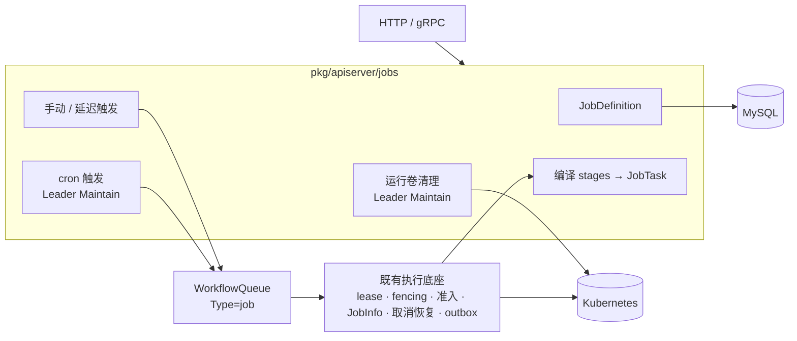

# 自定义 Job 模块设计

> 状态：Implemented Reference。本文只记录设计取舍和原因；字段、请求示例与运行规则以 [`workspace-jobs-api.md`](workspace-jobs-api.md) 为准，gRPC 消息见 [`grpc-api.md`](grpc-api.md)。2026-10-17 与用户确认方向，由 #151–#154 实现。

## 1. 背景

原来的独立 Job 是 `POST /api/v1/jobs` 写入的一条 `WorkflowQueue{Type: job, AppID: ""}`。执行本身不依赖 AppID，但用户需要的能力要么缺失，要么只存在于 Application 语义中：

| 能力 | 原来卡住的位置 |
| --- | --- |
| 定时执行 | `WorkflowSchedule{AppID, WorkflowID}` 触发时要拿应用调度锁、经过 `EnsureAppWorkflowIdle`（每个应用只允许一个活跃任务）和 StatefulSet 清理 fence，这些都是部署场景的串行语义 |
| 延迟执行 | `ClaimTaskForDispatch` 处理 `ExecuteAt > 0` 时要求 AppID 非空 |
| 失败重试 | `JobRetryPolicy` 只处理 OOM |
| 多步骤与丰富负载 | Workflow 步骤按名字引用 Application 组件；`CommandJobSpec` 只有 image/command/args/timeout |

用 Application 的 `type: job` 组件绕过这些限制，又会引入版本、组件状态、应用锁等不属于计算任务的语义。

## 2. 架构

Job 模块负责定义、触发决策和编译；运行记录仍是 `WorkflowQueue`，所有权与恢复仍由既有执行底座负责，MySQL 仍是唯一事实源。

## 3. 关键决策

| 决策 | 选择 | 原因与放弃的方案 |
| --- | --- | --- |
| 执行底座 | 运行记录继续使用 `WorkflowQueue{Type: job}`，新增 `JobDefinition` 保存可复用规格 | 方案 B（独立 JobRun 表加通用执行所有权层）领域边界更干净，但要重写 lease、reaper、取消恢复和结果 outbox 这些最关键的正确性协议，并维护两份；收益不足以抵消风险 |
| 定义与运行 | 两层：触发时把 Spec 与 Revision 快照写入运行 | 修改或删除定义不能改变已入队或运行中的工作 |
| 多步骤 | `stages`：stage 之间串行，stage 内并行 | 直接对应现有 `StepExecution`（StepByStep / DAG 模式），不改执行器；任意 `dependsOn` DAG 需要拓扑调度和对应的恢复逻辑，暂不需要 |
| 步骤间数据 | 每次运行一个共享 PVC，挂载到 command step 的 `/workspace` | 比对象存储产物传递简单得多；PVC 由 Leader 以存活的带标签 PVC 为待办清单清理，开销只与存活卷数量相关，不随历史增长 |
| 负载定义 | 复用 Application traits，拒绝会产生附属对象的 trait | traits 处理器只读组件的 Name 和 Namespace，可直接复用；附属对象（新建 PVC、Ingress 等）没有 Job 侧的生命周期，共享存储改由 `volume` 承担 |
| 失败重试 | 只提供 K8s `backoffLimit`；评测 step 拒绝 `retry` | 平台级重跑需要新的 attempt 协议；评测 Runner 的 Pod 重启会绕过 `recovery.replaySafe` 门禁重放 trial |
| cron 存放位置 | `schedule` 内嵌在定义上，不单独建资源 | 一个定义只需要一个调度；`schedule` 只出现在定义请求中，一次性 `/jobs` 与 `/runs` 拒绝它 |
| 并发策略 | Forbid（默认）/ Allow / Replace，只判断 `lastRunTaskId` | 与 K8s CronJob 的语义一致；手动触发的运行不参与判断 |
| Replace 顺序 | 先取消上一次运行，再在同一事务中推进 next_run 并入队 | 反过来做，崩溃时会留下新旧两个运行；先取消时，崩溃后下一轮看到旧运行已结束，靠幂等键正常入队 |
| NextRun 重算 | 只在 cron 或 enabled 变化时重算 | 只改规格时重算，会跳过已经到期但尚未处理的触发 |
| 省略 schedule | 清空调度，但保留 `lastRunTaskId` | 之后重新启用时，Forbid / Replace 仍要能识别仍在运行的上一次触发 |
| 授权 | 只依据快照解码后的 step 类型与 volume 声明，不重跑 DSL 校验 | 否则收紧任何校验规则都会让已入队和历史运行被判为 Forbidden，列表还会静默过滤它们 |
| cron 格式 | 与 WorkflowSchedule 相同：5 段，或秒位为 0 的 6 段，按 UTC 计算 | 同一个仓库里的调度表达式只有一套规则 |

## 4. 非目标

Application 内的 `type: job` 组件仍由应用 Workflow 负责。不支持任意 DAG、平台级重跑、跨步骤对象存储产物、补跑错过的触发、cron 时区，也不新增运行角色或另一套派发、租约机制。

## 5. 验证边界

本地测试使用 SQLite 与 Kubernetes fake，不能证明真实 MySQL 的锁与唯一约束、Leader 切换时 cron 只触发一次、Replace 取消后旧 Pod 确实停止，以及 PVC 的实际挂载、回收和 RWX 存储类能力，这些需要在目标集群验收。
