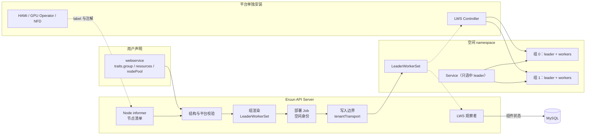
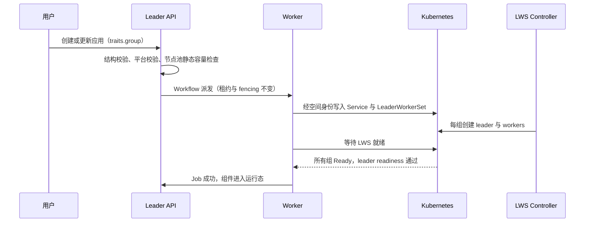

# 多节点模型服务：副本组设计

> 状态：Draft / Proposal。本文描述 Eruun 承载单副本跨多台 GPU 节点的模型服务（例如 Kimi K3 这类超大 MoE 模型）所需的能力，是 [自托管模型服务与 GPU 方向](vllm-hami-distributed-inference-design.md) 中 Profile B 的具体设计。M1–M10 已确认，M11 待确认。文中字段、环境变量、Helm values 和外部项目的标签名都尚未实现，不构成当前契约。
>
> 基线：`origin/main` `0d85462`（2026-11-06）。Eruun 尚未发布，契约变化直接修改，不保留兼容层。

## 1. 决策记录

| 编号 | 决策 | 状态 |
| --- | --- | --- |
| M1 | 公共形态为 `webservice` 组件加 `traits.group`：声明了 group 的组件渲染为副本组，未声明时仍是 Deployment。不新增 `model` 组件类型，Eruun 不生成推理引擎参数；具体模型的部署配方放在模板中 | 已确认（2026-11-06） |
| M2 | 副本组后端为 LeaderWorkerSet（LWS），作为平台单独安装的可选依赖，由 Helm values 声明启用；未启用时 Try 和写入明确拒绝 `traits.group`。不使用 KubeRay，不在 Eruun 内用 StatefulSet 自行实现组语义 | 已确认（2026-11-06） |
| M3 | 组拓扑以 Eruun 自有环境变量注入：`ERUUN_GROUP_SIZE`、`ERUUN_GROUP_RANK`、`ERUUN_LEADER_ADDRESS`；DSL 中不出现 `LWS_*` | 已确认（2026-11-06） |
| M4 | leader 使用组件主声明；`traits.group.worker` 只允许覆盖 `command`；probes、Service、gateway 只作用于 leader | 已确认（2026-11-06） |
| M5 | 组内 Pod 必须位于同一互联域（NVLink 或 RDMA 网络）。由管理员在 nodePool 上声明拓扑键，成员只选择节点池名字 | 已确认（2026-11-06） |
| M6 | 补齐 Pod 基础能力：storage `ephemeral` 支持内存介质与容量（用于 `/dev/shm`）；`traits.resources` 增加扁平字段 `gpuMemory`、`gpuCores`、`rdma`，由平台配置映射为实际资源名，平台不支持时写入拒绝 | 已确认（2026-11-06） |
| M7 | 首期模型权重只引用管理员预置的只读 PVC；制品下载、校验和不可变 revision 另行设计 | 已确认（2026-11-06） |
| M8 | 组生命周期：整组就绪、成员故障整组重建、按组滚动更新、只清理本组件拥有的 LWS；新增 LWS 观察者回写组件状态 | 已确认（2026-11-06） |
| M9 | 首期不引入 gang 调度器，依靠节点池独占节点并限制同一时间只调度一个组；S0 实测部分调度行为后再决定是否接入 Volcano 或 Kueue | 已确认（2026-11-06） |
| M10 | 节点清单：Leader 以只读 Node informer 读取 GPU Feature Discovery、HAMi、NFD 写在 Node 上的信息，不写入 MySQL；管理员 API 按节点池汇总容量；网络质量由管理员声明并用 nccl-tests 实测 | 已确认（2026-11-06） |
| M11 | 空间写入边界当前强制 `runAsNonRoot` 并丢弃全部 capabilities。GPU 与 RDMA 工作负载是否需要例外，见 §9 | 待确认 |

HAMi 的安装方式（2026-11-06 已确认）：不作为 Eruun chart 的子 chart，由安装器的可选步骤以固定版本装成独立 Helm release；Eruun 通过 Helm values 的 `gpu.provider` 声明集群使用的 GPU 后端，方式与 `gateway.provider` 相同。

## 2. 背景

### 2.1 为什么需要副本组

以 Kimi K3 为例：官方模型卡给出的总参数为 2.8T，每 token 激活约 104B，共 93 层，权重为 MXFP4 格式（以上来自 vLLM recipe 与模型卡转述，实施时需按原始文件核验）。权重约 1.5TB，8 卡 B300（单卡 288GB）可以单机放下，8 卡 H200（单卡 141GB）需要 2 到 3 台。超出单机后，一个可服务的模型副本就是一组跨节点的进程：任一成员缺失，整组都无法推理。

Kubernetes 原生工作负载没有这种语义。Deployment 和 StatefulSet 的 Pod 各自独立重启，一个成员重启后，其余成员仍持有已经失效的通信组，服务表现为挂起而不是失败。

### 2.2 模型切分不进 Eruun

“把模型分层放到多台机器上”由推理引擎完成，Eruun 只需要提供拓扑：

| 并行方式 | 引擎如何切分 | 通信要求 | 典型用法 |
| --- | --- | --- | --- |
| TP（张量并行） | 每层内部按 attention head、MLP 行列切分 | 每层一次 all-reduce，需要 NVLink | 机内，等于每台卡数 |
| PP（流水线并行） | 把连续的 decoder 层分成若干段，每台机器负责一段 | 相邻段之间点对点传激活，带宽要求低 | 跨机网络普通时，段数等于机器数 |
| EP（专家并行） | 按专家编号把 MoE 专家分到各卡 | 每个 MoE 层一次 all-to-all，需要 RDMA 或跨机 NVLink | 大 MoE 追求吞吐时，常与 DP attention 组合 |

每个节点挂载同一份完整权重目录，引擎按 safetensors 索引只加载本 rank 需要的张量。选择 TP×PP 还是 DP+EP，只是启动参数不同，Eruun 的声明结构不变。这延续了 Profile B 的约束：不把 Ray rank、vLLM 参数或模型层变成数据库实体。

### 2.3 现有能力与缺口

| 方面 | 当前事实（`0d85462`） | 缺口 |
| --- | --- | --- |
| 工作负载 | `webservice` 渲染 Deployment，`store` 渲染 StatefulSet（`job_builder_component.go`） | 没有成组创建、成组重建、成组就绪 |
| GPU | `traits.resources.gpu` 固定映射为 `nvidia.com/gpu`（`traits/resources.go`） | 无法声明 HAMi 的显存和算力切分、RDMA 资源 |
| 共享内存 | storage `ephemeral` 渲染为普通 emptyDir（`traits/storage.go`） | 没有内存介质与容量上限，`/dev/shm` 只有默认的 64MiB |
| 节点放置 | nodePool 提供 `nodeSelector` 与 `tolerations` | 没有组内同一互联域的约束 |
| CRD 工作负载 | Sandbox 用 dynamic informer 观察（`informer/sandbox_observer.go`）；HTTPRoute 以 unstructured 渲染，并经空间 Role 和写入边界管控 | 没有 LWS 的渲染、等待、观察和清理 |
| 节点信息 | 平台 ClusterRole 对所有资源只有 `list` | 没有 Node 的 `get` 和 `watch`，也没有容量视图 |
| 安全基线 | 写入边界对所有容器强制 `runAsNonRoot`、丢弃全部 capabilities（`workspace/transport.go` `securePodMap`） | 默认以 root 运行的推理镜像无法启动；RDMA 可能需要 `IPC_LOCK`（§9） |

## 3. 目标与非目标

### 3.1 目标

- 一个与模型、引擎无关的副本组能力：任何需要多 Pod 协同、成员同生共死的服务都用 `traits.group` 声明。
- 引擎参数由用户或模板写在 command 中，通过环境变量引用组拓扑；Eruun 不解析也不生成并行参数。
- 组的就绪、故障、更新、删除都有明确语义，并在组件状态中可见。
- GPU 切分、RDMA、共享内存用 Eruun 自己的字段描述能力，资源名由平台配置决定。
- 管理员和用户能看到每个节点池的 GPU 型号、显存、每台卡数和节点数，作为选择依据。

### 3.2 非目标

- Prefill/Decode 分离、跨十几台机器的宽 EP 路由、KV cache 感知路由（llm-d、Dynamo 一类）。
- 自动扩缩容、按负载切换并行方案。
- 校验 TP×PP 与卡数是否匹配。这需要解析引擎参数，与 M1 相悖；不匹配时由引擎启动失败报错。
- 安装或管理 LWS、HAMi、GPU Operator、NFD、驱动和 RDMA 设备插件。它们由平台安装，安装器只提供可选步骤。
- 多集群、跨地域调度。

## 4. 架构



职责边界：

- **校验**：结构规则与平台无关，例如 `group.size` 范围、worker 覆盖范围、嵌套位置；平台规则读取 Helm 注入的配置和节点清单，例如 LWS 是否启用、GPU 后端是否支持所用字段、节点池能否在静态上满足组规模。
- **渲染**：把组件声明转换为一个 LeaderWorkerSet：组件的 `replicas` 是组数，`group.size` 是每组 Pod 数，leader 与 worker 模板来自同一份组件声明，只在 command 与 probe 上不同。
- **写入边界**：对 LWS 的 leader 和 worker 两个 Pod 模板执行与 Deployment 相同的安全处理。
- **LWS Controller**：创建组内 Pod、成员故障时整组重建、按组滚动更新。Eruun 不再实现这些控制逻辑。
- **观察者**：读取 LWS 与组内 Pod 状态，回写组件状态；MySQL 仍是 Workflow 和组件状态的事实来源，informer 只是派生视图。

## 5. 主流程

### 5.1 部署与就绪



就绪的定义是：LWS 报告期望组数全部就绪，且每组 leader 的 readiness probe 通过。模型权重加载可能需要数十分钟，部署 Job 的超时与 startup probe 必须允许足够长的时间，具体默认值在实现中按 S0 实测确定。

### 5.2 成员故障

LWS 使用整组重建策略（`RecreateGroupOnPodRestart`），固定启用，不对用户暴露：组内任一 Pod 重启，整组 Pod 删除重建，通信组随之重新建立。组件状态在重建期间显示该组未就绪，并给出触发重建的 Pod 与原因。重建不改变 Workflow 状态，也不触发 Eruun 的重新部署。

### 5.3 更新

模型、镜像或参数变化后，LWS 按组滚动：先建新组，新组就绪后再删旧组。`traits.rollout` 的 `maxSurge`、`maxUnavailable` 映射为组级参数，单位是组，不是 Pod。显存紧张的集群通常无法同时容纳新旧两组，此时 `maxSurge` 只能为 0，更新期间会短暂少一组容量；这是容量问题，Eruun 不做隐式调整。

### 5.4 删除与取消

组件删除和 Workflow 取消只删除本组件拥有的 LeaderWorkerSet 和 Service，组内 Pod 由 LWS 的 ownerReference 级联回收。模型权重 PVC 是管理员预置的共享资源，任何组件删除都不清理它。

## 6. 公共契约（概念示例，不冻结）

### 6.1 `traits.group`

```json
"group": {
  "size": 2,
  "worker": { "command": ["..."] }
}
```

- `size`：每组 Pod 数，至少为 2；为 1 时不需要副本组，直接用普通 `webservice`。上限在实现中确定。
- `worker.command`：worker 的启动命令，缺省时与 leader 相同。worker 不接受其他覆盖字段。
- 只允许出现在 `webservice` 组件顶层；init、sidecar、Job 步骤中出现时拒绝。
- 与 `traits.share` 同时使用时的语义尚未设计，首期拒绝组合使用。

### 6.2 组拓扑环境变量

| 变量 | 含义 | 来源 |
| --- | --- | --- |
| `ERUUN_GROUP_SIZE` | 每组 Pod 数 | 渲染时写入的常量 |
| `ERUUN_GROUP_RANK` | 本 Pod 在组内的序号，leader 为 0 | downward API 读取 LWS 写在 Pod 上的 worker 序号 label |
| `ERUUN_LEADER_ADDRESS` | 本组 leader 的稳定 DNS 名 | 由 LWS 的组序号 label 与确定性的 Pod、headless Service 命名拼接 |

command 中通过 Kubernetes 的 `$(VAR)` 展开引用这些变量。LWS 的 label 名称与命名规则需在 S0 按固定版本核验；后端更换时只改渲染，变量名不变。

### 6.3 GPU、RDMA 与共享内存

```json
"resources": { "gpu": "8", "gpuMemory": "24Gi", "gpuCores": "50", "rdma": "1" },
"storage": [{ "type": "ephemeral", "mountPath": "/dev/shm", "medium": "memory", "size": "64Gi" }]
```

- `gpu`：整卡数，保持现有语义。
- `gpuMemory`、`gpuCores`：单卡显存与算力份额，仅在 `gpu.provider=hami` 时可用，映射为 HAMi 的资源名（以 HAMi v2.5.1 文档为例，是 `nvidia.com/gpumem` 与 `nvidia.com/gpucores`）；其他 provider 下写入拒绝。多节点副本组应使用整卡，§7.3 说明原因。
- `rdma`：RDMA 设备数量，映射为平台配置中的 RDMA 资源名；未配置时写入拒绝。
- `medium: memory`：渲染为内存介质的 emptyDir，`size` 为必填的容量上限。内存介质的用量计入容器的内存限额，`resources.memory` 必须预留这部分。

### 6.4 节点池拓扑键

节点池增加管理员可写的拓扑键，例如机架或 NVLink 域的 Node label 键。组件引用该节点池且声明了 `traits.group` 时，渲染为 LWS 的独占拓扑放置：同一组的 Pod 落在同一拓扑域内，且一个拓扑域只放一个组。未声明拓扑键的节点池也可以承载副本组（例如整个池本来就在同一 RDMA 网络内），但 Eruun 不保证组内互联质量；节点池容量 API 会标明该池没有拓扑键。Try 当前没有警告通道，不为此新增。LWS 的独占拓扑注解名需在 S0 核验。

### 6.5 示例：Kimi K3，2 台 8 卡，TP8×PP2

```json
{
  "name": "kimi-k3",
  "type": "webservice",
  "image": "vllm/vllm-openai@sha256:<固定 digest>",
  "replicas": 1,
  "properties": {
    "ports": [{ "port": 8000 }],
    "command": ["vllm", "serve", "/models/kimi-k3",
      "--tensor-parallel-size", "8",
      "--pipeline-parallel-size", "$(ERUUN_GROUP_SIZE)",
      "--nnodes", "$(ERUUN_GROUP_SIZE)",
      "--node-rank", "$(ERUUN_GROUP_RANK)",
      "--master-addr", "$(ERUUN_LEADER_ADDRESS)",
      "--port", "8000"]
  },
  "traits": {
    "group": { "size": 2, "worker": { "command": ["<同上>", "--headless"] } },
    "nodePool": "gpu-h200-ib",
    "resources": { "gpu": "8", "rdma": "1", "cpu": "96", "memory": "1600Gi" },
    "storage": [
      { "type": "ephemeral", "mountPath": "/dev/shm", "medium": "memory", "size": "64Gi" },
      { "type": "persistent", "name": "kimi-k3-weights", "mountPath": "/models", "readOnly": true }
    ],
    "probes": [
      { "type": "startup", "httpGet": { "path": "/health", "port": 8000 }, "periodSeconds": 30, "failureThreshold": 120 },
      { "type": "readiness", "httpGet": { "path": "/health", "port": 8000 } }
    ],
    "service": [{ "type": "internal" }]
  }
}
```

命令形态参考 vLLM 官方的 LWS 部署示例。改用 DP+EP 时只替换 command 中的并行参数，其余声明不变。H200 是否支持 K3 的 MXFP4 权重、性能如何，需按 vLLM 的 K3 recipe 实测确认。

### 6.6 校验与错误

| 场景 | 处理 |
| --- | --- |
| 平台未启用副本组后端，组件声明了 `traits.group` | Try 与写入拒绝 |
| `group` 出现在非 `webservice` 组件或嵌套位置，或与 `share` 组合使用 | 结构校验拒绝 |
| `gpuMemory`、`gpuCores` 在非 `hami` provider 下使用；`rdma` 在未配置资源名时使用 | 平台校验拒绝 |
| `medium: memory` 未写 `size` | 结构校验拒绝 |
| 节点池在静态上无法满足，例如 `group.size` 大于池内节点数，或单 Pod 的 `gpu` 大于池内单台物理卡数 | 平台校验拒绝 |
| 节点池当前空闲资源不足 | 不拒绝，交给调度；组件状态给出 Pending 原因 |
| 节点池节点缺少 GPU 信息 | 不拒绝，清单显示为未知 |

## 7. 平台配置

### 7.1 Helm values

新增配置与 `gateway` 一样由 `values.yaml` 唯一提供，同时渲染服务端环境变量与 ClusterRole 规则：

| 配置（概念名称） | 含义 |
| --- | --- |
| `group.backend` | `""` 关闭副本组，`lws` 启用。启用时服务端启动时通过 Discovery 检查 LWS CRD，缺失则启动失败 |
| `gpu.provider` | `""`、`nvidia` 或 `hami`。决定 GPU 字段的资源名映射和节点清单的读取来源 |
| `gpu.rdmaResource` | RDMA 设备插件暴露的资源名；为空表示不支持 `rdma` 字段 |

### 7.2 安装器

`all_in_one_install_quickstart.sh` 增加两个可选步骤：以固定版本把 LWS 和 HAMi 各自装成独立 Helm release，放在各自的 namespace，并据此设置上面的 values。安装 HAMi 前，若检测到已有 NVIDIA device plugin，则报错退出，不自动停用，因为两者都注册 `nvidia.com/gpu`。HAMi 不安装宿主机驱动和 container toolkit，这部分由 GPU Operator 或云厂商镜像提供；与 GPU Operator 共存时，需关闭 Operator 自带的 device plugin。HAMi 调度器中 kube-scheduler 镜像与集群版本的匹配要求，以所用 HAMi 版本文档为准。

### 7.3 HAMi 的使用边界

- 多节点副本组使用整卡。切分解决的是一张卡运行多个小模型；大模型缺的是显存，切分只会更少。HAMi 通过拦截 CUDA 调用限制显存，它与 NCCL 跨机通信、CUDA graph 的兼容性未经验证。
- 一个组内不混用不同厂商的设备：通信库（NCCL、HCCL）与引擎构建都不同。异构的用法是不同模型使用不同节点池。
- 建议节点池分两类：整卡池承载大模型副本组，切分池承载小模型、embedding、rerank 等。
- HAMi 会把 `allocatable["nvidia.com/gpu"]` 放大为可切分份数（默认每卡 10 份），任何计算物理卡数的地方都不能使用这个值。

## 8. 节点清单（M10）

Leader 增加只读 Node informer，平台 ClusterRole 增加 `nodes` 的 `get`、`watch`。清单直接从 informer 缓存计算，不写入 MySQL：节点信息是 Kubernetes 的观测状态，不是 Eruun 的事实来源。

| 信息 | 来源（按 `gpu.provider`） |
| --- | --- |
| GPU 型号、单卡显存、物理卡数 | `nvidia`：GPU Feature Discovery 的 `nvidia.com/gpu.product`、`nvidia.com/gpu.memory`、`nvidia.com/gpu.count`；`hami`：节点注解 `hami.io/node-nvidia-register` |
| 驱动与 CUDA 版本 | GPU Feature Discovery 的 `nvidia.com/cuda.driver.*` 系列 label |
| 可用节点数 | 节点池 selector 匹配、Ready 且未 cordon 的节点 |
| 已分配量 | 汇总节点上 Pod 的 requests；HAMi 时以其注解为准 |
| RDMA 能力 | `gpu.rdmaResource` 对应的 allocatable，NFD 的 PCI 与 RDMA 特征 label |
| 跨机 NVLink 域 | GPU Feature Discovery 的 `nvidia.com/gpu.clique`（仅 GB200 一类机型） |
| 互联拓扑与实测带宽 | 无法读取；由节点池拓扑键声明，用 nccl-tests 实测 |

以上 label 和注解名称需按集群实际安装的版本核验。管理员 API 按节点池返回汇总结果，例如 `GET /api/v1/admin/node-pools/:name/capacity`，gRPC 同步提供；缺少的字段显示为未知，不推测。成员侧的节点池选项是否展示 GPU 摘要，在 Console 设计时确定。

网络实测不需要常驻服务：副本组可用后，用一个 `size: 2` 的组运行 `nccl-tests` 的 `all_reduce_perf`，结果作为节点池的验收记录。

## 9. 安全基线（M11，待确认）

空间写入边界对所有容器强制 `runAsNonRoot: true`、`allowPrivilegeEscalation: false`、`capabilities.drop: [ALL]` 和 `RuntimeDefault` seccomp，并拒绝 hostNetwork、hostIPC、hostPath。这对推理工作负载有两处影响：

1. **非 root 运行**：常见推理镜像默认以 root 运行，在当前边界下无法启动。处理方式是使用以非 root 用户构建的镜像，或在 `securityPolicy` 中声明非零 `runAsUser`，并确保模型缓存、编译缓存等目录可写。这不需要放宽边界，在模板与文档中说明即可。
2. **RDMA 内存锁定**：通过 RDMA 进行 NCCL 通信需要锁定内存，常见做法是授予 `IPC_LOCK`，或在节点上调高 memlock 限制。当前边界会丢弃这项能力。

可选方案：

- **A**：不放宽。要求节点运行时把 memlock 限制设为无限，并在 S0 验证 drop ALL 时 RDMA 能否工作。
- **B**：只对声明了 `rdma` 资源的容器保留 `IPC_LOCK`，其他能力仍全部丢弃，并在写入边界中显式校验这一条件。

在 S0 结果出来前不做选择。hostNetwork 和特权容器不在任何方案中。

## 10. 调度风险（M9）

副本组需要的资源大，容易出现部分调度：leader 已调度，worker 长期 Pending，leader 占着整机 GPU 空等。多个组同时调度时可能互相占住一部分资源，形成死锁。LWS 和 HAMi 都不解决这个问题。首期依靠节点池独占节点，并限制同一时间只调度一个组；S0 记录部分调度的实际表现，再决定是否接入 gang 调度器。接入 Volcano 时需同时验证与 HAMi 调度器的兼容性。

## 11. 交付拆分

| 阶段 | 内容 | 依赖 |
| --- | --- | --- |
| S0 | 真实集群实验（§11.1），固定 LWS、vLLM、驱动、HAMi 的版本矩阵，回答本文所有标注“需核验”的问题和 M11 | 至少 2 台 8 卡 GPU 节点 |
| PR 1 | M6：内存介质 emptyDir、`gpu.provider` 与 `gpuMemory`/`gpuCores`/`rdma` 映射、Helm values 与安装器的 HAMi 步骤 | 无，单机模型服务也可用 |
| PR 2 | M10：Node informer、RBAC、节点池容量 API（HTTP 与 gRPC） | PR 1 的 `gpu.provider` |
| PR 3 | M1–M5、M8：`traits.group`、LWS 渲染、空间 Role 与写入边界、等待与观察者、leader-only Service、组级 rollout、清理、`group.backend` values 与安装器的 LWS 步骤 | S0 |
| PR 4 | Console 支持、K3 等模型模板 | PR 3 |

M7 的制品管理与 M9 的 gang 调度另行设计。

### 11.1 S0 实验清单

1. 先用较小的模型做 PP2：确认 downward API 能推导出 rank 和 leader 地址，以及 vLLM 多机启动与 `--headless` worker 的行为。
2. 在 2 个组之间验证 LWS 的独占拓扑放置。
3. 删除一个 worker，确认整组重建，并记录从故障到重新就绪的时间。
4. 修改镜像触发滚动更新，记录 `maxSurge: 0` 时的容量变化。
5. 在当前写入边界（非 root、drop ALL）下运行 nccl-tests over RDMA，回答 M11。
6. 同时提交两个组、资源只够一个时，记录部分调度的表现。
7. 安装 HAMi 后，记录 Node 注解与 allocatable 的实际内容，确认 §8 的读取规则。
8. 最后部署 K3，记录权重加载时间、显存余量和基本吞吐。

## 12. 测试与验证边界

- 单元测试覆盖校验规则、资源名映射、LWS 渲染结果与写入边界处理；fake client 测试覆盖等待、观察与清理路径。
- fake client 不能证明 LWS Controller 的行为、整组重建、独占拓扑、HAMi 调度、RDMA 通信与真实容量。这些只有 S0 和真实集群验收能证明，本文在完成前保持 Draft。

## 13. 参考资料

2026-11-06 检索，实施时需按固定版本重新核验：

- [vLLM：LWS 部署](https://docs.vllm.ai/en/stable/deployment/frameworks/lws/)：多机命令形态、`--headless` worker、`/dev/shm` 挂载与整组重建策略示例。
- [vLLM Recipes：Kimi K3](https://recipes.vllm.ai/moonshotai/Kimi-K3)：镜像、并行与 MoE 后端建议。
- [HAMi configuration v2.5.1](https://project-hami.io/docs/v2.5.1/userguide/configure)：显存与算力资源名。
- [LeaderWorkerSet](https://github.com/kubernetes-sigs/lws)：组语义、重启策略、独占拓扑与滚动更新。
